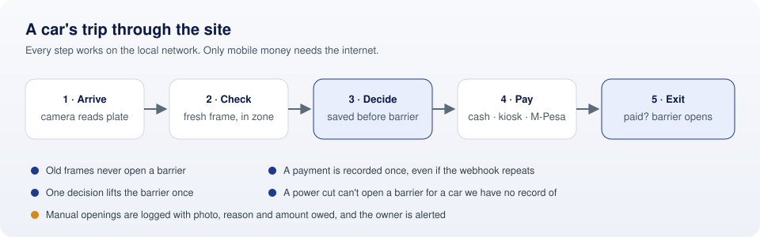
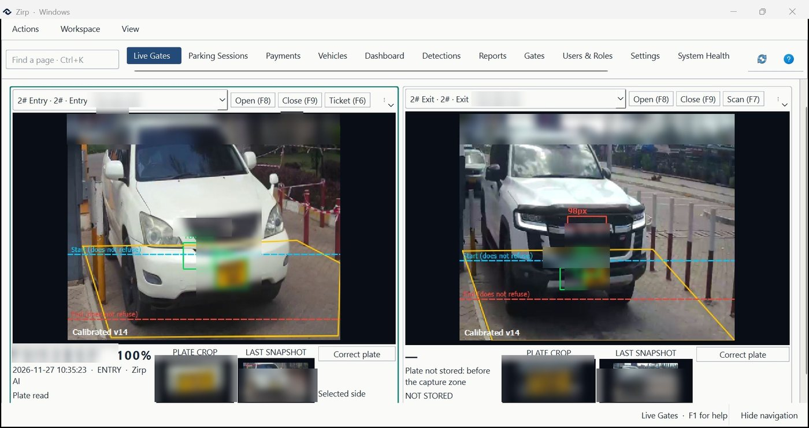
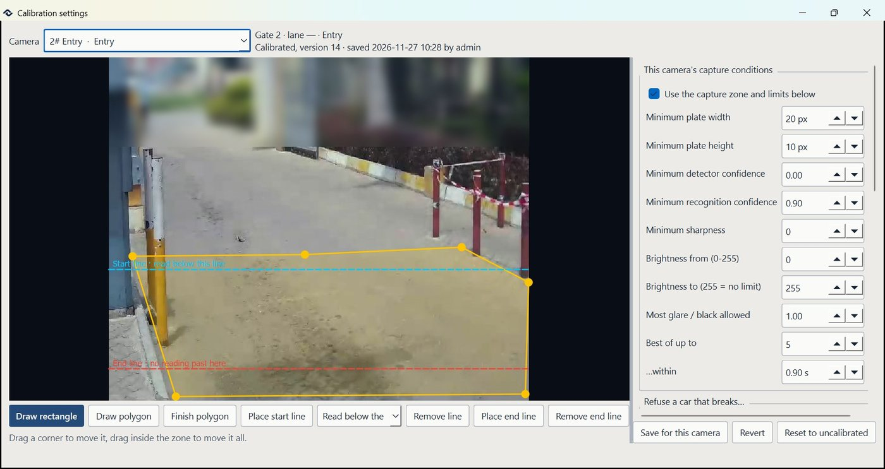
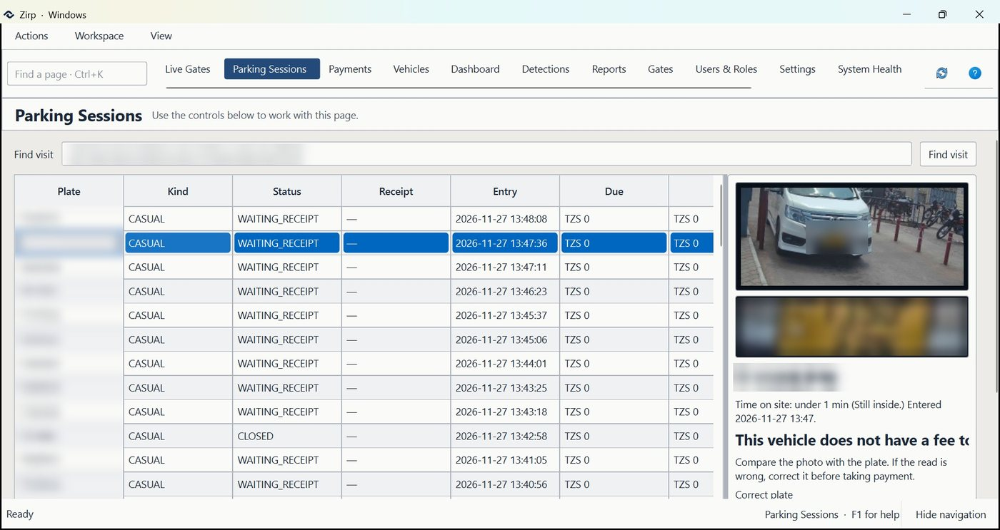
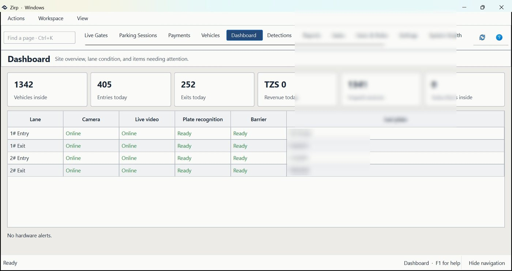
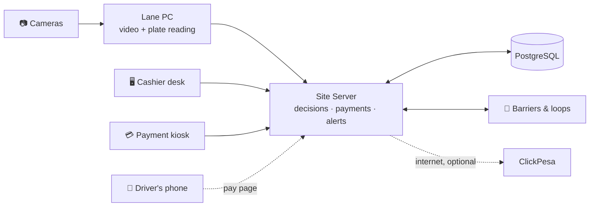

<p align="center">
  
</p>

<h1 align="center">Zirp</h1>

<p align="center">
  <b>Parking management for Tanzanian car parks that keeps working when the internet doesn't.</b><br>
  Number-plate cameras, barriers, cash and mobile-money payments, all on your own local network.
</p>

<p align="center">
  <a href="https://github.com/josiaO/ParkSystem/releases"></a>
  
  
  
</p>

---

A car drives up, the camera reads `T123ABC`, the barrier lifts and a receipt
prints. When it leaves, the driver pays at the kiosk, the cashier or on their
phone, and the exit barrier opens. Zirp handles all of that, and it runs
entirely on the site's LAN, so a dead internet line doesn't close the car
park.

<p align="center">
  
</p>

## See it at work

<p align="center">
  
</p>

**Live Gates.** The entry and exit cameras of one lane, side by side. The yellow
shape is where that camera reads plates, the blue and red lines where reading
starts and stops, and the green box the plate being read. Under each picture
are the plate it read, the plate crop and the last snapshot, and **Open** /
**Close** buttons that move that one barrier only.

<table>
  <tr>
    <td width="50%"></td>
    <td width="50%"></td>
  </tr>
  <tr>
    <td><b>Calibration settings</b>, opened from a camera's ⋮ menu. Draw where plates are read, set size and confidence limits, switch each rule on or off, and use test mode to try it without opening a barrier.</td>
    <td><b>Parking sessions.</b> Every visit beside the selected one's photo, plate crop and time on site, with plate corrections, payments and receipts in one place.</td>
  </tr>
</table>

<p align="center">
  
</p>

**Dashboard.** Today's figures at a glance, and every lane's camera, live
video, plate recognition and barrier in one table.

<sub>Screenshots from a live site. Plates, camera addresses and people are blurred.</sub>

## What you get

- **Plate recognition built for Tanzanian plates.** Works with the camera's
  own plate reader, Zirp's on-board model (FastALPR), or both. Fixes the
  usual `0/O`, `1/I`, `8/B` mix-ups on `T123ABC` plates, reads two-line
  plates, and reads a car at most twice, only inside the zone you draw for
  that camera.
- **Barriers that do the right thing.** A barrier lifts only after the decision
  is saved. A power cut can't open it for a car we have no record of, and one
  decision lifts it once.
- **Payments that add up.** Cash, payment kiosk, and M-Pesa, Mixx by Yas,
  Airtel Money and HaloPesa through ClickPesa. Each payment lands in the ledger exactly
  once, even when the provider sends the same webhook twice.
- **Owner alerts.** Every hand-opened barrier is logged with the plate, a
  photo, the reason and the amount owed, and sent to the owner by SMS, email or
  webhook.
- **Fleets and families.** Company fleets, private owners with several cars
  sharing one place, and visitor passes.
- **One installer.** Pick the computer's role (server, lane PC, cashier desk,
  kiosk) and it sets up everything: services, firewall, recovery. Updates back
  up the database first and roll back on their own if something's wrong.

## Download and install

1. Download **`Zirp-Setup-<version>.exe`** from the
   [latest release](https://github.com/josiaO/ParkSystem/releases).
2. Check the download against the `.sha256` file from the same release:
   ```powershell
   Get-FileHash .\Zirp-Setup-1.0.0-rc4.exe -Algorithm SHA256
   ```
3. Run it as administrator and pick the role of this computer.
4. Open **Zirp** from the Start menu. The setup wizard connects the database
   and creates the first admin account.

Already have Zirp? Run the new installer and choose **Update**. Your settings,
database and photos are kept. Full guide: **[docs/install.md](docs/install.md)**.

Other PCs on the site can download the installer straight from the server:
`http://<site-server>:8760/downloads/zirp-setup.exe`.

## How it fits together



On a small site, the lane PC and the Site Server are the same computer. The
detailed version is in [docs/architecture.md](docs/architecture.md).

## Find your way around the docs

| If you want to... | Go to |
|---|---|
| Install, update, roll back or uninstall | [Installing and updating](docs/install.md) |
| **Connect a camera**, fix a black picture, calibrate where cars are read | [Connecting cameras](docs/cameras.md) |
| See how a car goes from camera picture to plate read to barrier, and why | [Recognition decision flow](docs/recognition-decision-flow.md) |
| Wire barriers and ground loops, open a barrier by hand, set up owner alerts | [Barriers and loops](docs/gates-and-loops.md) · [loop board protocol](docs/loop-boards.md) |
| Take cash, kiosk or mobile-money payments | [Payments](docs/payments.md) |
| Manage company fleets, family cars and visitor passes | [Linked vehicles](docs/vehicle-groups.md) |
| Set up PostgreSQL, back up, restore | [Database](docs/database.md) |
| Check services, read logs, recover from failures | [Running a site](docs/operations.md) |
| Understand the design | [Architecture](docs/architecture.md) |
| Work on the code, run tests, build the installer | [Development](docs/development.md) |

There's also a browsable version of these guides in [`docs-site/`](docs-site/)
(open `index.html`).

## For developers

```bash
git clone https://github.com/josiaO/ParkSystem.git && cd ParkSystem
python -m venv .venv && source .venv/bin/activate   # Windows: .venv\Scripts\activate
pip install -r requirements-dev.txt
pytest -q
python -m app.site_service        # API on http://127.0.0.1:8760
```

The stack: Python (FastAPI, SQLAlchemy, Alembic) for the services, PySide6 for
the operator desktop, Next.js for the back office and pay page, ONNX Runtime
for plate recognition, MediaMTX and FFmpeg for video, Inno Setup for the
installer. More in [docs/development.md](docs/development.md).

```
app/            services, desktop app, domain rules, migrations
portal/         Next.js back office and driver pay page
tools/          camera lab, field tests, SDK host for QY/HVX cameras
packaging/      Windows installer and zirpctl
docs/           the guides linked above
tests/          ~1,400 tests
```

## Status

Zirp is running on a live site with four lane cameras. The current builds are
release candidates. Before calling it 1.0 we still want installs on clean
machines and a set of on-site hardware checks (camera cable pulls, barrier
relay failure, a real power cut). See the
[November 2026 audit](docs/audit-2026-11.md) for what's tested and what's
still open.
