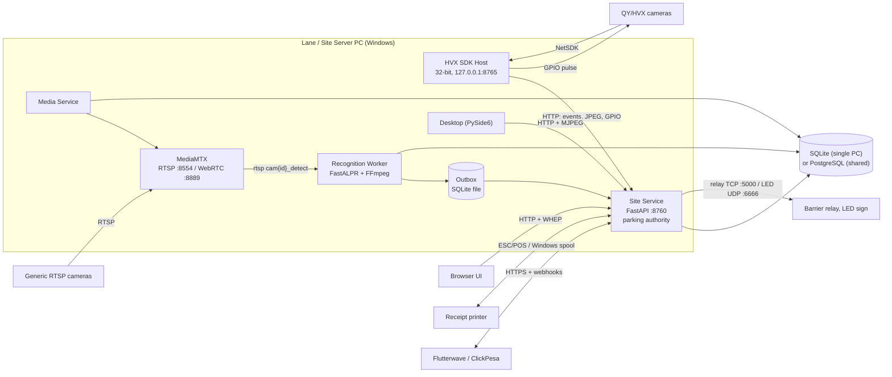
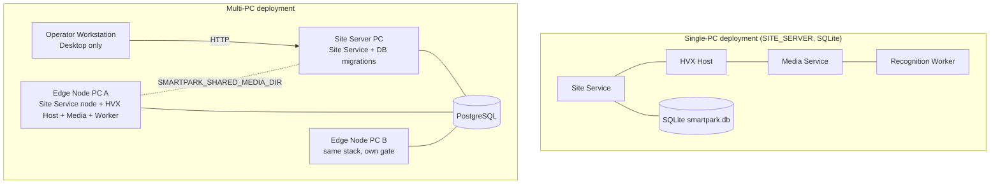
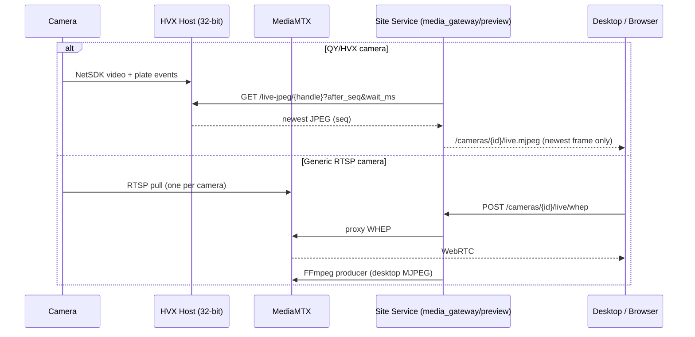
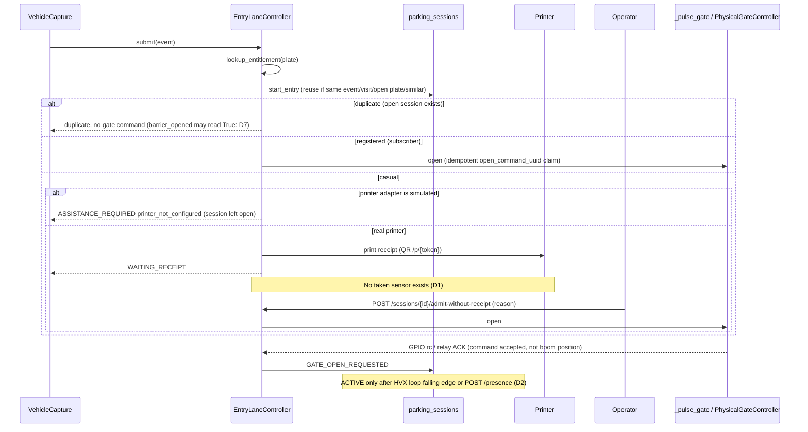
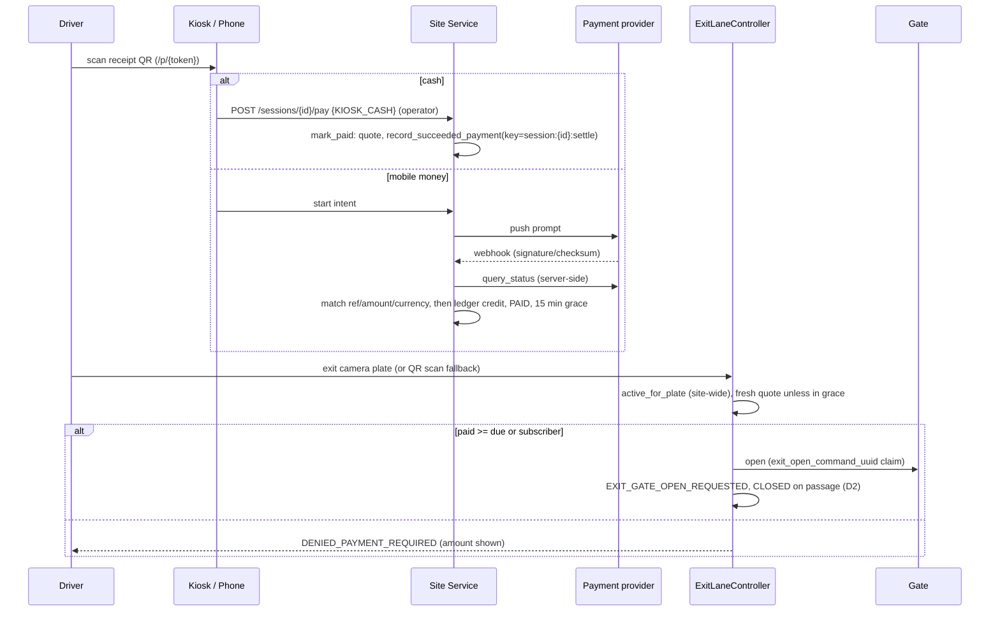
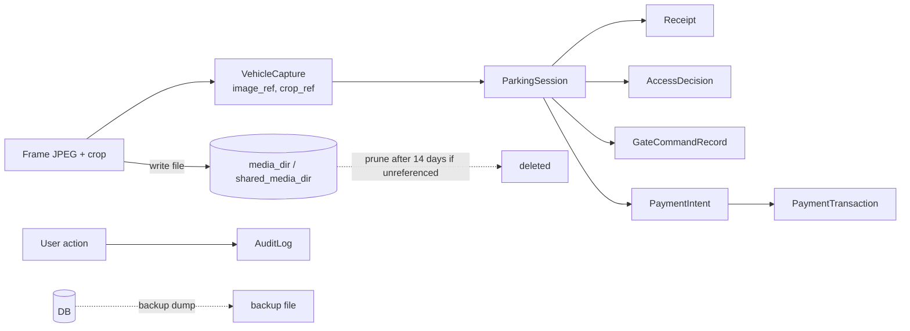
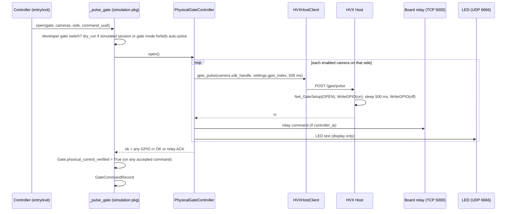

# Zirp: Engineering Handover

| | |
|---|---|
| Investigation date | 2026-11-16 |
| Checkout | `C:\SmartParkEdge` (Windows 11 Pro), remote `github.com/josiaO/ParkSystem` |
| Branch / HEAD | `main` @ `04105ff` ("fixed stale camera display, stale recognition, and slow boom opening") |
| Working tree | One uncommitted change: `docs/WINDOWS-TEST-PROTOCOL.md` deleted (not by this investigation). Ignored local material: `Current_ParkSystem_configs/` (previous ParkWatch install dump), `TestingData/`, `dist/` (built kit), `models/` (ONNX), `data/`, `logs/`, `.venv/` (a **Linux** venv, unusable on this PC). |
| Environment | Windows 11 PC `SERVER01` (192.168.1.240) running the installed kit (built from `f76a575`; code identical to HEAD apart from line endings) as **SITE_SERVER** on local PostgreSQL 18 `smartpark`, with live QY cameras of lane **2#** (192.168.1.49 entry, .50 exit) on the LAN. Lane **1#** cameras (.144/.145) answer on the network but are outside this server's node scope. No receipt printer or payment provider was exercised. **The boom was not pulsed** (needs an operator sign-in; see section 16). |

**Evidence labels**

| Label | Meaning |
|---|---|
| **[SRC]** | Confirmed by reading source code |
| **[TEST]** | Confirmed by an automated test run in this investigation (see section 9) |
| **[RUN]** | Confirmed by local runtime execution in this investigation |
| **[HW]** | Confirmed against real hardware. **Nothing in this report carries this label.** |
| **[UNVERIFIED]** | Not verified |

No application source, configuration, dependency, schema, migration, or existing document was changed. This file and `ZIRP_DOCUMENTATION_CLEANUP.md` were written to the repository root so that the earlier handover in `docs/` (dated 2026-11-14, HEAD `8a29f85`) stays intact as historical evidence.

> **Note on HEAD.** The HEAD commit message claims fixes for stale display, stale recognition and slow boom opening, but the commit changes **only documentation**: it deletes README.md, `SMARTPARK-ARCHITECTURE-AND-AUDITS.html` and nine `docs/*.md` runbooks, and it adds the previous handover plus two AI task briefs (`CLAUDE_CODE_TASK.md`, `CLAUDE_CODE_STALE_AND_BOOM.md`). No source file changed in that commit. Whatever latency or staleness work exists is in earlier commits (`5938c53`, `c03f84f`, `c21e9e4`, `3b918af`). Nothing in the repository proves that the three field symptoms are fixed.

---

## 1. Executive summary

Zirp (package `smartpark-edge`; `app/config.py` `app_version = "0.3.0"`, `pyproject.toml` `version = "0.1.0"`) is a **Windows-first Python parking and lane-control system** for one site with several lanes. About 51k lines of application Python and about 12k lines of desktop/web UI code, with 1,083 test functions in 123 files.

At runtime it is **five cooperating processes**:

1. **Site Service** (FastAPI/uvicorn, 64-bit). The single parking authority.
2. **HVX SDK Host** (32-bit Python + `ctypes`). Wraps the vendor `NetSDK.dll`.
3. **Media Service**. Owns a MediaMTX sidecar for generic RTSP cameras.
4. **Recognition Worker**. FastALPR on frames pulled from MediaMTX.
5. **Desktop app** (PySide6). Plus a vanilla-JS browser UI served by the Site Service.

Data lives in SQLite for a single PC, or a shared PostgreSQL database for multi-PC sites.

**What is genuinely solid [SRC]:**
- **Plate-first model.** `ParkingSession` is keyed by site and normalized plate. A partial unique index allows only one open session per plate per site (`app/models/parking.py`). Exits look up the session site-wide, so cross-gate exit works by design.
- **Session lifecycle.** An explicit state machine in `app/domain/parking_engine.py` is driven only by `app/application/entry_lane.py::EntryLaneController` and `app/application/exit_lane.py::ExitLaneController`.
- **Gate idempotency.** Gate commands use a conditional UPDATE on `open_command_uuid` / `exit_open_command_uuid` plus a unique `GateCommandRecord.command_uuid`.
- **Tariffs.** Tariff rules are frozen on the session at entry.
- **Payments.** Mobile money is credited only after a server-side status query that checks reference, amount and currency (`app/services/mobile_payments.py::settle_intent`). Webhooks are authenticated, and the ledger has unique idempotency and provider-transaction keys.
- **Recognition is not barrier authority.** It produces a `VehicleCapture`, and stale queued events (over 20 s) are diverted to review.

**What blocks an automatic production lane today [SRC]:**
- **No receipt-taken sensor driver exists.** The production profile forces "receipt must be taken before opening". The only real-printer adapter declares no taken sensor, so every casual entry stops at WAITING_RECEIPT. An operator must press **Admit without receipt** (audited override) for each car (Defect **D1**).
- **Passage is sensed only through HVX camera GPIO loop inputs.** The production profile forces WAIT_FOR_PASSAGE. On a lane without an HVX loop input, sessions never leave GATE_OPEN_REQUESTED or EXIT_GATE_OPEN_REQUESTED. That breaks exit for that car and blocks its next entry (Defect **D2**).
- **Cash top-ups are impossible after the payment grace period** because the cash idempotency key is fixed per session (Defect **D3**).
- **Barrier "success" means the camera SDK or relay accepted a command.** There is no boom-position feedback anywhere.

**Hardware status (section 16):**
- **[HW] confirmed on lane 2#:** HVX SDK login, live decoded video (about 10 fps, 704×576, frame age 30–110 ms), and FastALPR plate reads of passing cars (confidence 0.96–1.0).
- **Not confirmed:** barrier actuation, printers, receipt sensor, passage loop, payment providers.
- **Context (owner, 2026-11-16):** SERVER01 is a **test bench**. The lanes are operated by the incumbent **ParkWatch** system, which shares the same QY cameras and booms. Zirp observes in parallel, with its booms deliberately locked (Developer gate switches off). The bench data shows what the defects *would* do if Zirp were in control:
  - 1,763 sessions older than a day remain open, because Zirp never controls the exit.
  - 1,595 entries stopped at "printer is simulated".
  - 2,188 exit reads found no session.
  - One exit read would have been billed 614,000 TZS against a session opened on 29 Oct.

The core business engine is reasonably sound. The weight of the codebase is in the camera, media and recognition plumbing: many acquisition paths, ownership flags, and `exec()`-composed modules. Most operational risk sits in the physical-lane gaps listed above, not in the parking domain logic.

---

## 2. Product requirements vs. implementation

| Requirement | Status | Evidence |
|---|---|---|
| Plate is the primary visit identity | Implemented | `ParkingSession.plate`, unique open-plate index `app/models/parking.py:26-33` [SRC] |
| Registered vehicles (VIP/staff/season) by plate, not card | Implemented | `RegisteredVehicle` (unique site+plate), `AccessPlan`, `app/services/access.py::lookup_entitlement` [SRC] |
| Casual receipt with unique identity and QR | Implemented | `parking_sessions._allocate_identity` (public token + human reference, both uniquely indexed); `app/services/receipts.py::build_document` [SRC] |
| Barrier opens only after a **physical** receipt-taken confirmation | Gate correctly fails closed; **sensor not implemented** | `receipt_jobs.mark_receipt_taken` refuses without `CAP_TAKEN_SENSOR`; `HardwareReceiptPrinter.capabilities = {CAP_CUTTER}` [SRC]. See D1. |
| Entry event and evidence preserved | Implemented | `VehicleCapture` with image/crop refs, `AccessDecision`, `GateCommandRecord`, `AuditLog` [SRC] |
| Exit finds the session site-wide (cross-gate) | Implemented | `parking_sessions.active_for_plate` filters by site and plate only [SRC] |
| Fee calculated/verified at exit | Implemented | `ExitLaneController._fresh_financial_state` → `tariff_engine.quote_stay` → `fee_engine.calculate_car1_fee` [SRC] |
| QR fallback at exit | Implemented | `POST /exit/qr-scan` → `ExitLaneController.submit_qr`; a disagreeing camera plate is flagged, never auto-denied [SRC] |
| Session closed only by a confirmed exit | Engine yes; **legacy bypass route exists** | `complete_authorized_exit` / `mark_vehicle_passed(side="EXIT")`; but `POST /sessions/{id}/exit` closes any session with `fees.view` (D4) [SRC] |
| Cash by authorized operators | Implemented, with top-up defect | `POST /sessions/{id}/pay` restricted to KIOSK_CASH (`_operator_payment_method`); D3 [SRC] |
| Mobile money, server-side verification, reconciliation, duplicate protection | Implemented (Flutterwave, ClickPesa) | `mobile_payments.py`, `_payments_reconcile_loop`, unique ledger keys [SRC]; providers [UNVERIFIED] |
| Browser success never establishes payment | Implemented | Public simulated payments disabled by default (`allow_public_simulated_payments=False`) [SRC] |
| Software authorization distinct from physical operation | Partly | Result carries `barrier_command_accepted` vs `barrier_opened`, `passage_required`; but `Gate.physical_control_verified` is set on any accepted command, and duplicate-entry responses report `barrier_opened=True` without sending a command (D7) [SRC] |

---

## 3. Repository map

| Path | Purpose | Entry points |
|---|---|---|
| `app/site_service.py` | Site Service process: deployment check, DB preflight, uvicorn | `python -m app.site_service` |
| `app/api_main.py` → `app/api/runtime.py` | ASGI app. `runtime.py` **`exec()`s** the 14 files in `app/api/runtime_parts/` (7.3k lines) into one namespace; `api_main` aliases that module | `app.api_main:app` |
| `app/api/runtime_parts/01_bootstrap.py` | `lifespan` (schema, bootstrap, background tasks), auth, nodes, modules | |
| `…/02_camera_*.py` | Camera CRUD, SDK connect/disconnect, discovery, ONVIF | |
| `…/04_media.py` | Snapshots, MJPEG, WHEP proxy, presence, `/media/*` | |
| `…/05_background_tasks.py`, `05_recognition_ingest.py`, `05_scope.py` | Outbox consumer, HVX event drain, coil polling, capture persistence, node scope | |
| `…/06_parking.py`, `07_payments.py`, `08_admin.py` | Lanes, gates, sessions, receipts, pay, exit QR, reports, backup, users | |
| `app/api/payments.py`, `registry.py`, `module_routes.py`, `recognition.py` | Routers mounted onto `app` | |
| `app/application/` | `entry_lane.py`, `exit_lane.py`, `live_parking.py` (capture → controller) | |
| `app/domain/` | Pure rules: `parking_engine.py` (lifecycle), `tariff_engine.py`, `receipt_engine.py`, `gates.py`, `recognition.py` | |
| `app/services/` | ~110 modules: sessions, payments, receipts, gates, HVX client, media gateway, MediaMTX, ALPR, node scope, health. Packages `alpr/`, `captures/`, `media_gateway/`, `simulation/` are `exec()`-composed | |
| `app/infrastructure/` | Adapters: cameras (`hvx`, `qy`, `rtsp`, `onvif`, `simulated`), gates, printers, payments, recognition engine, secrets, AI (Gemini) | |
| `app/models/` | SQLAlchemy models (normal modules since `8814b6b`) | |
| `app/migrations/` | Alembic `0001`–`0016`, runner, frozen legacy fixups | `db.ensure_schema()` |
| `app/recognition_worker/` | Worker process (exec-composed) | `python -m app.recognition_worker` |
| `app/media_service.py` | MediaMTX owner process | `python -m app.media_service` |
| `app/desktop/` | PySide6 operator/admin app (`main/` and `setup_parts/` exec-composed) and launcher | `app/desktop/launch.py` |
| `app/web/` | Browser UI (`index.html`, `assets/*.js`), served by the Site Service at `/` | |
| `tools/hvx_sdk_host/` | 32-bit host: `hvx_host.py` (HTTP on 127.0.0.1:8765), `hvx_sdk_parts/` (ctypes bindings, video, GPIO) | `run_hvx_host.bat` |
| `tools/*.py` | Field tools: camera lab, ALPR evaluation, field acceptance, latency capture/report, soak monitor, startup check | |
| `packaging/` | Windows USB kit builder (`make_windows_kit.sh`), installers (`windows/*.ps1`), licences | |
| `scripts/` | Dev launchers (Windows/Linux), MediaMTX install | |
| `tests/` | pytest suite, fake HVX SDK (`tests/fakes/fake_hvx_sdk.py`), fixtures | |
| `research/` | Ghidra/reverse-engineering evidence of the previous ParkWatch install and the OcxConfig SDK | |
| `docs/`, `docs-site/` | Remaining docs (see `ZIRP_DOCUMENTATION_CLEANUP.md`) | |

---

## 4. Technology inventory

| Area | Technology (version pinned in `requirements.txt`) |
|---|---|
| Language | Python ≥3.11 (`pyproject.toml`); CI uses 3.12. HVX host needs **32-bit** Python (kit ships `python32\`) |
| Web/API | FastAPI 0.141.1, Starlette 1.6.0, uvicorn 0.52.4, pydantic 2.13 / pydantic-settings 2.15 |
| Database | SQLAlchemy 2.0.52, Alembic 1.20, SQLite (WAL, `NullPool`), PostgreSQL via psycopg 3.3.6 (`QueuePool`, statement/idle timeouts, keepalives) |
| Auth | argon2-cffi (passwords), SHA-256 hashed opaque session tokens, HMAC media tokens |
| Recognition | fast-alpr 0.4.0, fast-plate-ocr 1.1.0, open-image-models 0.6.0, onnxruntime 1.29, OpenCV headless 4.14, numpy 2.5 |
| Video | FFmpeg (bundled in kit, GPL; invoked by `frame_grab.py`, `hw_decode.py`, `recognition_decoder.py`, `media_gateway/30_producers`, `rtsp_probe.py`), MediaMTX (RTSP → WebRTC/WHEP), vendor NetSDK (`NetSDK.dll`, `PlaySdk.dll`, `DecodeSdk.dll`, `RtspRecvSdk.dll`) |
| Desktop | PySide6 6.11 |
| Browser UI | Vanilla JS, WebRTC WHEP player (`app/web/mediamtx-reader.js`, `assets/live.js`) |
| Receipts | `qrcode`, Pillow; ESC/POS over TCP 9100, Windows RAW spool (`_windows_raw_print`), CUPS |
| Hardware I/O | HVX GPIO via SDK (`Net_WriteGPIOState`, `Net_GateSetup`), "Board" TCP relay (`board_tcp.py`, port 5000), LED UDP (`led_udp.py`, port 6666, display only), pyserial (QR scanner) |
| Payments | Flutterwave, ClickPesa (httpx), simulated provider |
| Optional AI | Gemini second opinion (`app/infrastructure/ai/gemini.py`), off by default (`ai_enabled=False`) |
| Windows services | NSSM (`vendor\nssm\nssm.exe`) or Task Scheduler |

---

## 5. Runtime architecture

### 5.1 Processes

| Process | Command | Owns | Talks to |
|---|---|---|---|
| **Site Service** | `python -m app.site_service` (64-bit) | Parking decisions, DB schema/migrations (Site Server only), HTTP API on `server_bind_host:8760` (default `127.0.0.1`), background loops, gate commands, desktop MJPEG producers | DB, HVX host (HTTP), MediaMTX (RTSP/WHEP/control API), outbox SQLite file |
| **HVX SDK Host** | `python32\python.exe tools\hvx_sdk_host\hvx_host.py` | **All QY/HVX camera SDK sessions**: login, video decode, plate events, event JPEGs, GPIO in/out | Bound `127.0.0.1:8765`, **no authentication** |
| **Media Service** | `python -m app.media_service` | The **MediaMTX** process and its camera path config | DB (camera list + flags), writes `media-service.json` status |
| **Recognition Worker** | `python -m app.recognition_worker` | FastALPR for **generic (non-native)** cameras; one FFmpeg decoder per camera on `rtsp://127.0.0.1:8554/cam{id}_detect` | DB, MediaMTX, writes outbox + health file |
| **Desktop** | `app/desktop/launch.py` (PySide6) | Operator UI. Can start the Site Service and pipeline services if they are not running (instance locks reject duplicates) | Site Service HTTP |
| **Browser UI** | served at `/` | Admin/operator/kiosk UI | Site Service HTTP, MediaMTX WHEP via `/cameras/{id}/live/whep` |

Each service takes an instance lock (`app/services/runtime.py::acquire_instance_lock`). Deployment roles (`app/deployment.py`) are `SITE_SERVER`, `EDGE_NODE` and `OPERATOR_CLIENT`. Operator workstations do not start the Site Service (`site_service.main` returns 2).

### 5.2 Site Service startup (`01_bootstrap.py::lifespan`)

1. On a **Site Server**, `ensure_schema()` runs Alembic upgrade-to-head. On a **Processing/Edge Node**, it refuses to start unless the shared schema is already current.
2. On a Site Server: `ensure_default_site`, `ensure_roles`, `ensure_bootstrap_admin`, `ensure_car1_tariff`, `ensure_access_plans`, `ensure_modules_initialized`, `sync_gate_lanes_from_cameras`, `migrate_plaintext_secrets`. A node only registers itself.
3. FastALPR warm-up runs in a background thread.
4. Background tasks start: `camera-events` (HVX event drain + coil polling), `parking-outbox` (worker events → business), `hvx-watch` (restore/disconnect SDK sessions every 5 s), `hybrid-fusion-flush`, `payments-reconcile`, `onvif-events`. The `diagnostic-heartbeat`, `db-link-probe` and `pipeline-watchdog` loops are wrapped in `_supervise_background_loop`. The others rely on their own internal `try/except` inside `while True`.
5. On shutdown it cancels tasks, stops MediaMTX detect consumers and live pumps, and closes HVX clients. It does **not** stop MediaMTX, which the Media Service owns.





---

## 6. Subsystem architecture

### 6.1 Cameras and hardware ownership

- **QY/HVX cameras.** Owned exclusively by the 32-bit HVX host (`tools/hvx_sdk_host/hvx_sdk_parts/20_connection.py`, `40_video.py` 1.4k lines, `30_captures.py`, `50_gpio.py`). The Site Service connects through `app/services/hvx_client.py::HVXHostClient`. `preview.resolve_playable` refuses any HTTP/RTSP fallback for a camera with an SDK handle ("QY/NetSDK owns this camera stream") [SRC].
- **SDK handles** are stored in the shared `Camera.sdk_handle` column. `_hvx_watch_loop` restores or disconnects sessions per node scope every 5 s (`05_background_tasks.py::_restore_hvx_sessions`, `_disconnect_out_of_scope_hvx_sessions`) [SRC]. See D6 for the risk this creates for GPIO.
- **Generic RTSP cameras.** MediaMTX is the single upstream puller when `media_gateway_enabled` (default True). Consumers are browser WHEP, the Recognition Worker's FFmpeg on `cam{id}_detect`, the Site Service's `mediamtx_detect` consumer (in-process fallback recognition), and the desktop MJPEG producer. In production, `preview.resolve_playable` refuses direct camera pulls unless `direct_generic_media_allowed()` [SRC].
- **ONVIF.** Discovery (`onvif_discover.py`), profile (`onvif_profile.py`), PullPoint events (`onvif_runtime.py`, `_onvif_events_loop`) [SRC; UNVERIFIED on hardware].
- **Gates.** `app/services/gates.py::PhysicalGateController.open` runs, per camera on that side and in sequence: HVX GPIO pulse (`/gpio/pulse` → `Net_GateSetup` + `Net_WriteGPIOState` on, hold `gpio_pulse_ms`=500, off), then the Board TCP relay (if `camera.controller_ip`), then LED UDP text. Success means **GPIO rc OK or relay ACK**. LED never counts [SRC]. The GPIO index and pulse length are **global settings**, not per lane.
- **Printers.** `app/infrastructure/hardware/printers.py`: simulated, `escpos` (TCP), `system` (Windows RAW spool / CUPS). `receipt_printers.py::receipt_printer_for` maps everything non-simulated to `HardwareReceiptPrinter` (capabilities `{CAP_CUTTER}` only) [SRC].
- **QR scanners.** `app/infrastructure/hardware/qr_scanners.py`. Exit QR enters via `POST /exit/qr-scan`, from desktop or kiosk keyboard-wedge input [SRC].
- **Presence/passage.** `app/services/presence.py::coil_watch` is fed by HVX GPIO input scans (`_poll_coil_and_read`) or `POST /cameras/{id}/presence`. A falling edge calls `_complete_passage_from_sensor` [SRC].

### 6.2 Streaming and frame lifecycle

| Stage | Implementation |
|---|---|
| HVX acquisition | SDK video callback in the host, then decode to JPEG, then `/live-jpeg/<handle>` long-poll (`wait_ms`, `after_seq`) |
| Generic acquisition | MediaMTX pulls RTSP once per camera (`mediamtx_sources.sync_camera`) |
| Site Service frame state | `media_gateway` (one producer per camera: HVX `live_jpeg` poll or FFmpeg subprocess), `preview.PreviewState` per camera with generation counters, `live_is_current`, `fresh_*` age checks |
| Desktop display | `GET /cameras/{id}/live.mjpeg` → `app/desktop/streams.py` keeps only the newest JPEG |
| Browser display | WHEP proxied to MediaMTX (`04_media.py`), MJPEG fallback |
| Recognition input | Worker: `recognition_decoder.py` FFmpeg on the MediaMTX detect path, newest-frame mailbox, frames older than `recognition_stale_frame_ms` (2000 ms) dropped (`30_camera_worker.py:155,313`), alarm at 300 ms frame age. HVX native: plate events drained from the host with capture tokens |
| Evidence | JPEG and crop stored under `settings.media_dir` (`SMARTPARK_SHARED_MEDIA_DIR` on clients), referenced as `/media/<kind>/<name>`, pruned after `media_retention_days`=14 |

There are **at least five places that decode or move frames**: HVX host decode, MediaMTX, the gateway FFmpeg producer, worker FFmpeg, and the Site Service detect consumer. One-shot FFmpeg grabs in `frame_grab.py` / `hw_decode.py` add more. Ownership between the worker and the in-process fallback is decided at runtime by `worker_owns_software_reads` (cached for 1 s, based on the worker's health file). This is a plausible source of the staleness and handoff symptoms reported from the field [SRC; behaviour UNVERIFIED].

### 6.3 Recognition

- **Engines.** Exactly **one** software engine is registered: `fastalpr` (`app/infrastructure/recognition/engines/registry.py`). `SMARTPARK_ALPR_ENGINE` can only select it. Modes `LOCAL`, `FASTALPR`, `LOCAL_ONLY` and `FASTALPR_ONLY` are **aliases** (`ocr_policy._canonical_mode`). The second "engine" is the camera's **native** plate recognition (HVX events). `HYBRID` and `NATIVE_WITH_LOCAL_VERIFY` fuse the two in `app/services/hybrid_fusion.py` / `app/core/fusion.py`. Gemini is an optional reviewer, not a reader [SRC].
- **Software pipeline** (`app/services/alpr/`): ROI crop (`alpr_detect_roi` default `0.06,0.18,0.94,0.92`), detector (`alpr_detector_confidence` 0.26), arrival framing (`camera_framing.py`: read only when the plate box is still), crop padding, OCR at 320 px, confidence floors (0.40 / 0.28 for shaped plates), per-camera temporal consensus (`app/core/consensus.py::ConsensusTrack`), visit IDs, and absence reset (`recognition_absence_reset_seconds` 0.6) [SRC].
- **Scheduling.** `app/services/recognition_runtime.py` runs a fair per-camera scheduler, at most one inference per camera, with a stall watchdog (`recognition_worker_stall_seconds` 5) [SRC].
- **Delivery.** The worker publishes to the durable outbox (`app/services/queues.py::SQLiteOutbox`, attempt counting, dead letter after 5 attempts). `_outbox_loop` checks `processed` keys and `VehicleCapture.event_id`, diverts events older than `outbox_max_action_age_seconds` (20 s) to review, then `_persist_capture_event` → `handle_live_entry`/`handle_live_exit` [SRC].
- **Duplicate suppression.** Unique `(camera_id, event_id)`, `(camera_id, visit_id)` and `(camera_id, image_id)` on captures; `ParkingEntryClaim` unique per camera+visit; open-plate unique index; `recent_similar_entry` (similarity ≥0.85 within 2 s on the same camera/lane) [SRC].

### 6.4 Parking business engine

The authoritative modules are `app/application/entry_lane.py`, `app/application/exit_lane.py`, `app/services/parking_sessions.py` and `app/domain/parking_engine.py`. Recognition never calls the gate controller directly. It produces a capture, and the controllers decide.

| Decision | Owner |
|---|---|
| Create session | `parking_sessions.start_entry` (only from `start_entry_from_recognition` in the live path) |
| Registered vs casual | `access.lookup_entitlement(strict=True)` |
| Print / wait for receipt | `EntryLaneController.submit` + `receipt_jobs` |
| Open entry barrier | `EntryLaneController._authorize_and_open` (developer switches, idempotent claim, `_pulse_gate`) |
| Exit fee and allow/deny | `ExitLaneController._fresh_financial_state` + `parking_sessions.start_exit` (row lock on PostgreSQL) |
| Open exit barrier | `ExitLaneController._open_authorized` |
| Close session | `mark_vehicle_passed(side="EXIT")` or the `OPEN_COMMAND_COUNTS_AS_PASSED` fallback (development only) |

**Policies.** `simulation/10_settings.py::parking_settings`. In `DEVELOPMENT` the default is `PRINT_AND_OPEN` with `OPEN_COMMAND_COUNTS_AS_PASSED`. In `PRODUCTION`, `REQUIRE_TAKEN_BEFORE_OPEN` and `WAIT_FOR_PASSAGE` are **forced** regardless of saved settings.

Production gate code (`_pulse_gate`, `handle_plate_event`) lives in the package named `app/services/simulation/`. That naming is misleading [SRC].

### 6.5 Payments

The ledger is `app/infrastructure/payments/ledger.py`:
- `PaymentTransaction` rows are immutable SUCCEEDED records with unique `idempotency_key` and `provider_transaction_id`.
- `paid_total` sums them.
- `apply_session_payment_state` sets PAID and a 15-minute exit grace.

Mobile payment flow:
1. `start_mobile_payment` creates a PENDING `PaymentIntent`.
2. The provider push prompt goes out (`payment_prompt_guard.py` limits repeats).
3. Settlement happens via webhook (signature/checksum required, `handle_webhook`) **or** reconciliation (`_payments_reconcile_loop`, every 60 s).
4. `settle_intent` queries the provider and checks reference, currency and amount before crediting.

Live keys require explicit opt-in (`flutterwave_allow_live_keys`, `clickpesa_live_enabled`, `payments_live_provider_confirmed`) [SRC; providers UNVERIFIED].

### 6.6 Database

- `app/db.py`. SQLite uses WAL, `busy_timeout` 5000 and `NullPool`. **`PRAGMA foreign_keys` is never enabled**, so FK constraints are not enforced on SQLite, as the comment in `lifespan` admits. PostgreSQL uses `QueuePool(10+20)`, `statement_timeout` 15 s, `idle_in_transaction` 60 s, TCP keepalives, and optional `sslmode` [SRC].
- **Migrations.** Alembic `0001`–`0016`; `migrations/runner.upgrade_to_head` handles fresh DBs (`create_all` + stamp) and legacy fixups. Only the Site Server migrates [SRC].
- **Concurrency.** Exit uses `SELECT … FOR UPDATE` (PostgreSQL only); entry relies on unique indexes and claims. The SQLite path is explicitly described as "not multi-lane production authority" (`parking_sessions.active_for_plate`). Multi-PC requires PostgreSQL: `Settings.validate_node_topology` rejects a CLIENT without a PostgreSQL URL [SRC].
- **Backup.** `app/services/backup.py`: dump, offline, download, and cloud copy. **There is no restore function** [SRC].

### 6.7 Security

- argon2 password hashes. Opaque 48-byte session tokens stored as SHA-256 with 12 h expiry. Header-only bearer auth except media routes, which use 10-minute HMAC media tokens [SRC].
- Login throttling (`login_throttle.py`). Roles: Admin (`*`), Operator, Developer, Kiosk Operator, Processing Node (`DEFAULT_ROLES`) [SRC].
- `/auth/setup` reveals the bootstrap password only to direct loopback requests (`_is_loopback_request`) [SRC].
- The public ingress middleware limits tunnelled hostnames to `/health`, `/p/...` and provider webhooks [SRC].
- Secrets: DPAPI on Windows, with a migration of plaintext camera passwords [SRC].
- Weaknesses (D9):
  - The HVX host is unauthenticated on loopback.
  - `default_camera_password="admin"` is applied when a camera is created without a password.
  - The Site Service API is plain HTTP on the LAN when bound to a non-loopback address for multi-PC.
  - Operator role holds `gates.open`, which `admit-without-receipt` uses.

### 6.8 User interfaces

| UI | Role | Transport |
|---|---|---|
| Desktop (`app/desktop/main/*`, PySide6) | Primary **operator** console: dashboard, lanes, live cameras (MJPEG), sessions, cash pay, exit QR, admit-without-receipt, kiosk mode, system health, setup wizard | HTTP to Site Service |
| Browser (`app/web/`) | **Admin** and secondary operator: dashboard, sessions/cameras, kiosk, admin, fees/reports, hardware lab; WHEP live video | HTTP + WHEP |
| Public page `/p/{token}` | Driver receipt and payment page | HTTP via public ingress |

Both UIs call the same API, and neither creates sessions directly in the live path. Both expose simulation calls (`/sim/*`), which the API refuses outside development via `_require_development_simulation` [SRC]. The legacy `POST /sessions` and `POST /sessions/{id}/exit` are **not called by either UI** but remain exposed (D4).

### 6.9 Deployment

- **Windows kit.** `packaging/make_windows_kit.sh` builds the USB kit with embedded python64 and python32, FFmpeg, MediaMTX, NSSM, models and the vendor SDK. `packaging/windows/Install-SmartPark.ps1` handles role selection. `Install-SmartParkServices.ps1` installs **NSSM services** for the Site Service, Recognition Worker and Media Service when NSSM is present and the script runs elevated. **The HVX host remains an AtLogOn scheduled task** because the vendor SDK has not been validated in Session 0 (`Install-SmartParkWinService.ps1:205-212`) [SRC].
- **Linux.** `scripts/run_dev_linux.sh` starts a dev stack. The HVX host is Windows-only (`platform_snapshot()["hvx_host_supported"]`). Generic RTSP cameras, MediaMTX and the worker are portable [SRC].

---

## 7. Critical execution flows

### 7.1 Camera acquisition and streaming



### 7.2 Recognition

```mermaid
sequenceDiagram
  participant MTX as MediaMTX cam{id}_detect
  participant W as Recognition Worker
  participant Q as Outbox (SQLite file)
  participant SS as Site Service _outbox_loop
  participant DB as Database
  W->>MTX: FFmpeg decode (newest-frame mailbox)
  loop sample at recognition_sample_fps
    W->>W: drop frame if age > 2000 ms
    W->>W: detector in ROI, then still-plate gate, then crop + OCR
    W->>W: ConsensusTrack (visit_id, similarity, confidence)
  end
  W->>Q: PlateRecognized {event_id, visit_id, image_ref, crop_ref}
  SS->>Q: pending(20)
  SS->>SS: skip if processed / capture exists; age > 20 s means needs_review
  SS->>DB: VehicleCapture (unique camera+event / visit)
  SS->>SS: handle_live_entry / handle_live_exit
  Note over SS: HVX native events take a parallel path:<br/>_camera_event_loop drains the host, then hybrid_fusion, then _persist_capture_event
```

### 7.3 Vehicle entry (production profile)



### 7.4 Exit and payment



### 7.5 Database and evidence



### 7.6 Hardware control



---

## 8. Configuration and feature flags

**Precedence** (`app/config.py`): process environment `SMARTPARK_*` → `<install>/.env` → class defaults. On top of that:
1. **Deployment config** (`app/deployment.py`, JSON in the data dir) supplies role, bind host/port and database. `apply_runtime_database_config` overrides `database_url`.
2. **DB-stored settings** (`SiteSetting` rows) supply parking policy (`parking`), site policy, migration flags (`services/flags.py`), developer switches (`services/developer.py`) and module enablement (`services/modules.py`).
3. **`deployment_profile=PRODUCTION`** overrides saved receipt and passage settings in `parking_settings`.

Data dir: `%PROGRAMDATA%\SmartParkEdge` on Windows, `$XDG_DATA_HOME/smartpark-edge` elsewhere.

| Setting | Default | Notes / conflicts |
|---|---|---|
| `deployment_profile` | `DEVELOPMENT` | Production behaviour (forced receipt + passage, simulated-printer refusal, no `/sim/*`) is **opt-in**. A forgotten env var leaves a site in development semantics: `PRINT_AND_OPEN`, open-command-counts-as-passed |
| `alpr_mode` | `HYBRID` | Validator fallback is `FASTALPR_ONLY`; `ocr_policy._canonical_mode` fallback is `NATIVE_ONLY`. **Three different defaults** for the same concept; per-camera `recognition_mode` overrides |
| `alpr_engine` | `fastalpr` | Only engine registered |
| `recognition_pipeline` / `fastalpr_new_pipeline_enabled` | `FASTALPR_NEW` / `True` | |
| `media_gateway_enabled`, `live_view_provider` | `True`, `MEDIAMTX` | Also overridable per DB flag; Media Service reads DB flags (`_effective_flags`) |
| `printer_adapter` | `simulated` | Production refuses a simulated printer for receipt-required lanes, but the session is still created first (D8) |
| `gate_physical_control_enabled` | `True` | False swaps in `SimulatedGateController` |
| `gpio_index` / `gpio_pulse_ms` | `0` / `500` | Global, not per lane |
| `coil_gpio_index` / `coil_poll_indexes` | `1` / `1..7` | Learned per camera at runtime |
| `outbox_max_action_age_seconds` | `20` | |
| `recognition_stale_frame_ms` | `2000` | Alarm at `recognition_frame_age_alarm_ms` 300 |
| `entry_dedupe_seconds` / `_similarity` | `2.0` / `0.85` | Code fallback inside `recent_similar_entry` uses 3.0 if unset |
| `payments_mobile_provider` | `simulated` | `allow_public_simulated_payments=False` |
| `default_camera_password` | `admin` | Applied when none given (`02_camera_routes.py:40`, `site_cameras.py:292`) |
| `server_bind_host` (deployment) | `127.0.0.1` | Must be widened for multi-PC/operator workstations |
| `node_role` | `SERVER` | `CLIENT` requires PostgreSQL URL, `recognition_gate_id`, `shared_media_dir` |
| Version | `app_version="0.3.0"` vs `pyproject version="0.1.0"` | Inconsistent |

---

## 9. Test coverage

**Structure.** 123 test files, 1,083 `test_` functions, ~21.6k lines. Grouped by subsystem:

| Subsystem | Files (examples) |
|---|---|
| Parking engine / entry / exit / tariff | `test_parking_engine`, `test_parking_entry`, `test_parking_exit`, `test_parking_tariff`, `test_parking_receipts`, `test_access_receipts`, `test_fees_actuators`, `test_tariff_timezone`, `test_session_from_capture`, `test_visit_dropout`, `test_desktop_exit_qr` |
| Payments | `test_mobile_money`, `test_payments_flutterwave`, `test_payments_clickpesa`, `test_public_session_boundary`, `test_public_ingress` |
| Recognition | `test_alpr*`, `test_fastalpr_only_pipeline`, `test_hybrid_fusion`, `test_plate_engine`, `test_recognition_*`, `test_live_plate_freshness`, `test_arrival_framing`, `test_empty_lane_worker`, `test_detection_history` |
| Camera / media / HVX | `test_hvx_*` (with `tests/fakes/fake_hvx_sdk.py`), `test_media_*`, `test_camera_*`, `test_live_*`, `test_mediamtx_telemetry`, `test_onvif_media2`, `test_rtsp_candidates`, `test_display_mailbox`, `test_multicamera_display_recovery`, `test_pipeline_watchdog` |
| DB / topology / nodes | `test_migration_architecture`, `test_platform_migrations_secrets`, `test_startup_database_bootstrap`, `test_db_link_*`, `test_node_scope`, `test_enterprise_node_architecture`, `test_deployment_roles`, `test_lane_node_config` |
| Security | `test_auth`, `test_security_hardening`, `test_safety_regressions` |
| Desktop / UI | `test_desktop_*`, `test_operator_desk`, `test_ui_productization`, `test_setup_wizard_validation`, `tests/whep-player.test.cjs` |
| Windows packaging / field tooling | `test_windows_*`, `test_ffmpeg_bundle`, `test_installer_download`, `test_field_*`, `test_soak_monitor`, `test_latency_*`, `test_startup_check`, `test_boot_health_check` |

**What is mocked.** All hardware: the fake HVX SDK, stubbed `httpx`, simulated printers and gates, in-memory/temp SQLite. No test touches a real camera, printer, relay, MediaMTX binary or payment provider. PostgreSQL-specific behaviour (row locks, partial indexes under concurrency) is **not exercised**: tests run on SQLite. Several tests assert on **source text** (`LEGACY_SOURCE_MARKERS` in `app/api_main.py` exists for them), which couples tests to code layout rather than behaviour.

**Gaps found while tracing** (no test found):
- Cash top-up after the payment grace period (D3).
- Production-profile lane without an HVX coil reaching exit (D2).
- `POST /sessions/{id}/exit` bypass (D4).
- Concurrent entry/exit on PostgreSQL.
- Backup **restore**.

**Results of this investigation's run:** see section 9.1.

### 9.1 Test run on this machine

**How it was run.**
- Interpreter: the installed kit's embedded Python 3.11.9 (`python64`), which carries every pinned runtime dependency. pytest 9.1.1 was added from a scratch folder via `sys.path`, so the kit itself was not modified.
- Code under test: this checkout (`C:\SmartParkEdge`).
- `PROGRAMDATA`/`XDG_DATA_HOME` pointed at a temp folder.
- **Hardware guards** for the run:
  - `SMARTPARK_GATE_PHYSICAL_CONTROL_ENABLED=false`
  - HVX host URL pointed at a dead port (the real host was live on 8765)
  - Board TCP and LED UDP ports redirected
- Reason for the guards: the tests contain the real site relay IPs (`192.168.1.6x`).

**Result [TEST]:**

| | |
|---|---|
| Full run | **Crashed** at about 31% with *Windows fatal exception: access violation* in `tools/hvx_sdk_host/hvx_sdk_parts/40_video.py::_create_hidden_hwnd` during `tests/test_hvx_host_latency.py` (D22) |
| `test_hvx_host_latency.py` alone | 9 passed |
| Remaining suite | **1,076 passed, 24 failed, 2 skipped** (3 subtests passed) |

| Failures | Count | Cause | Product defect? |
|---|---|---|---|
| `test_windows_ready` ×3, `test_adapters::test_gate_adapter_wraps_working_controller` | 4 | Caused by this run's physical-control guard (they expect the HVX controller, got `SimulatedGateController`) | No |
| `test_migration_architecture` ×2 (`README.md` missing, dead technician-doc links), `test_windows_packaging::test_usb_payload…` (latency tool docs) | 3 | HEAD `04105ff` deleted `README.md` and the runbooks these tests require | **Yes: repo regression from HEAD** |
| `test_platform_migrations_secrets::AlembicRunnerTests` ×6 | 6 | `PermissionError [WinError 32]`: temp SQLite files still open when the test deletes them on Windows (engines/connections not disposed by the migration runner or tests) | Windows-only test hygiene; worth checking `migrations/runner.py` disposes its engine |
| `test_windows_pipeline_startup` ×4 | 4 | Launcher tests see this PC's real installed NSSM services and data instead of mocks | Test isolation |
| `test_windows_service_recovery` (SQLite path percent-encoded, `C%3A…`), `test_stability` (hard-coded `/tmp`), `test_recognition_measure` + `test_recognition_worker_runtime::slow_inference` (FFmpeg not on PATH), `test_recognition_worker_startup` (embedded-Python multiprocessing), `test_recognition_worker_runtime::concurrent_producer`, `test_db_link_failure_simulation` (timing; `no such table auth_sessions`) | 7 | Environment / portability | Low (the path encoding case deserves a look for installs under paths with spaces) |

**No parking, payment, receipt, tariff or security test failed.** The Windows CI job only runs seven files, so most of the Windows-specific failures above are invisible in CI.

**Defect reproductions [TEST]** (`scratchpad/defects/test_defect_repro.py`, in-memory SQLite, fake openers; each test passes when the defect is present): **5/5 reproduced.**

| Defect | Reproduced result |
|---|---|
| **D3** | Cash paid 4,000; after grace, due 38,000; top-up via `mark_paid` credits nothing (1 transaction) |
| **D2** | Registered car left at `GATE_OPEN_REQUESTED` under `WAIT_FOR_PASSAGE`; exit raises uncaught `InvalidTransition` |
| **D7** | Next visit returns `duplicate` with `barrier_opened=True`, gate called once |
| **D8** | Production + simulated printer → `printer_not_configured` with a session created; next visit is a `duplicate` |
| **D4** | `close_session` → status CLOSED, lifecycle still ACTIVE, 0 payments, due 6,000 |

---

## 10. Confirmed defects (ranked by operational risk)

Status of the defects in the previous handover (2026-11-14) was re-checked against current code:
- **Fixed:** old D1 (`app/models` untracked), D3 (`/auth/setup` disclosure, now loopback-only), D4 (outbox head-of-line block, now attempt counting and dead letter), D6 (stale replay, now a 20 s age limit), D7 (unknown adapter), D8 (silent gate link), D9 (operator mobile money), D12 (hard-coded script password).
- **Partially addressed:** old D2 (operator override added; sensor still missing) and D5 (NSSM services, but the HVX host is still a logon task).
- **Still open:** old D10 (exec composition), D11 (no restore), D13 (no boom feedback).

| # | Severity | Finding | Execution path / evidence | Operational impact | Recommended action |
|---|---|---|---|---|---|
| **D1** | **Critical (go-live)** | No receipt-taken sensor driver. Production forces `REQUIRE_TAKEN_BEFORE_OPEN`, and the only real printer adapter lacks `CAP_TAKEN_SENSOR`. | `simulation/10_settings.py::parking_settings` (lines 11-17); `receipt_printers.py::HardwareReceiptPrinter.capabilities={CAP_CUTTER}`; `receipt_jobs.mark_receipt_taken` raises without a sensor; `POST /sessions/{id}/receipt-taken` passes `sensor_confirmed=False` [SRC] | Every casual entry needs an operator click (`admit-without-receipt`) before the barrier opens. That is not an automatic lane. | Choose the Rock City Mall receipt hardware (presenter printer with taken status, or a beam/switch on a camera GPIO input or relay board). Implement one adapter that reports `CAP_TAKEN_SENSOR` or calls `confirm_receipt_taken(sensor_confirmed=True)` from a verified edge. |
| **D2** | **Critical (go-live)** | Passage confirmation exists only for HVX loop inputs. Production forces `WAIT_FOR_PASSAGE`, and there is no time-out or fallback. | `_poll_coil_and_read` → `coil_watch` falling edge → `_complete_passage_from_sensor` (`05_recognition_ingest.py:394-467`), or manual `POST /cameras/{id}/presence`. `start_exit` raises `InvalidTransition("cannot exit from GATE_OPEN_REQUESTED")`, uncaught by any caller [SRC] | On a lane without an HVX loop, entry sessions stay `GATE_OPEN_REQUESTED`. The car **cannot exit by plate or QR**, and its next entry is swallowed as a duplicate. Exit sessions stay `EXIT_GATE_OPEN_REQUESTED`, never CLOSED. With a loop, one falling edge closes **up to 4** open-requested sessions on that camera, and the loop's position relative to the boom is unverified. | Define the passage source per lane (loop after boom, beam, or relay-board input). Make the policy per lane. Add an operator "mark passed" action and a time-out to review. Handle `InvalidTransition` in controllers and return an operator-visible result. Field-verify loop placement. |
| **D3** | **High** | Cash payment idempotency key is fixed per session, so a second cash payment is silently treated as a duplicate. | `simulation/40_exit.py::mark_paid` and `public_pay.pay_public_session` use `idempotency_key=f"session:{row.id}:settle"`; `ledger.record_succeeded_payment` returns the existing row [SRC] | A driver who pays cash and then exceeds the 15-minute grace is re-quoted higher at exit (`_fresh_financial_state`) and denied. The operator cannot record the top-up (the duplicate key is returned, nothing is credited), so the car is stuck behind a manual gate open. `test_partial_payment_then_settle` covers a partial *non-settle* payment followed by one settle, not this case. | Key cash payments on amount and remaining-due state (or a client-supplied operation id). Add a test for pay → grace expiry → top-up → exit. |
| **D4** | **High** | Legacy routes create and close sessions outside the engine. | `POST /sessions` (`06_parking.py:192`) inserts `status="OPEN"` with no lifecycle, token or site check; a conflicting open plate gives an `IntegrityError` and a 500. `POST /sessions/{id}/exit` (`:217`) sets `CLOSED` with no payment check, lifecycle or gate. Both require only `fees.view`, which Operator has [SRC] | Any operator token can close an unpaid session or create a session that bypasses the lifecycle. Lifecycle and status diverge. The audit row exists but there is no control. Not used by the UIs. | Remove both routes, or route them through the controllers with an audited override permission. |
| **D5** | **High** | HVX host (cameras, plate events, **barrier GPIO**) runs only as an AtLogOn scheduled task. | `Install-SmartParkWinService.ps1:205-212`; message `"HVX cameras need a signed-in session"` [SRC] | After a power cut, HVX lanes cannot read plates or open booms until someone signs in to Windows. | Run `Test-HvxHostAsService.ps1` on the site PC. If Session 0 works, register the host as an NSSM service. If not, use documented auto-logon to a locked-down account. |
| **D6** | **Medium-High** | GPIO pulses use the shared `Camera.sdk_handle` without checking that the handle still maps to that camera's IP on this host. | `gates._gpio_pulse` → `hvx.gpio_pulse(handle=camera.sdk_handle)`; handle restoration is asynchronous (`_hvx_watch_loop`, 5 s period, 30 s retry back-off) [SRC] | After an HVX host restart, or on a multi-PC site where another node wrote the handle, a pulse can go to the wrong handle (another camera's relay) or fail. | Resolve the handle from the local host's `/info` connections by camera IP immediately before pulsing, and refuse on mismatch. |
| **D7** | **Medium** | Duplicate entry responses report `barrier_opened=True` without sending a command, whenever the stale open session's lifecycle is `GATE_OPEN_REQUESTED`/`VEHICLE_PASSED`/`ACTIVE`. | `EntryLaneController.submit`, `if not created:` branch [SRC] | A returning car with an unclosed session (see D2 / misread exits) waits at a closed barrier while the UI or logs say it opened. | Report `barrier_opened=False` for duplicates and surface "open session already exists: plate X since T" to the operator. |
| **D8** | **Medium** | Refusals after session creation leave open sessions with no automatic expiry. | `printer_not_configured` returns after `start_entry_from_recognition` has committed a session. `receipt_jobs.expire_if_not_taken` and `EntryLaneController.vehicle_left` have **no callers** [SRC] | WAITING_RECEIPT or SESSION_CREATED sessions accumulate. Each blocks that plate's next entry (duplicate) until an operator acts. | Check printer readiness before creating the session, and schedule `expire_if_not_taken` / `vehicle_left` from presence or time-out. |
| **D9** | **Medium** | Security defaults. | `default_camera_password="admin"`; HVX host has no auth (any local process can pulse GPIO); Site Service API is plain HTTP when bound for LAN clients; Operator role includes `gates.open` (manual open and admit override) [SRC] | Credential exposure and an unaudited local path to the barriers. | Require camera passwords. Add a shared-secret header to the HVX host. Put TLS (or at least an IP allow-list) on the LAN API. Review the Operator permission split. |
| **D10** | **Medium** | No database restore. | `app/services/backup.py` has dump/offline/cloud only [SRC] | Recovery after disk failure is unrehearsed. | Implement and test restore for SQLite and PostgreSQL. |
| **D11** | **Medium** | `exec()`-composed modules share global namespaces. | `app/api/runtime.py` (14 parts), `recognition_worker/__init__.py`, `services/{alpr,captures,media_gateway,simulation}/__init__.py`, `desktop/main`, `desktop/setup_parts`, `hvx_sdk_parts`. Ruff ignores F821/F811/F401 for them (`pyproject.toml`). `__file__` is rewritten [SRC] | No static import graph, hidden coupling, tests rely on source text (`LEGACY_SOURCE_MARKERS`). | Convert to ordinary modules one package at a time (start with `simulation`, which holds production gate code). |
| **D12** | **Low-Medium** | SQLite foreign keys are not enforced. | No `PRAGMA foreign_keys=ON` in `db._sqlite_on_connect` [SRC] | Orphaned rows are possible on single-PC sites; behaviour differs from PostgreSQL. | Enable the pragma after checking existing data. |
| **D13** | **Low** | Gate success is "command accepted", with no boom feedback, but `Gate.physical_control_verified` is set True on any accepted command. | `simulation/00_context.py::_pulse_gate` lines 114-116 [SRC] | The flag name overstates what is known. | Rename it or set it only from a commissioning test with an observed boom. |
| **D14** | **Low** | Config and naming inconsistencies. | Three `alpr_mode` defaults; `app_version` vs `pyproject`; `TariffQuote.due_minor` holds major units (`int(result.due)` truncates fractions); production gate code in `services/simulation/` [SRC] | Confusion; small rounding risk if a currency with minor units is configured. | Tidy in passing. |
| **D15** | **Low** | Unsupervised core loops. | `camera-events`, `parking-outbox`, `hvx-watch`, `fusion-flush`, `payments-reconcile`, `onvif-events` are plain `create_task` (internally guarded, but a `BaseException`-class failure ends them silently); only diagnostics are supervised [SRC] | Rare, but a dead loop is invisible. | Wrap them in `_supervise_background_loop` and surface their liveness in `/health/ready`. |

### 10.1 Additional defects found by running the system on SERVER01 (2026-11-16)

| # | Severity | Finding | Evidence | Impact | Recommended action |
|---|---|---|---|---|---|
| **D16** | **High** (as a design gap; bench data is expected) | There is no stale-session expiry or reconciliation. On the test bench the accumulation is expected, because ParkWatch, not Zirp, lets cars out. It still demonstrates that nothing in Zirp ever closes or flags a session whose exit it did not see. | PostgreSQL `smartpark`: 1,775 open sessions, 1,763 older than 1 day (oldest 29 Oct); 1,592 in `WAITING_RECEIPT/SESSION_CREATED`; `access_decisions`: 1,595 × "production printer is simulated", 2,188 × `DENIED_NO_SESSION`; today `T465EGC` exit was refused with `due=614000` against session 47 (entered 29 Oct, gate 1#) **[RUN]** | Direct field consequence of D2/D8. Once automatic gating is enabled, returning cars will be swallowed as duplicates at entry and billed weeks of parking at exit. | Before go-live: an operator "close stale sessions" tool with audit, plus the D2/D8 fixes. Decide what to do with the existing 1,763 rows. |
| **D17** | **High** | Exit plate matching is weak in practice: only **42 %** of distinct exit-camera plates (1,113 of 2,634) were ever read at an entry camera; since 11 Nov on lane 2#, 299 of 784 (38 %). Mean OCR confidence on all cameras is 0.97–0.98, so confidence does not separate good from bad reads. | `vehicle_captures` joins **[RUN]**. Caveat: other mall entrances and pre-logging cars inflate the gap; the number is an upper bound on misreads. | Most exits fall back to QR or an operator. Exact-match exit (`active_for_plate`) is the bottleneck. | Run `tools/evaluate_alpr.py` against labelled lane-2# footage. Consider using the higher-resolution main stream for OCR (the host serves **stream_type 1, 704×576**). Make "did you mean" (`kiosk_lookup.near_matches`) part of the exit-lane UI flow. |
| **D18** | **Medium** | Native camera recognition never contributes. All 7,916 captures are `source=fastalpr`, including cameras 3/4 in `HYBRID` mode. The host receives native events (`callback.image`), and they take a median of 0.7 s, p95 1.8 s from camera to Site Service drain (`event.age_at_drain`). | `vehicle_captures.source`, host `/metrics` **[RUN][HW]** | HYBRID is effectively FASTALPR_ONLY with extra latency; the UI choice is misleading. | Trace `hybrid_fusion` with live events; either make native reads count or drop HYBRID for QY cameras. |
| **D19** | **Medium** | Services cannot start if `logs\services\` is missing. NSSM writes stdout to `C:\ProgramData\SmartParkEdge\logs\services\*.log` and refuses to start ("Error setting up one or more I/O filehandles"). | Reproduced during this investigation by moving the log folder to `logs-archive\`; all three services stayed Stopped until the folder was recreated **[RUN]** | A technician "cleaning logs" takes the parking system down after the next reboot. | Have the launchers/installer recreate the folder at start, or point NSSM at the logs root. |
| **D20** | **Medium** | HVX host access log grows without bound. `run-hvx-host.bat` redirects stdout to `hvx-host-launch.log`, and the host prints one line per HTTP request (live long-polls, GPIO scans, event drains). | Old log: 1,237,629 lines / 66 MB; new log: 4,037 lines in about 10 minutes (about 30 MB/day) **[RUN]** | Disk fill on a 24/7 site PC; the useful lines are drowned. | Silence per-request logging or rotate it. |
| **D21** | **Medium** | DB camera status and handles go stale. Cameras 1/2 (gate 1#, out of this node's scope) show `SDK_CONNECTED` with `sdk_handle` 1 and 0 while no session exists for them on this host, and those same handle numbers now belong to cameras 3/4. Before the host started, the heartbeat reported camera 3 as `STREAMING` at 7.6 fps with `frame_age_ms=null`. | `cameras` table vs. host `/info`; `site-service.log` RUNTIME lines **[RUN]** | Concrete instance of D6: a manual "open gate 1# ENTRY" would pulse handle 1, which is **gate 2#'s entry camera**. Status shown to operators is not runtime truth. | Clear handle/status on disconnect and on host loss; resolve the handle by IP at pulse time (D6). |
| **D22** | **Medium** | HVX host hidden-window crash. `_create_hidden_hwnd` registers the process-wide window class `SmartParkHVXVideo` with a per-SDK-object `WNDPROC`; a second SDK object in the same process reuses the class (error 1410) and can call a freed callback. | Full test run on Windows x64 died with *access violation* in `40_video.py:1386 _create_hidden_hwnd` during `tests/test_hvx_host_latency.py`; the same file passes alone (9/9) **[RUN]**. Cause is inferred, not proven. | Kills the whole Windows test run; would crash the field host if it ever re-creates the SDK object without restarting. | Make the `WNDPROC` module-level (process lifetime), or unregister the class on SDK teardown. |
| **D23** | **Low-Medium** | The desktop has **no sign-out**, and an enrolled kiosk PC auto-signs in before the login dialog can be used. The only way back to a staff login is "Kiosk device… → Forget", which the auto sign-in skips past. | `app/desktop/main/10_auth.py::_kiosk_auto_sign_in`; no `auth/logout` call anywhere in `app/desktop` **[SRC][RUN]** | An admin cannot use a kiosk PC without file-system access. | Add File → Sign out (call `/auth/logout`, reopen `Login`) and a modifier key to skip kiosk auto sign-in. |
| **D25** | **Critical (go-live)** | Lane 2# passage loop inputs never change. GPIO inputs 1–4 read a constant `1` on both cameras (5–7 read `0`); with `coil_active_value=1` the lane reads "occupied" permanently, `learned_index` stays null, and no falling edge ever arrives. | `GET /cameras/3/presence`, `/cameras/4/presence`, three host `gpio-scan` reads 2 s apart **[HW]** | On top of D2: even this HVX lane cannot confirm passage, so production sessions would stay at `GATE_OPEN_REQUESTED`/`EXIT_GATE_OPEN_REQUESTED`. | Check wiring at the camera I/O (which input the loop detector drives, NO/NC contact). Set `coil_gpio_index`/`coil_active_value` per lane after watching a car cross. |
| **D26** | **High** | **Native plate events reach the parking controller 3.6 s late** (p50; p95 6.1 s, max 10.6 s): about 1.6 s waiting to be drained from the HVX host (`age_at_drain_ms` p95 4.6 s) plus 1.2 s fetching the event JPEG and crop (`media_ms` p95 2.4 s). The controller then decides in about 60 ms, and the relay is switched about 165 ms after the gate call. | `latency-trace-site-service.jsonl` (25 native events) and boom test **[HW]** | This, not the GPIO path, is the main cause of the reported "slow boom opening" and of "stale recognition". The `decision.source_age` trace records also carry no age value. | Push events from the host (or poll faster), make the decision on the plate text before fetching evidence images, and fetch the images afterwards. Fix the trace field. |
| **D27** | **Medium** | Board TCP relay controllers configured on lane 2# (`controller_ip` .65/.67) **do not listen on TCP 5000** (they answer ping). Every gate open waits out `board_tcp_timeout_seconds` (1.5 s) per side before replying. LED "ok" means a UDP packet was sent, not received. | Boom test: GPIO OK in about 0.9 s, `Board TCP failed: timed out`, HTTP round-trip about 3.0 s; TCP probe **[HW]** | Adds 1.5 s to every gate call and a dead secondary actuator path. | Remove `controller_ip` for lanes without a Board relay, or fire the relay in parallel with GPIO. |
| **D28** | **Medium** | Services do not stop cleanly. On `sc stop`, all three services were still running after 15 s; the Recognition Worker sits in **StopPending** indefinitely (`Stop-Service` blocks forever), and an earlier crash log shows it dying with `KeyboardInterrupt` inside `asyncio.sleep`. | Two restarts in this audit **[RUN]** | Windows Update reboots and installers hang or force-kill; risk of half-written state. | Handle NSSM's Ctrl-C/stop properly (signal handler, cancel tasks, bounded shutdown) and set NSSM `AppStopMethod*` timeouts. |
| **D29** | **Medium** | The kiosk device account can record **cash** payments. The `Kiosk Operator` role has `payments.create`; the kiosk page's primary button posts `KIOSK_CASH` to `/p/{token}/kiosk-pay` or `/sessions/{id}/pay`. The kiosk's "mobile" button posts `MOBILE_SIMULATED`, which production refuses, so real mobile money is reachable only from the driver's phone page. | `app/web/assets/pages/30_kiosk.js:80-118`, `kiosk_devices.KIOSK_ROLE`, `users` table (`kiosk-device:kiosk-68c1decb98a0`) **[SRC][RUN]** | If the physical kiosk is driver-facing, anyone at it can mark their own visit paid. | Decide whether the kiosk is attended. If not, remove cash from the kiosk role and wire the kiosk "mobile" button to `/api/public/payment-intents`. |
| **D30** | **Medium** | Access hygiene. One shared `admin` account and no individual operator accounts, so the audit log cannot tell staff apart. PostgreSQL traffic to the lane PC (`.241`) is unencrypted (`ssl=off`), and the DB superuser and app role share one trivial password. `/auth/setup` reveals the admin username on the LAN. Positives: unauthenticated LAN requests to protected routes return 401, `pg_hba` limits the app role to `.240`/`.241`, and the superuser is local-only. | `users`/`user_roles`, `pg_hba_file_rules`, `SHOW ssl`, LAN probes **[RUN]** | Weak accountability and credential risk. | Per-person operator accounts, distinct strong DB passwords, `db_sslmode=require` with server SSL. |
| **D31** | **Low-Medium** | The Site Service's view of the cameras lags and stutters relative to the host: frame age p50 125 ms, p95 0.5–0.58 s, max 0.81 s (host: p50 47–63 ms, max 250 ms), with dips to 1–3 fps while the host holds about 9 fps. `/health/ready` flaps to DEGRADED in 8 of 90 samples while all frames are fresh. | 3-minute sampler, 1 s interval **[HW]** | Contributes to "stale display" on the desktop (which renders the Site Service MJPEG) and to false alarms. | Profile the host long-poll consumer (`media_gateway` HVX producer); find what drives the DEGRADED flips. |
| **D32** | **High** | The site setting `public_base_url` is malformed (`http://192.168.1.240/8760`), and `PATCH /settings/site` accepts it without validation. Receipt QR codes and alert photo links built from it are broken. | `site_settings.site.public_base_url`; observed in a live alert on 2026-11-16 **[RUN]** | Drivers scanning a receipt cannot reach the payment page; alert photo links fail. | **Fixed 2026-11-16.** Value corrected via `PATCH /settings/site` to `http://192.168.1.240:8760`; the receipt QR now decodes to `http://192.168.1.240:8760/s/…` and the receipt page, QR and alert photo load over the LAN. `site_policy.validate_public_base_url` rejects malformed URLs on save (a digits-only path gets a "did you mean :8760" message); `tests/test_public_base_url.py`. |
| **D33** | **Medium** | `C:\ProgramData\SmartParkEdge\logs` grants Modify only to the installing user (`PC`) and Administrators. A log file first created by an elevated process then blocks a non-elevated `run-hvx-host.bat` (the redirect is refused and `hvx_host.py` raises `PermissionError` on `hvx-host.log`), so the camera host silently fails to start. | ACL check and failed starts during deployment **[RUN]** | Cameras and booms stay down after a restart by another user. | Installer grants the service/operator group Modify on the logs folder; host logs to stderr if the file cannot be opened. |
| **D24** | **Info** | Test-bench configuration, intentional per owner: ParkWatch controls the lanes. Note for bench work: Zirp and ParkWatch hold **simultaneous SDK sessions on the same QY cameras**, so a GPIO pulse from Zirp moves the **live** boom ParkWatch customers use (this audit's two test pulses did). Bench boom tests need a supervised, empty lane. The site currently runs with **Developer mode on**: `gate_opening_enabled=false`, `automatic_gate_opening_enabled=false`, `printer_adapter=simulated`. The last successful gate command was 29 Oct 21:13. | `site_settings` **[RUN]** | Zirp is observing, not controlling, the lanes. | Production cut-over checklist. |

What was checked and found **correct** (do not "fix"):
- Recognition cannot open barriers directly.
- Mobile money requires a server-side query and amount/currency/reference match.
- Simulated public payments are off by default.
- Webhooks without a configured secret are rejected.
- LED success never counts as barrier success.
- Gate double-submit is prevented by conditional UPDATE.
- Stale queued events (over 20 s) never actuate.
- Processing Nodes never migrate or bootstrap.
- `admit-without-receipt` requires a reason and writes `AuditLog` + `RECEIPT_OPERATOR_OVERRIDE`.

---

## 11. Incomplete, simulated, or disconnected features

| Feature | State |
|---|---|
| Receipt-taken sensor | Contract exists (`CAP_TAKEN_SENSOR`, `wait_until_taken`); only the simulator implements it |
| Passage sensor for non-HVX lanes | Only via `POST /cameras/{id}/presence`; no in-tree producer |
| Boom position feedback | None |
| Entry-attempt expiry / "vehicle left" | Implemented (`expire_if_not_taken`, `vehicle_left`) but never called |
| Database restore | Missing |
| Additional ALPR engines | Registry is pluggable; only FastALPR is registered |
| Gemini AI review | Implemented, disabled by default, needs API key and consent flag |
| ONVIF events, Board TCP relay, LED UDP | Implemented, **no hardware evidence** |
| Simulation (`/sim/*`, simulated printer/gate/payment) | Development only; refused in production |
| Multi-tenant / multi-site | `site_id` columns and site-scoped constraints exist; a single default site is assumed by bootstrap and most routes |
| Cloud backup | `POST /backup/cloud` exists [UNVERIFIED] |
| Public ingress tunnel | Middleware exists; tunnel connector is external |

---

## 12. Deployment reality

| Scenario | Reality |
|---|---|
| **Windows, single PC, HVX cameras** | The designed target. Kit and installer exist. HVX host needs an interactive logon (D5). Casual entry needs an operator per car in production (D1). Passage works only if HVX loop inputs are wired and learned (D2). **[UNVERIFIED on hardware]** in this investigation. |
| **Windows, single PC, generic RTSP cameras** | MediaMTX + worker path. **No passage source in production** (D2), so automatic exit closure cannot complete. |
| **Windows, multi-PC (Site Server + Edge Nodes + PostgreSQL)** | Implemented: node registry, exclusive gate ownership (migration 0012), node auth, shared media dir, DB link fail-fast + outbox. Concurrency guarantees depend on PostgreSQL row locks and unique indexes (sound in code, **not tested** against PostgreSQL here). Handle sharing risk (D6). |
| **Operator workstation** | Desktop only, connects over HTTP to the Site Server; requires a widened `server_bind_host`. |
| **Linux** | Dev and generic-camera path runs (`scripts/run_dev_linux.sh`); no HVX; no packaged installer. |
| **Updates / rollback** | Reinstall from kit (`Install-SmartPark.ps1`, `Wipe-SmartPark.ps1`); Alembic upgrades forward only; no automated rollback. |

---

## 13. Architecture assessment

**Sound, keep:**
- **Process split.** The 32-bit SDK host, the separate recognition worker and the MediaMTX owner are justified by hardware (32-bit DLL), CPU isolation and codec work.
- **Business core.** Domain lifecycle + application controllers + ledger.
- **Idempotency.** DB-enforced idempotency and uniqueness rather than in-memory flags.
- **Durable outbox** between the worker and business logic, with age limits.
- **Payment verification** model.

**Unnecessarily complicated:**
- Five-plus frame acquisition and decode paths with runtime ownership negotiation between the worker and the Site Service's in-process fallback (`worker_owns_software_reads`, `mediamtx_detect`, `media_gateway`, `preview`). For a site with a handful of cameras this is hard to reason about and is the most likely home of the reported staleness symptoms. The direction should be **one owner per camera per role**: the host for HVX, MediaMTX + worker for generic, and no in-process fallback recognizer in production.
- `exec()`-composed packages (D11) and source-text tests.
- Two layers of compatibility facades (`api_main` → `api.runtime`, `recognition_worker.py` marker file, `LEGACY_SOURCE_MARKERS`).
- Production gate orchestration living in `services/simulation/`.

**Should be redesigned (small, targeted):**
- **Lane hardware model.** Make receipt sensor, passage sensor, GPIO index/pulse and relay per-lane configuration with explicit capability flags. Global settings and "HVX loop or nothing" are the root of D1, D2 and D6.
- **Barrier verification.** Distinguish `COMMAND_ACCEPTED` from `PASSAGE_CONFIRMED` everywhere, including the UI and `physical_control_verified`.

A rewrite of the HVX host (C#/C++) is **not justified by current evidence**. The repository contains latency instrumentation (`app/core/latency_trace.py`, `tools/latency_capture.py`, `tools/latency_report.py`, Windows `Latency-A*.bat`) built to answer that question, but no field data is committed.

---

## 14. Engineering roadmap (small, independent tasks)

0. **Field fixes on lane 2# before anything else** (no code needed):
   - Find which camera input the loop detectors drive and its polarity, and set `coil_gpio_index`/`coil_active_value` (D25).
   - Remove the dead Board relay IPs .65/.67 (D27).
   - Close or reconcile the 1,763 stale sessions with an audited operator action (D16).
0b. **Native event latency (D26):** decide on the plate before fetching evidence images; drain host events faster. This is the measured cause of the slow boom.
1. **Lane passage source (D2).** Per-lane passage policy, an operator "mark passed" action, handling of `InvalidTransition` in the exit path, and a time-out to review. Tests for an RTSP-only production lane.
2. **Receipt-taken sensor (D1).** Pick the hardware, then build one adapter and a field test. Until then, document the operator override as the production procedure.
3. **Cash top-up (D3).** Fix the idempotency key and add a regression test.
4. **Remove or guard the legacy session routes (D4).**
5. **HVX host as a boot-time service (D5).** Run `Test-HvxHostAsService.ps1` on the site PC first.
6. **Handle verification before GPIO (D6).**
7. **Duplicate-entry reporting and stale-session expiry (D7, D8).**
8. **Field latency run.** Execute the A1–A3 latency kits on the Windows rig and commit the reports, before any decision about the host or streaming redesign.
9. **Single-owner media path** (after step 8 data): remove the in-process fallback recognizer in production.
10. **DB restore + SQLite FK pragma (D10, D12).**
11. **Security hardening (D9).**
12. **De-`exec` one package at a time (D11)**, starting with `services/simulation` (rename to `services/lane_ops` or similar).

---

## 15. Outstanding verification (needs equipment or field time)

- HVX/QY: SDK login, video, plate events, capture tokens, GPIO pulse → boom actually rises, coil input index and polarity, loop placement relative to the boom, behaviour in Session 0.
- Boom latency from command to motion (A1 kit), and real-car end-to-end (A2), under load (A3).
- Generic RTSP cameras through MediaMTX on Windows: WHEP in the desktop/browser, worker frame age, reconnection.
- FastALPR accuracy on Tanzanian plates in day/night conditions (`tools/evaluate_alpr.py`, `tests/fixtures/alpr/smoke.jsonl`).
- Thermal printer model at Rock City Mall: ESC/POS QR rendering, paper-out reporting, presenter/taken capability.
- Board TCP relay and LED UDP devices, if installed.
- Flutterwave/ClickPesa sandbox end-to-end: push prompt, webhook through the public tunnel, reconciliation, amount mismatch handling.
- PostgreSQL multi-PC: two lanes racing the same plate, DB link loss mid-transaction, outbox drain after reconnection.
- 72-hour soak (`tools/soak_monitor.py`).
- Backup and (once written) restore drill.

---

## 16. Runtime and hardware evidence on SERVER01 (2026-11-16)

**Installation.** `C:\Users\PC\AppData\Local\Programs\SmartPark Edge`, built from `f76a575` (`BUILD-INFO.txt`). Data dir is `C:\ProgramData\SmartParkEdge`. The deployment is `SITE_SERVER`, bound to `0.0.0.0:8760`, with PostgreSQL at `192.168.1.240:5432/smartpark`, schema revision `0016_kiosk_devices` (head). NSSM services (LocalSystem) run the Site Service, Media Service and Recognition Worker. The HVX host is **not** a service: it was found **not running** (D5 in practice: `/health/ready` reported DEGRADED, "HVX host not answering").

**Actions taken (at the owner's request):**
1. Stopped the three services, which needed an elevated script; the Recognition Worker had been stuck in StopPending.
2. **Moved** (not deleted) all logs to `C:\ProgramData\SmartParkEdge\logs-archive\20261116-183907\`. This exposed D19, and the folder was recreated.
3. Restarted the services and started the HVX host with the kit's `run-hvx-host.bat`.
4. Relaunched the desktop elevated. Renamed `kiosk_device.json` to `kiosk_device.json.bak` so the desktop shows the staff sign-in (D23). **Rename it back to restore kiosk auto sign-in.**

No application code, schema or DB rows were changed.

| Check | Result | Label |
|---|---|---|
| PostgreSQL health from Site Service | HEALTHY, 65–130 ms | [RUN] |
| HVX host start → SDK login to 192.168.1.49 / .50 | Both connected within 20 s via `Net_ConnCameraEx`; Site Service restored sessions automatically (`Restoring SDK session camera=3/4`) | [HW] |
| Live video | `sdk_draw_data` callbacks at about 10 fps, 704×576 (`stream_type 1`), `frame.age_at_serve` p50 41 ms / p95 72 ms / max 279 ms; `/health/ready` became `READY_HARDWARE` | [HW] |
| Handle assignment after restart | Swapped vs. the stored DB values (cam 3: 0 → 1, cam 4: 1 → 0); DB updated by `_hvx_watch_loop` | [HW] |
| Plate recognition on passing cars | 10 captures in about 2 minutes on cams 3/4, FastALPR, confidence 0.96–1.0; each car produced 2 captures about 5–7 s apart (session layer dedupes) | [HW] |
| Native event latency | `event.age_at_drain` p50 707 ms, p95 1.8 s | [HW] |
| Parking decisions on those reads | Entries → `ASSISTANCE_REQUIRED: production printer is simulated`; exits → `DENIED_NO_SESSION` or `DENIED_PAYMENT_REQUIRED due=614000` | [RUN] |
| Earlier field instability (archived `hvx-host.log`) | Repeated "Forcing SDK disconnect after video stop failure: stop_rc=6" every about 2 minutes on both handles until the host stopped at 14:21; Site Service logged 600+ media reconnects (`OcxConfig/NetSDK video supplied no fresh JPEG`) | [RUN] |
| Boom actuation (19:06, signed in as `admin`, `POST /gates/2/open`) | ENTRY → camera 3, handle 0 (`.49`); EXIT → camera 4, handle 1 (`.50`). The host reported GPIO success for both, and the handles matched the host's live mapping. Relay on about 165 ms after the call; pulse total 0.87 / 0.95 s; HTTP round-trip 3.08 / 2.87 s because the Board relays time out (D27). `gate_opening_enabled` was already `true` and was left `true`. **Whether the booms physically rose must be confirmed by the person at the lane.** | [HW] command; boom motion [UNVERIFIED] |
| Handle-swap window | After the 19:03 restart the host assigned `.49`→0 and `.50`→1, while the DB still held the previous, opposite values until `_hvx_watch_loop` restored them at 19:03:45 and 19:03:54. For about 10 s a gate command would have pulsed the other boom (D6). | [HW] |
| Logs | Old logs and the earlier archive were **deleted** at the owner's request at 19:02; new logs start from that restart. | [RUN] |
| Desktop | Starts as administrator; no sign-out (D23) | [RUN] |

---

## 17. Production-readiness work (branch `production-readiness`, 2026-11-17)

Each change is test-covered. Commits on top of `e63deca` (manual-open alerts):

| Commit | Fixes | What changed |
|---|---|---|
| `d991a05` | D6, D21, D27 | GPIO pulse resolves the camera's **live** SDK handle by IP from the host and refuses cameras not connected on this PC. Camera relay, Board relay and LED run concurrently; a dead Board gets a 0.3 s grace period instead of adding 1.5 s to every open |
| `5cf99da` | D3, D4, D7 | Cash idempotency key includes the paid-before total, so top-ups after the grace period are recorded. `POST /sessions` is a real manual entry through the engine (`sessions.create`). `POST /sessions/{id}/exit` is a supervised close: reason required, `sessions.close`, owed amount recorded as written off. Duplicate entries never report `barrier_opened`; open visits older than 10 min are flagged |
| `3836fbe` | D2, D8, D16 | An exit read completes an entry still waiting for passage. Incomplete visits at an exit return an operator message (no uncaught `InvalidTransition`). Lane sweeper (Site Server, 30 s): passage assumed after `passage_timeout_seconds` (60), unauthorized entry attempts cancelled after `stranded_entry_minutes` (15) |
| `a7aad84` | D26, D20, D22 | GPIO input scans no longer block plate-event draining (measured 0.8 s per scan); unlearned loop reads one pin per cycle and a full scan every 10 s. Event images, `/info` and `/gpio/pulse` reuse a keep-alive HTTP client (client construction measured 233–361 ms per pulse). Host access log only records failures. Hidden window class keeps a process-lifetime WNDPROC (fixes the test-suite access violation) |
| `5c5c133` | D29, P2 | Kiosk (web and desktop) mobile money uses the real provider push flow and server-verified status. `kiosk_cash_enabled=false` blocks kiosk-device cash for unattended kiosks |
| `85b96ca` | D28, D33 | Services always finish stopping (10 s hard deadline after main returns; uvicorn graceful shutdown bounded at 8 s). Ctrl+C is not logged as a crash. Installer grants local users Modify on the logs folder |

Still open (needs hardware, credentials or a decision):
- D1: receipt-taken sensor.
- D25: lane 2# loop wiring.
- Board UDP protocol capture.
- Payment provider sandbox keys.
- D5: HVX host as a boot-time service.
- D9 (rest): camera password policy, HVX host shared secret, LAN TLS.
- D10: database restore.
- D11: exec-composed modules.

### 17.1 D5 resolved: camera host runs as a boot-time service (2026-11-17)

- `Test-HvxHostAsService.ps1` on SERVER01 (camera 192.168.1.49), Session 0, LocalSystem: **PASS** host starts, **PASS** SDK loaded, **PASS** camera connects, **PASS** live video at 7.6 fps (227 frames in 30 s) **[HW]**.
- Its "native plate" check failed only because these QY cameras send vehicle events **without plate text**. FastALPR reads the snapshot, consistent with all captures being `source=fastalpr` (D18). The test now requires a vehicle event and reports plate text as information.
- The first run had failed before the SDK even loaded: `Test-HvxHostAsService.ps1` and `Install-SmartParkWinService.ps1 -HvxHostAsService` passed the host script path through PowerShell 5.1, which split it at the space in `SmartPark Edge`. Fixed in `addd187`.
- `Register-HvxHostService.ps1` registered `SmartParkHvxHost` (Running, Auto, LocalSystem). Under the service both lane 2# cameras streamed (READY_HARDWARE, 9.1 and 7.6 fps) and real cars were read on both cameras (entry: 2 reads, exit: 3 reads) **[HW]**.
- Cameras and booms now come back after a reboot or power cut with nobody signed in. Not yet exercised by an actual reboot of SERVER01.

### 17.2 Live view, recognition speed, both lanes, service stop (2026-11-17)

Measured on SERVER01 with all four cameras connected (lane 1# .144/.145 and lane 2# .49/.50; lane 1# is served by the Site Server because its Edge Node has no heartbeat, `fbf9d8e`) **[HW]**.

| Measure | Before | After |
|---|---|---|
| Site Service event loop lag p95 | 240–300 ms, ~0.3 stalls > 250 ms per second | 40–45 ms, 2–3 stalls in 5 min (startup one-offs) |
| Relay frame age p95 (per camera) | 300–355 ms | 112–149 ms |
| Event ingest → capture saved | p50 534 ms, p95 1,022 ms | p50 440–480 ms, p95 650–840 ms |
| Camera event → parking decision | p50 0.7–0.95 s, p95 1.3–1.7 s | p50 0.73–0.81 s, p95 ~1.0 s |
| Recognition Worker stop | stuck in StopPending (needed admin) | 2 s, no admin; whole stack restarts in < 10 s |

Causes found and fixed (`7c72e90` and the commit after it):
- A stall sampler in `loop_monitor` names the code blocking the loop (heartbeat `event_loop.stall_sources`). The main cause was `latest_for_camera`, which the desktop polls for every camera: `ORDER BY id DESC` with no `LIMIT` fetched ~10k rows per call. `LIMIT 1` was added there and on 11 other latest-row lookups.
- A new `httpx.AsyncClient` per camera-host call built an SSL context on the loop (snapshot trigger, GPIO). These calls now use the shared client.
- Capture persistence (JPEG crop/encode + INSERT) runs in a worker thread.
- For QY events (no native box), the drain's detector pass is reused by the read instead of running the detector twice.
- FastALPR itself takes ~130 ms per read on this CPU (thread count makes little difference).
- NSSM 2.24 with `AppRotateOnline 1` stayed in StopPending after the app exited. It is now set to 0 in the installers and on SERVER01. The console log under a service is WARNING and above, so the NSSM stdout file stays small.

"Stacking" check over 3 h (1,481 captures):
- No missed cars: different cars 2–3 s apart on lane 1# entry were each captured.
- About a third of captures re-read the same car under a new visit about 6 s later. Entry treats these as duplicates (no second session).
- One car misread with a one-character difference (T186EEP/T188EEP, 1302BLB/T302BLB, T697DHY/T697DHV) opened **two sessions**. Entry now treats a plate with similarity ≥ 0.85 to one opened on the same gate in the last 10 s as the same car (`duplicate_lookalike`; barrier not opened again, no second ticket). Registered plates are exempt.

Follow-ups done the same day:
- The exit "did you mean" match (`kiosk_lookup.near_matches`, run for every unmatched exit read) was seen as a loop stall source. It now scans `(id, plate)` only, rejects candidates by length, and stops each edit distance at the allowed bound. Scores are unchanged, and a test checks equality with `plate_similarity` and that no match is missed. Over 2,000 open visits: 135 ms → 41 ms per read.
- The Site Service now waits up to 90 s for the database at startup. A restart during a CPU-heavy test run hit the 5 s connect timeout once; the service exited and NSSM paused it until resumed by hand. At boot PostgreSQL can also start after the Site Service. A missing password still fails at once.

Still open:
- The desktop must be restarted to use the direct-from-host live view (`c9c172d`).
- The web UI has no capture-distance field yet (the desktop zone editor has it).
- Ground loop: not wired to any camera input (inputs 0–7 watched across ~20 cars). Use the per-camera capture distance (plate width) as the virtual trigger.

### 17.3 Tanzanian plate slot correction (2026-11-17)

FastALPR's OCR uses fixed character slots, so a standard plate (T + 3 digits + 3 letters) has a known character class in each position. Findings on 24 h of SERVER01 reads (2,670 captures):
- The site already had `plate_validation=TZ`, but the Site Service path used the corrected plate only to decide whether to hold a read. Captures and sessions kept the OCR text (37 reads like 7716BAZ, 1787DLP).
- The old TZ policy also rewrote special and government plates (SM15411 → SM154II, STN5711 → STN57II, DFA7905 → DFA79OS) and other lengths (T8790DKV → T879ODKV).

New rule (`correct_tz_standard_plate`):
- 7-character reads only; special prefixes (STK/STL/STM/STN/STJ, SU, SM, DFP/DFPA, CD, TCDF, JWTZ, PT, MC) never.
- Leading 1/7/I → T.
- Digit slots: O/D/Q→0, I/L→1, Z→2, J→3, S→5, G→6, B→8. J→3 was confirmed by the operator (TJ99BCR was T399BCR); G→6 by a correct read of the same car. A→4 and T→7 were tested and left out: no correct read confirmed them.
- Letter slots: 0→O, 1→I, 2→Z, 5→S, 8→B.
- Accepted only if the result is exactly T999AAA, at most 2 characters changed, and the series letter (slot 4) is A–H. A–G covered 99.6% of 9,800 standard reads.
- Registered plates (exact or O/0, I/1, B/8, S/5 confusion) still win.

The corrected plate is now what the capture, session and live label use; the OCR text stays in `plate_raw`. On the 366 non-standard reads, the rule corrects 43 (all the 1/7/I prefixes plus TS63ESV → T563ESV, TO88EHB → T088EHB, T849EH2 → T849EHZ, TZ77EOD → T277EOD, TB19EGG → T819EGG, T39ZEEE → T392EEE). No special plate is changed. Of all 206 distinct corrections across the whole capture history, 101 (49%) match a correct read of the same car on another pass.

This does not fix misreads inside a slot class (T186EEP/T188EEP, T697DHY/T697DHV). Those need the lookalike duplicate rule (17.2) or model fine-tuning.


### 17.4 Payments: mock mode, end-to-end tests, portal, settings tool (2026-11-17)

- **ClickPesa MOCK mode.** A private base URL (loopback, LAN, `.test`/`.local`) collects without the live flags. Credentials and checksums are still required. Real hosts keep the live gate. `/payments/health` and the public status show the mode.
- **Bundled mock ClickPesa** (`app/mock_services/clickpesa.py`): phone page (approve, decline, reverse) and fault switches. Kit launcher: `Start-MockPayments.bat`.
- **Money fixes:** a payment approved after the local expiry is now credited (`late_success`), and a reversal after success is flagged for an operator instead of dropped.
- **End-to-end tests** against the mock, 11 scenarios (`tests/test_payments_mock_clickpesa.py`).
- **D11 (part):** payment handlers moved to `app/api/payment_handlers.py`, with late-bound runtime helpers.
- **Settings tool:** `python -m app.cli env list|get|set|unset|check|preset mock-payments|template|restart` (kit: `SmartPark-Settings.bat`). It validates against the settings types, keeps comments, writes a `.env.bak`, and masks secrets.
- **Next.js portal** (`portal/`): public pay page and back office over the existing API; see `portal/README.md`.
- **Verified on SERVER01** (kit `.env` switched to mock payments; the previous `.env` was kept as a backup):
  - receipt T626DXW → push → approve → webhook → status query → one ledger credit of TZS 649,000 → page "Payment received";
  - portal webhook pass-through: signed 202, tampered 401;
  - back-office pages 200 with a session, redirect without one, revoked token refused.
- **Receipt QR codes now open the portal.** The site public base URL was changed from `http://192.168.1.240:8760` to `http://192.168.1.240:3000` (`PATCH /settings/site`, audited). A receipt QR decodes to `…:3000/s/<token>`, which redirects (307) to the portal page (200). The portal must keep running, and phones need inbound TCP 3000 allowed in Windows Firewall.
- **Portal and mock start at boot.** `Register-PortalServices.ps1` registered `SmartParkPortal` (port 3000, serving `C:\SmartParkEdge\portal`) and `SmartParkMockPayments` (port 9100, test only). Both run as LocalSystem with delayed auto-start and restart on failure, log to `logs\services`, and can be started or stopped by a signed-in user without admin (verified: restarted with `sc` in 16–18 s). Undo with `-Remove`; `-NoMock` installs the portal only. Rebuilding the portal (`npm run build`) needs the portal service stopped first.
- **Pay page redesigned to the operator's design** (`parking_payment_portal_demo_v2.html`):
  - white header, navy headline;
  - a vehicle card with the entry photo, a plate box with the plate crop, reference, entry time, gate, duration, free period, chargeable time and rate, and the total;
  - a payment card with a check-before-paying notice, mobile money or kiosk cash, network, number, live approval steps and a session QR;
  - a success screen with a receipt grid (registration, amount, method, references, status). English/Swahili kept.
- **Driver payload additions:** `reference` (human ticket reference), `free_label`, `chargeable_label`, `rate_label` (from the stored quote; the active tariff for older sessions without a snapshot).
- **Photos:** `SMARTPARK_PUBLIC_RECEIPT_PHOTO=full` on SERVER01, so drivers see the entry photo and plate crop, as requested; `blurred`/`off` remain available. Photo URLs are offered only while the file exists. **Correction:** the retention cleanup does not delete photos of parked cars. `prune_unreferenced_media` never deletes a file a capture still references and has removed 0 files on SERVER01 (now covered by `test_cleanup_never_removes_a_photo_a_visit_still_uses`). The 4,435 missing photos (29 Oct–10 Nov) date from a one-time media loss around 10 Nov: everything from 11 Nov is present. That matches `Wipe-SmartPark.ps1`, which deletes `%ProgramData%\SmartParkEdge` (media) but not the PostgreSQL database, leaving capture rows whose files are gone. Follow-up: the wipe should also clear the PostgreSQL data or refuse to run against it. Separately, referenced photos are kept indefinitely, so media grows without a limit.
- **Factory reset is PostgreSQL-aware** (`Wipe-SmartPark.ps1`, `python -m app.cli db status|reset`):
  - It first asks the app what the PC holds, falling back to `deployment.json`.
  - When PostgreSQL holds the visit records and their photos are local, it requires `-SiteData`:
    - `Reset` is Site Server only. The database name must be typed exactly (case-sensitive). The database is emptied *before* any file is deleted; if that fails, nothing is deleted.
    - `Keep` keeps `media`, `deployment.json` and `secrets`, and removes only logs, caches and the program.
  - Edge Nodes and operator workstations are refused a reset: their PostgreSQL database is the whole site's data. With shared photo storage they wipe local files only.
  - `-Force` without a choice is refused. `-DryRun` shows the plan without changing anything.
  - The stop list now includes the Recognition Worker, portal and mock services.
  - Verified on SERVER01 with `-DryRun` across all paths; services and data were untouched.

### 17.5 Live video smoothness and missed cars (2026-11-18)

**Video.**
- **Cameras:** the QY SDK delivers a steady ~10 fps per camera (95–99 ms per frame).
- **The defect:** the host's JPEG encoder ticked on its own 15/s timer, beating against the camera clock:
  - frames waited 0–70 ms (37 ms median) before they could be served;
  - whenever two camera frames fell between ticks, the older one was skipped, a hitch roughly every 1.5 s;
  - a second fixed sleep in the "between frames" branch kept the delay even after the first fix.
- **The fix (`c781a2a`):** the draw-data callback now wakes the encoder through a per-camera event.
- **Measured on 4 cameras:**
  - frame age at serve p50 40 ms → 8 ms (p95 70 → 14 ms);
  - encoded fps equals delivered fps (no skips), 10.3–11 fps;
  - no frozen or duplicate frames.
- **Remaining:** gaps are still uneven (p50 67 ms, p95 ~185 ms) because the camera's decoder hands frames over in bursts; smoothing that needs a display buffer, which adds delay. The fps diagnostics are now a 60 s rolling rate; the lifetime average had read 3.6 fps.

**Missed cars.**
- **Visibility:** every camera event now records an outcome (`495ad4d`; `event_outcomes` in the runtime heartbeat), and unread event images are kept in `media/misses`.
- **What review showed:**
  - Most unread events had no readable plate in view: empty lanes (guard or pedestrian), a goods tricycle, and cars caught side-on after a late trigger.
  - The real misses were clear plates lost by the plate-crop perspective warp (`T710EMG` two-line plate, government `STL7509`); the plain crop reads them at 0.999.
- **Fix (`0d15ed9`):** OCR the unwarped crop when the warped view is not accepted. Zooming or a lower detector threshold recovered nothing more.
- **Live, before → after:**

  | | Before | After |
  |---|---|---|
  | Events | 99 | 66 |
  | Read | 71 | 57 |
  | Unread | 9 | 0 |
  | No read of that car within 20 s | 7 | 0 |

- **Open:** the late triggers come from ParkWatch's snapshot timing. A short pre-event buffer of live frames could add another chance to read a car, but the data does not need it yet.

### 17.6 Independence from ParkWatch (2026-11-18)

ParkWatch is the legacy system that was studied while building Zirp; it must not be part of Zirp.

**What was found.**
- **Code:** no code reads ParkWatch's database, settings or program.
- **Build (fixed in `a99e4d3`):** the kit build and the SDK lookup took the camera manufacturer's NetSDK files from ParkWatch's folder. They now use only Zirp's copy (`tools/hvx_sdk_host/vendor`, not committed).
- **Runtime:** the ground loops are wired to ParkWatch's I/O boards. ParkWatch commands each camera snapshot, and in 24 h 3,017 of 3,093 Zirp captures (97.5%) started from those events.

**Zirp's own trigger (virtual loop, `758f01f` and the lingering-car fix):**
- **Fires on distance:** once per car, when the plate reaches the camera's capture width (zone editor), moving or not. The old trigger waited for a still plate and caught 6 of 44 cars.
- **Waiting cars:** a car waiting short of that distance fires after 1.5 s in view.
- **Far cars:** a car that never gets close is read from its widest frame when it leaves.
- **Sampling:** the detector runs every 0.25 s (was 0.5 s).
- **Junk filter:** boxes wider than 40% of the frame are ignored. A bollard row was being read as `11111`/`HH111`.
- **`SMARTPARK_CAPTURE_TRIGGER`:**
  - `zirp` (default): Zirp commands the camera's full-resolution snapshot when the loop fires and reads it through the normal event path.
  - `external`: another system triggers the cameras and Zirp only reads.
  - `both`.
- **Bench setting:** SERVER01 runs `external` while ParkWatch still runs the lanes, so Zirp never sends snapshot events into ParkWatch.

**Measured (shadow runs, cars triggered by ParkWatch versus whether Zirp's own loop fired for the same car within 20 s):**

| | Cars Zirp's loop fired for |
|---|---|
| Still-plate trigger | 6/44 |
| Virtual loop | 31/39 |
| + bollard filter | 38/43 |
| + lingering cars | see below |

- **Snapshot command tested:** one Zirp-commanded snapshot on an empty lane 2# entry returned the camera's full 1920×1080 image to Zirp in 0.91 s.
- **Reading:** low-resolution live reads match only ~30% of plates, which is why `zirp` mode reads the commanded full-resolution snapshot. That's the same image and reader that read 100% of seen cars in 17.5.

**Cut-over:** when ParkWatch is retired on a lane, set `SMARTPARK_CAPTURE_TRIGGER=zirp` (`SmartPark-Settings.bat set CAPTURE_TRIGGER=zirp --restart`). Set each camera's capture distance in the zone editor to where cars stop.
