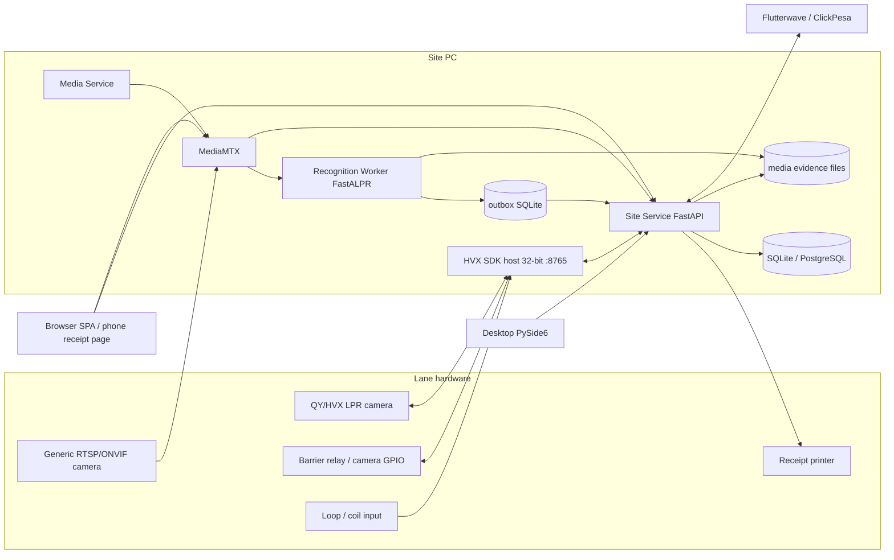
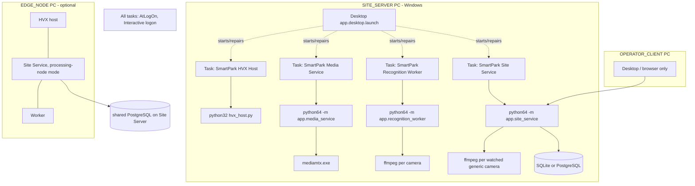
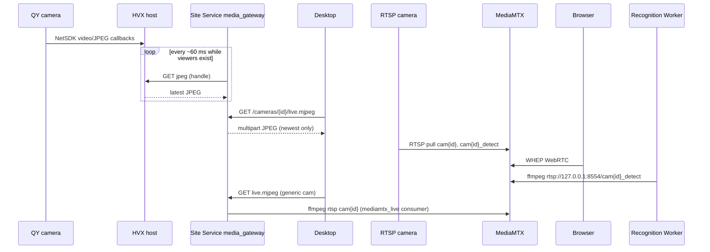
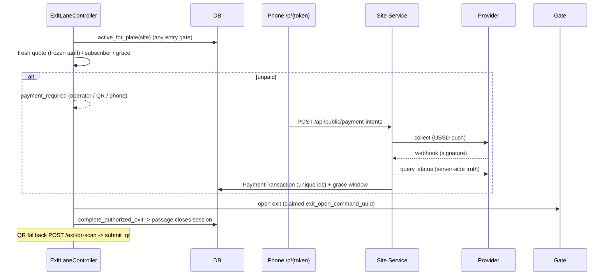
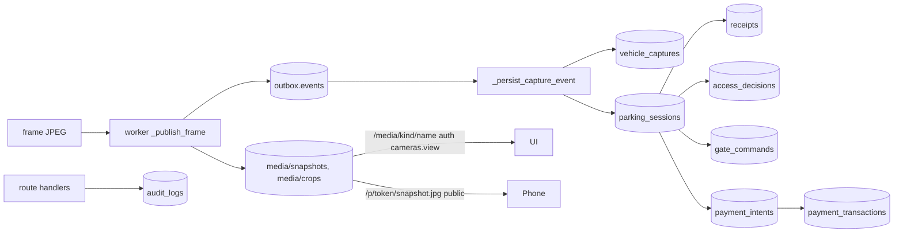
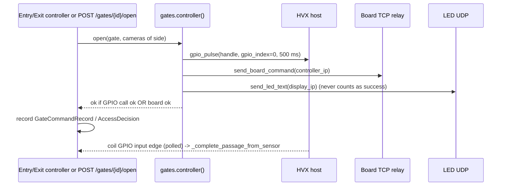

# Zirp — Engineering Handover

Investigation date: 2026-11-14. Local checkout: `/home/josiamosses/Downloads/smartpark_edge_rebuild`.
Branch `main`, HEAD `8a29f85` ("removed docs"). Working tree: clean except untracked `docs/` (this folder).
Investigation environment: Linux, Python 3.12.3 in the project `.venv`. No Windows host, no camera, printer, barrier, or payment provider was available.

**How to read the evidence labels used throughout:**

| Label | Meaning |
|---|---|
| **[SRC]** | Confirmed by reading source code |
| **[TEST]** | Confirmed by an automated test that ran in this investigation |
| **[RUN]** | Confirmed by local runtime execution in this investigation |
| **[HW]** | Confirmed with real hardware — *nothing in this report carries this label* |
| **[UNVERIFIED]** | Not verified |

No source code, configuration, dependency, schema, or existing document was changed. Tests ran with `XDG_DATA_HOME` pointed at a temporary scratch folder so no real site data was touched.

---

## 1. Executive summary

Zirp (internal/package name *SmartPark Edge*, `pyproject.toml` name `smartpark-edge`, `app/config.py` `app_version = "0.3.0"`) is a **Windows-first, Python, single-site parking and lane-control system**. It is one FastAPI "Site Service" that owns the parking business logic and talks to: a separate 32-bit Python process wrapping the QY/HVX vendor `NetSDK.dll`, a MediaMTX sidecar for generic RTSP cameras, a separate FastALPR recognition-worker process, a PySide6 desktop operator app and a vanilla-JS browser UI. Data lives in SQLite (default) or PostgreSQL (multi-PC).

What it genuinely is today:

- **The software-side plate-first model is real.** `ParkingSession` is keyed by site + normalized plate with a DB-enforced "one open session per plate per site" partial unique index (`app/models/40_parking.py`), entry/exit are routed through application controllers (`app/application/entry_lane.py`, `exit_lane.py`), exits find sessions site-wide (cross-gate works by design), tariffs are frozen at entry, and payment-provider callbacks are verified server-side before money is credited. **[SRC]**
- **The physical lane is not finished.** There is no driver for a receipt-taken sensor; the production profile forces "receipt must be taken before opening", so **casual entry cannot open automatically in production** with any real printer adapter (Defect D2). Barrier "success" means the SDK/relay accepted a command, never a confirmed boom position.
- **The GitHub repository cannot run.** The ORM package `app/models/` is excluded by `.gitignore` (`models/` pattern meant for ONNX models) and was never committed. A clean clone has no `ParkingSession`, `Camera`, `User`, etc. (Defect D1, confirmed **[RUN]**). The local checkout and the built `dist/` kit work only because the files exist on this disk.
- **Nothing has been proven against hardware in this investigation.** Camera, SDK, printer, relay, MediaMTX-on-Windows and payment-provider behaviour are **[UNVERIFIED]**.

Overall: a substantial (~48k lines of Python under `app/`, ~18.5k lines of tests in 97 files), heavily-iterated codebase whose core business engine is reasonably sound, wrapped in a lot of compatibility indirection, with a handful of high-severity operational gaps that must be closed before Rock City Mall go-live.

---

## 2. Product requirements (as stated by the owner) vs. implementation

| Requirement | Implementation status |
|---|---|
| Plate is primary identity of a visit | **Implemented** — `ParkingSession.plate`, unique open-plate index. [SRC] |
| Registered (VIP/staff/season) by registration, not card | **Implemented** — `RegisteredVehicle`, `AccessPlan`, `app/services/access.py::lookup_entitlement(strict=True)`. [SRC] |
| Casual visitor gets receipt with unique ID + QR | **Implemented in software** — `public_token`, `human_reference` (unique), `app/domain/receipt_engine.py`, `app/services/receipt_jobs.py::print_entry_receipt`. Real printer output [UNVERIFIED]. |
| Barrier opens only after a *physical* receipt-taken sensor | **Not implemented.** Policy exists; no sensor driver; real printers declare no taken sensor; manual confirmation endpoint always refuses. See D2. |
| Record entry + preserve evidence | **Implemented** — `VehicleCapture` with snapshot/crop on disk, `AccessDecision`, `GateCommandRecord`, `AuditLog`. [SRC] |
| Exit: find session site-wide, compute fee, verify payment/exemption, open exit barrier | **Implemented** — `ExitLaneController.submit_plate` → `active_for_plate(site_id)` → `quote_stay` → allow/deny. [SRC] |
| QR fallback at exit | **Implemented** — `POST /exit/qr-scan` → `ExitLaneController.submit_qr`. Physical QR scanner integration (`app/infrastructure/hardware/qr_scanners.py`) [UNVERIFIED]. |
| Session closed only by confirmed exit workflow | **Partially** — `complete_authorized_exit` / passage completion; passage depends on camera GPIO "coil" input. In DEVELOPMENT profile the open command itself counts as passage. |
| Cash by authorised operators | **Implemented** — `POST /sessions/{id}/pay`, `POST /p/{token}/kiosk-pay` with `payments.create`/`kiosk.use`. |
| Mobile money with server-side verification | **Implemented in code** (Flutterwave, ClickPesa adapters, webhook + `query_status` + reconcile loop). Never exercised against a live provider. [UNVERIFIED] |
| Browser redirect never establishes payment | **Respected** — public simulated payment disabled by default (`allow_public_simulated_payments=False`); external providers only via intents. [SRC] |
| Duplicate payment protection | **Implemented** — unique `idempotency_key` and `provider_transaction_id` on `PaymentTransaction`. [SRC] |
| QY/HVX cameras + SDK | **Implemented** via 32-bit host `tools/hvx_sdk_host/`. [UNVERIFIED on hardware] |
| Generic RTSP cameras | **Implemented** via MediaMTX + FFmpeg decoders. |
| ONVIF | Discovery, Media2 profiles, event loop (`app/services/onvif_*`). [UNVERIFIED] |
| Thermal printers | Windows spooler / ESC/POS TCP adapters in `app/infrastructure/hardware/printers.py`. [UNVERIFIED] |
| Barrier controllers/relays | Camera GPIO via SDK host, "Board" TCP relay (`app/services/board_tcp.py`). [UNVERIFIED] |

---

## 3. Repository map

Tracked files: 615. Untracked-but-required: `app/models/` (8 files). Top-level layout:

| Path | Purpose | Key entry points |
|---|---|---|
| `app/site_service.py` | **Production API process entry** (`python -m app.site_service`). Loads `deployment.json`, checks DB, runs Uvicorn with `app.api_main:app`, 1 worker. | `main()` |
| `app/api_main.py` → `app/api/runtime.py` → `app/api/runtime_parts/*.py` | The whole FastAPI app. `runtime.py` `exec()`s 14 part files into one shared namespace; `api_main` aliases itself to that module via `sys.modules`. | `lifespan()` in `01_bootstrap.py` |
| `app/api/payments.py`, `recognition.py`, `module_routes.py`, `registry.py` | Route tables registering part functions; module-gated route class | |
| `app/application/` | **Business orchestration**: `entry_lane.py::EntryLaneController`, `exit_lane.py::ExitLaneController`, `live_parking.py::handle_live_entry/handle_live_exit` | |
| `app/domain/` | Pure-ish domain: `parking_engine.py` (lifecycle states, `LanePolicy`), `tariff_engine.py`, `receipt_engine.py`, `recognition.py` (`NormalizedRecognitionEvent`), `recognition_engine.py`, `modules.py` | |
| `app/services/` (83 files) | Everything else: sessions, captures, fees, payments, gates, media gateway, MediaMTX, preview, ALPR, ONVIF, node scope, health, backup, simulation, AI review | |
| `app/services/{alpr,captures,media_gateway,simulation}/` | Split modules loaded by `exec()` from numbered part files | |
| `app/models/` **(git-ignored!)** | SQLAlchemy ORM, split into numbered parts, loaded by `exec()` | |
| `app/models.py` | Inert "compatibility marker" — the only tracked models file | |
| `app/db.py`, `app/database_config.py`, `app/deployment.py`, `app/config.py` | Engine, DB selection, role config (`deployment.json`), env settings (`SMARTPARK_*`) | |
| `app/migrations/` | Alembic env + 14 revisions (`0001`…`0014`), `runner.py::upgrade_to_head`, `legacy.py` | |
| `app/recognition_worker/` | **Recognition Worker process** (`python -m app.recognition_worker`), exec-loaded parts | `99_entrypoint.py` |
| `app/media_service.py` | **Media Service process** — sole owner of MediaMTX | `main()` |
| `app/desktop/` | PySide6 operator/admin app; `launch.py` is the installed Windows entry and service bootstrapper; `main/` exec-loaded parts; `setup_parts/` deployment wizard | `launch.py::main` |
| `app/web/` | Single-page browser UI (`index.html`, `assets/*.js`), WHEP reader `mediamtx-reader.js`; `launch.py` dev launcher | |
| `app/infrastructure/` | Adapters: cameras (`hvx`, `qy`, `rtsp`, `onvif`, `simulated`), gates, printers, QR scanners, payments (`clickpesa`, `flutterwave`, `mobile_money`, `ledger`), recognition engines (FastALPR only), secrets (DPAPI/file), AI (Gemini) | |
| `app/core/` | Plate normalization/policy, consensus tracking, native/software fusion | |
| `app/cli.py` | `create-admin`, `reset-admin` | |
| `tools/hvx_sdk_host/` | **32-bit SDK host** (stdlib + ctypes), HTTP on `127.0.0.1:8765`; `hvx_sdk_parts/` exec-loaded | `hvx_host.py` |
| `tools/` | `camera_lab*.py`, `field_acceptance_test.py`, `startup_check.py`, `evaluate_alpr.py` | |
| `packaging/` | `make_windows_kit.sh` (offline USB kit builder), Windows PowerShell installers/repair/diagnostics, `verify_windows_kit.py` | |
| `scripts/` | Dev launchers (`run_dev_linux.sh`, `Start-SmartPark.ps1`, MediaMTX install/soak) | |
| `vendor/mediamtx/` | `mediamtx.yml` + README (binary not committed) | |
| `tests/` | 97 pytest files + 1 Node test (`whep-player.test.cjs`) | |
| `research/` | Ghidra reverse-engineering evidence of the previous ParkWatch install and the OcxConfig SDK | |
| `docs-site/` | Static HTML "production documentation" site | |
| `Current_ParkSystem_configs/`, `TestingData/`, `dist/`, `models/`, `data/`, `logs/` | Ignored local material: previous ParkWatch site dump, field footage, built installer, ONNX models | |
| Root images (`TZ_plates.webp`, `images*.jpeg`), `:memory:.ses`, `architecture.svg`, `SMARTPARK-ARCHITECTURE-AND-AUDITS.html` | Stray tracked artefacts / old architecture material | |

### 3.1 Local-only assets (on this machine, git-ignored)

This investigation used the local checkout, not GitHub. The local tree holds runtime assets that are deliberately kept out of git. They were checked as follows **[RUN]**, without being loaded or executed:

| Asset | Location | Check |
|---|---|---|
| QY/OcxConfig SDK DLLs + `hvx_bindings.json`, `OcxConfig.ocx`, `OcxConfigClient.exe` | `Current_ParkSystem_configs/Camera_config/OcxConfig/` | `app/services/hvx_vendor.py::resolve_vendor_dir()` resolves to this folder. `pe_image_info` reports `NetSDK.dll`, `CommModule.dll`, `PlaySdk.dll`, `RtspRecvSdk.dll`, `DecodeSdk.dll`, `Log.dll` as PE32 i386, which matches the 32-bit host design. `NetSDK.dll` SHA-256 `f2259207…2055` is the build analysed in `research/ocxconfig` (SDK 3.2.3.6). |
| Previous ParkWatch install (incl. `VideoDrivers/IPC_QY`, `LPREngine`, server) | `Current_ParkSystem_configs/ParkingSystem/`, `ParkWachServer/` | Reference and reverse-engineering source only; Zirp does not load it. |
| Built installer kit | `dist/SmartParkEdge-Install/` (+ `.zip`, `.sha256`) | `payload/vendor/NetSDK.dll` has the same SHA-256 as the local OcxConfig copy. The kit also bundles python32/python64, FFmpeg, MediaMTX, VC++ x86/x64 runtimes, `qy-sdk/OcxConfig.ocx` and `QY-SDK-MANIFEST.txt`. `packaging/make_windows_kit.sh` takes the SDK from this OcxConfig folder first. |
| FastALPR ONNX models | `models/fastalpr/detector/yolo-v9-t-384-license-plates-end2end.onnx`, `models/fastalpr/ocr/cct_xs_v2_global.onnx` (+ plate config) | Present. |
| MediaMTX binary | `vendor/mediamtx/mediamtx` (Linux) + tarball | Present. |
| Field footage | `TestingData/` | Present, not examined in detail. |
| ORM models | `app/models/` | Present locally; **not in git** (D1). Unlike the assets above, this is source code and is ignored by accident. |

Consequence: the local machine can build a complete Windows kit; a GitHub clone cannot (it has no ORM models and no vendor SDK). Whether the DLLs load and talk to the Rock City Mall cameras still needs a Windows PC and a camera **[UNVERIFIED]**.

**Structural observation:** five packages (`api/runtime`, `models`, `recognition_worker`, `desktop/main`, `services/{alpr,captures,media_gateway,simulation}`, `tools/hvx_sdk_host/hvx_sdk_parts`) are *not real Python packages*: each `__init__` reads numbered files and `exec()`s them into one namespace, and rewrites `__file__` to a non-existent "original" file. This defeats static analysis, IDE navigation, import-cycle detection and coverage attribution, and is what allowed `app/models/` to silently fall out of git.

---

## 4. Technology inventory

| Area | Technology (pinned in `requirements.txt`) |
|---|---|
| Language | Python ≥3.11 (64-bit app; 32-bit Python for SDK host); JavaScript (browser UI) |
| API | FastAPI 0.141, Starlette 1.6, Uvicorn 0.52 (single worker), pydantic 2 / pydantic-settings |
| ORM / DB | SQLAlchemy 2.0.52, Alembic 1.20; SQLite (WAL, NullPool) or PostgreSQL via psycopg 3 (QueuePool) |
| Desktop UI | PySide6 6.11 (Qt) |
| Recognition | `fast-alpr` 0.4, `fast-plate-ocr` 1.1, `open-image-models` 0.6, `onnxruntime` 1.29, OpenCV-headless, numpy. Models: YOLOv9-t-384 plate detector + OCR ONNX (downloaded by the kit builder; local `models/fastalpr`) |
| Native ALPR | Camera-side LPR delivered through QY/HVX `NetSDK.dll` callbacks |
| Media | MediaMTX (external binary, RTSP→WebRTC/WHEP), FFmpeg (external binary; RTSP→MJPEG/JPEG pipes) |
| Hardware SDK | Vendor `OcxConfig` 32-bit DLLs (`NetSDK.dll`, `CommModule.dll`, `PlaySdk.dll`, `RtspRecvSdk.dll`, `DecodeSdk.dll`, `Log.dll`, …). They are git-ignored but **present locally** in `Current_ParkSystem_configs/Camera_config/OcxConfig/` (see §3.1) |
| Payments | Flutterwave v3, ClickPesa third-party API, simulated provider |
| Security | argon2-cffi password hashing; random bearer tokens stored SHA-256 hashed; Windows DPAPI secret store |
| Other | `qrcode`, Pillow, `pyserial` (QR scanners), httpx, optional Gemini AI review |
| Windows ops | PowerShell installers, Task Scheduler tasks (default) or NSSM services (optional helper) |

---

## 5. Runtime architecture

### 5.1 Processes (as implemented)

| Process | Started by | Owns | Talks to |
|---|---|---|---|
| **Site Service** (`python -m app.site_service`, task "SmartPark Site Service") | Task Scheduler (AtLogOn) or `app/desktop/launch.py` fallback | FastAPI, parking decisions, DB migrations/bootstrap, camera event polling, HVX session lifecycle, MJPEG transcoding for desktop, gate commands, payment reconcile loop, outbox consumer | DB, HVX host (HTTP :8765), MediaMTX (RTSP :8554 / control API), outbox SQLite file |
| **HVX SDK host** (32-bit `python32\python.exe tools/hvx_sdk_host/hvx_host.py`) | Task "SmartPark HVX Host" or launcher; Windows only | All QY/HVX camera connections, native ALPR callbacks, SDK JPEG video, GPIO (barrier relay + coil input) | Cameras (TCP 30000), Site Service via loopback HTTP |
| **Media Service** (`python -m app.media_service`) | Task or launcher | MediaMTX child process + path registration from DB | DB, MediaMTX control API |
| **MediaMTX** | Media Service | RTSP pulls from generic cameras; WHEP/WebRTC to browsers; local RTSP re-publish | Cameras, browsers, local decoders |
| **Recognition Worker** (`python -m app.recognition_worker`) | Task or launcher | FastALPR for **non-SDK** cameras; one FFmpeg decoder per camera on MediaMTX detect path | DB (read config), MediaMTX, outbox SQLite file (write) |
| **Desktop** (`app.desktop.launch`) | User | Qt UI only; starts/repairs the above on server/edge roles | Site Service HTTP (`/live.mjpeg`, REST) |
| **Browser UI** | User | `app/web` SPA | Site Service REST, MediaMTX WHEP |

Each Python process takes an instance lock (`app/services/runtime.py::acquire_instance_lock`). Deployment roles (`app/deployment.py`): `SITE_SERVER`, `EDGE_NODE` (local gate runtime + shared central PostgreSQL), `OPERATOR_CLIENT` (thin UI; must not start services).

### 5.2 Site Service startup (`01_bootstrap.py::lifespan`)

1. Processing node? → require schema already at head, register node identity, no bootstrap writes. Otherwise `ensure_schema()` (create_all + stamp for fresh DB, else Alembic upgrade), `ensure_default_site`, `ensure_roles`, `ensure_bootstrap_admin`, `ensure_car1_tariff`, `ensure_access_plans`, modules init, gate/lane sync, plaintext-secret migration.
2. FastALPR status; background warm-up task.
3. `start_idle_watch()`; set hybrid-fusion persistence callback.
4. Background tasks: `_camera_event_loop` (HVX native events), `_outbox_loop` (recognition → parking), `_hvx_watch_loop` (SDK session restore/scope), `_fusion_flush_loop`, `_payments_reconcile_loop`, `_onvif_events_loop`, supervised `_diagnostic_heartbeat_loop`.
5. Shutdown: cancel tasks, stop ONVIF, stop live pumps, close HVX clients. MediaMTX is intentionally left to the Media Service.

Only the diagnostic heartbeat is wrapped by `_supervise_background_loop`; the parking-critical loops each have their own internal `while True/try` (e.g. `_outbox_loop` swallows all exceptions with `except Exception: pass`).

### 5.3 Communication paths

- UI ↔ Site Service: HTTP bearer tokens (header, or `?access_token=` query string for media/MJPEG).
- Site Service ↔ HVX host: unauthenticated JSON over `127.0.0.1:8765` (`app/services/hvx_client.py`).
- Recognition Worker → Site Service: **local SQLite outbox file** `<data_dir>/outbox/parking-events.sqlite3` (`app/services/queues.py::SQLiteOutbox`); the Site Service polls it every 0.1 s using the file mtime as a wake-up token.
- Edge Node ↔ Site Server: shared PostgreSQL (no HTTP sync protocol); node auth via `/node/auth` sessions.

---

## 6. Subsystem architecture

### 6.1 Cameras and hardware ownership

| Device | Owning process | Code |
|---|---|---|
| QY/HVX camera connection, native LPR, SDK video, GPIO out (barrier), GPIO in (coil) | HVX SDK host | `tools/hvx_sdk_host/hvx_sdk_parts/20_connection.py`, `30_captures.py`, `40_video.py` (1322 lines), `50_gpio.py` |
| QY/HVX session lifecycle decisions (connect/disconnect/restore by node scope) | Site Service | `05_background_tasks.py::_hvx_watch_loop`, `_restore_hvx_sessions`, `_disconnect_out_of_scope_hvx_sessions` |
| Generic RTSP camera pull | MediaMTX (production); Site Service `media_gateway` FFmpeg (development only, `direct_generic_media_allowed()`) | `app/services/mediamtx*.py`, `media_gateway/30_producers` |
| ONVIF events | Site Service | `app/services/onvif_events.py`, `onvif_runtime.py` |
| Board TCP relay, LED UDP display | Site Service | `board_tcp.py`, `led_udp.py` |
| Receipt printer | Site Service (in-process call during entry) | `app/infrastructure/hardware/printers.py`, `receipt_printers.py` |
| QR scanner | Desktop/browser keyboard wedge or serial | `qr_scanners.py` |

Adapter registry (`app/infrastructure/hardware/cameras/__init__.py`): `hvx` and `qy` are the **same implementation** (`QYCameraAdapter(HVXCameraAdapter)`); `rtsp`, `ipcam`, `dahua`, `hikvision` all resolve to `rtsp`; **any unknown adapter id silently resolves to `hvx`** (`resolve_adapter_key`), and `DEFAULT_CAMERA_ADAPTER = "hvx"`.

### 6.2 Streaming

Per **SDK camera**: NetSDK JPEG callback in host → `media_gateway._sdk_frames` HTTP-polls the host every `live_sdk_interval_seconds=0.06` → `LatestFrameBuffer` → `/cameras/{id}/live.mjpeg` → desktop `streams.py` (drops all but newest JPEG) and browser.
Per **generic camera (production)**: camera RTSP → MediaMTX path `cam{id}` (+ `cam{id}_detect`) → browser WebRTC/WHEP (`mediamtx-reader.js`), **plus** Site Service `mediamtx_live._consume` FFmpeg decoder → JPEG cache → `/live.mjpeg` for the desktop (only while a viewer is attached), **plus** worker FFmpeg decoder (`recognition_decoder.py`) on the detect path.

Staleness controls exist: `stale_stream_seconds=2.5`, `recognition_stale_frame_ms=2000`, `live_is_current`, generation counters per camera, `/media/live-*?v=` digest check (410 when superseded). Whether stale frames can still be shown on Windows under load is [UNVERIFIED]; it is the subject of several recent commits (`2ca77da`, `ec46a3d`).

Per-camera isolation: producers and decoders are per camera; recognition scheduler (`recognition_runtime.py`) admits ≤1 inference per camera with a watchdog. A stuck native SDK call in the shared 32-bit host can still affect all SDK cameras (one process).

### 6.3 Recognition

- **Engines:** exactly one software engine, FastALPR (`app/infrastructure/recognition/engines/registry.py::_ENGINES = {"fastalpr": ...}`); `alpr_engine`/`alpr_mode` settings and UI choices do not select another implementation. Native camera LPR is the second, independent source (HVX/QY only, or ONVIF plate metadata).
- **Where FastALPR runs:** in the **Recognition Worker** for non-SDK cameras; **in the Site Service** for SDK cameras' optional software verification (`_maybe_watch_local_alpr`, `hybrid_fusion`), and for manual reads (`_manual_alpr_lock`). Two processes can therefore load ONNX models.
- **Pipeline (worker):** decoder newest-JPEG → ROI (`alpr_detect_roi`) → detector → stillness/arrival check → crop OCR → `PlateTrack` consensus (`app/core/consensus.py`) → evidence write → `events.publish` (outbox, dedupe key `camera:visit`).
- **Fusion:** `app/services/hybrid_fusion.py`, `app/core/fusion.py`, `app/core/hybrid.py` combine native + local reads with a flush loop.
- **Visit tracking/dedup:** worker visit IDs adopted by Site Service (`_persist_capture_event`), `VehicleCapture` unique on (camera,event), (camera,visit), (camera,image_id); `dedup.camera_events`; outbox `published`/`processed` tables.

### 6.4 Parking engine — authority map

| Decision | Authority |
|---|---|
| Create/reuse session | `parking_sessions.start_entry` + DB unique indexes + `ParkingEntryClaim` |
| Registered vs casual | `access.lookup_entitlement(strict=True)` (exact plate) |
| Receipt print / taken | `receipt_jobs.print_entry_receipt` / `mark_receipt_taken` |
| Entry authorization + gate command | `EntryLaneController._authorize_and_open` (claims `open_command_uuid` with a conditional UPDATE) |
| Fee | `tariff_engine.quote_stay` with tariff frozen at entry |
| Exit authorization | `ExitLaneController._submit_session` |
| Physical barrier | `gates.PhysicalGateController.open` (GPIO via host or Board TCP; LED never counts) |
| Session close | `complete_authorized_exit` / passage events |

Recognition does not call the gate directly; it goes through `handle_live_entry/exit`. The UI cannot create sessions except via simulation endpoints guarded by `_require_development_simulation()`. **However, an operator with `payments.create` can mark a session paid with any method string** (`POST /sessions/{id}/pay`, `PaymentConfirm.method` is free text), so "MOBILE_MONEY" can be recorded without provider verification (D9).

### 6.5 Payments

`app/services/mobile_payments.py`: `start_mobile_payment` creates a PENDING `PaymentIntent` and asks the provider for a USSD push; `handle_webhook` verifies signature then **re-queries the provider** (`settle_intent` → `provider.query_status`) and checks amount/currency/reference (`_check_match`) before `record_succeeded_payment`. `_payments_reconcile_loop` polls stale intents. Live ClickPesa requires two explicit flags; Flutterwave live keys require `flutterwave_allow_live_keys`. Legacy `/payments/mobile-money/webhook` returns 410. This is a sound design. **[SRC]**; behaviour against real providers **[UNVERIFIED]**.

### 6.6 Database and persistence

- Authoritative schema = ORM `create_all` for fresh DBs + Alembic revisions for upgrades (`app/migrations/runner.py`). `tests/test_migration_architecture.py` exists to keep them aligned.
- Concurrency guarantees are DB-level partial unique indexes (open plate, entry event, exit event, visit, public token, human reference, payment keys, gate command UUID, one active node per gate). `with_for_update()` is used in `active_for_plate`/`recent_similar_entry` (effective on PostgreSQL; no-op on SQLite).
- SQLite: WAL, `busy_timeout=5000`, NullPool. Fine for one PC; multi-PC requires PostgreSQL (wizard enforces PostgreSQL for Edge Nodes).
- Evidence: JPEG files under `settings.media_dir` (`snapshots/`, `crops/`), retention `media_retention_days=14`; served by `/media/{kind}/{name}` with `cameras.view`.
- Backup: `app/services/backup.py::dump_sql` (SQLite online backup → SQL; PostgreSQL via `pg_dump`). **No restore function or endpoint exists.**
- Outbox: separate local SQLite file per machine (not in the main DB).

### 6.7 Security

- Passwords: argon2. Tokens: `secrets.token_urlsafe(48)`, stored SHA-256, 12 h expiry.
- RBAC: roles in `DEFAULT_ROLES` (Admin `*`, Operator, Developer, Kiosk Operator, Processing Node), re-applied on every start for system roles.
- `GET /auth/setup` is **unauthenticated** and returns all usernames and, while the bootstrap password is unchanged, **the admin password in clear** (`app/services/bootstrap.py::setup_status`). Server/edge roles bind `0.0.0.0` (`Install-SmartPark.ps1:612`, wizard). (D3)
- `scripts/Start-SmartPark.ps1` prints a hardcoded legacy password; `settings.default_camera_password = "admin"`.
- HVX host HTTP API (connect, GPIO pulse) has no authentication; bound to loopback only.
- Bearer tokens accepted in `?access_token=` query strings (leaks to logs/history).
- Public exposure is constrained by `PublicIngressGuard`, which keys off the `Host` header matching `public_ingress_hosts`; a tunnel that rewrites `Host` would expose the full API. [UNVERIFIED config risk]
- Error bodies and logs are redacted (`app/services/redaction.py`); secrets are moved to DPAPI store (`secrets_migration.py`).

### 6.8 User interfaces

- **Desktop (PySide6)** — the primary operational interface on the Windows site PC: login, dashboard, parking (sessions, live gates, payment), admin, system/settings, plus the deployment wizard. Talks only HTTP to the Site Service; video via `/live.mjpeg`.
- **Browser SPA** (`app/web`) — dashboard, sessions/cameras, kiosk, admin, fees/reports, hardware; WebRTC live view via MediaMTX. Also the receipt phone page `/p/{token}` (server-rendered HTML in `07_payments.py`).
- Most functions are duplicated across both UIs. Labels in the public receipt page still say "Demo payment simulation".

### 6.9 Deployment

- Windows USB kit built on Linux by `packaging/make_windows_kit.sh` (bundles python64, python32, wheels, NetSDK, FFmpeg, MediaMTX, ONNX models), installed by `Install-SmartPark.ps1` with role choice; services registered by `Install-SmartParkServices.ps1` as **Task Scheduler tasks triggered AtLogOn, LogonType Interactive** (D5). An NSSM-based Windows-service helper (`Install-SmartParkWinService.ps1`) is copied but is not the default path.
- Linux: Site Service + browser UI + MediaMTX + worker run; HVX/QY SDK cannot (PE32 DLL).

---

## 7. Critical execution flows (diagrams reflect code, not old docs)

### 7.1 Product-level component diagram



### 7.2 Runtime process and deployment diagram



### 7.3 Camera acquisition and streaming sequence



### 7.4 Recognition processing sequence

```mermaid
sequenceDiagram
  participant W as Worker (non-SDK cams)
  participant OB as Outbox SQLite
  participant SS as Site Service _outbox_loop
  participant Host as HVX host
  participant EL as _camera_event_loop
  participant P as _persist_capture_event
  W->>W: detect, wait still, OCR crop, consensus
  W->>W: write snapshot+crop to media dir
  W->>OB: enqueue PlateRecognized (dedupe camera:visit)
  SS->>OB: pending(20) ordered
  SS->>P: persist VehicleCapture (or hybrid_fusion.offer_local)
  Host-->>EL: native LPR report (polled)
  EL->>P: native capture (+ optional local FastALPR verify / fusion)
  P->>P: dedupe, plate policy, hold for review?
  P->>P: handle_live_entry / handle_live_exit
  Note over SS,OB: exception in processing => break; same head item retried forever
```

### 7.5 Vehicle entry sequence

```mermaid
sequenceDiagram
  participant P as handle_live_entry
  participant E as EntryLaneController
  participant DB as DB
  participant Pr as Printer adapter
  participant G as PhysicalGateController
  P->>E: submit(event, printer from settings)
  E->>DB: lookup_entitlement(strict)
  E->>DB: start_entry (unique open plate / claim)
  alt registered
    E->>G: open (skip receipt)
  else casual
    E->>Pr: print_entry_receipt
    alt policy REQUIRE_TAKEN_BEFORE_OPEN (forced in PRODUCTION)
      E-->>P: WAITING_RECEIPT
      Note over E,Pr: only SimulatedKioskPrinter has a taken sensor; POST /sessions/{id}/receipt-taken passes sensor_confirmed=False and fails 409
    else PRINT_AND_OPEN (DEVELOPMENT default)
      E->>G: open
    end
  end
  E->>DB: claim open_command_uuid (conditional UPDATE)
  G->>G: GPIO pulse via host / Board TCP; ok = command accepted
  E->>DB: GATE_OPEN_REQUESTED; WAIT_FOR_PASSAGE (prod) until coil clears
```

### 7.6 Vehicle exit and payment sequence



### 7.7 Database and evidence flow



### 7.8 Hardware control sequence



---

## 8. Configuration and feature flags

**Precedence:** process env `SMARTPARK_*` > `<install>/.env` > `Settings` defaults (`app/config.py`). Database selection comes from `<data_dir>/deployment.json` (`app/deployment.py`) applied at process start via `apply_runtime_database_config` (sets env + `settings.database_url` before `app.db` creates its import-time engine). Runtime rollout flags live in DB `site_settings.migration` and override env (`app/services/flags.py::flags`). Parking settings: DB `site_settings.parking` merged over defaults, **then overridden by `deployment_profile`**. Developer switches: DB `site_settings.developer`, inert unless `developer_mode=true`.

| Setting | Default | Notes / conflicts |
|---|---|---|
| `deployment_profile` | `DEVELOPMENT` | Installer sets `PRODUCTION`. Changes receipt policy, passage sensing, simulation availability, direct media. Running from source = DEVELOPMENT semantics. |
| `receipt_policy` | `PRINT_AND_OPEN` (dev) | Forced `REQUIRE_TAKEN_BEFORE_OPEN` in non-DEVELOPMENT; the UI setting is silently ignored in production (`simulation/10_settings.py`). |
| `passage_sensing` | dev: open counts as passed; prod: `WAIT_FOR_PASSAGE` | |
| `printer_adapter` | `simulated` | Production entry refuses a simulated printer (`printer_not_configured`). |
| `gate_physical_control_enabled` | `True` | |
| `gpio_index` / `gpio_pulse_ms` | `0` / `500` | Global, not per camera. |
| `coil_gpio_index`, `coil_poll_indexes` | `1`, `"1,2,3,4,5,6,7"` | Coil index is "learned" at runtime. |
| `media_gateway_enabled`, `live_view_provider`, `recognition_pipeline`, `fastalpr_new_pipeline_enabled`, `webrtc_live_enabled`, `native_alpr_enabled` | `True`, `MEDIAMTX`, `FASTALPR_NEW`, `True`, `True`, `True` | `flags.py::_from_settings` has getattr fallbacks of `DIRECT_LEGACY`/`False` that differ from these defaults (dead fallbacks). Production validation requires MediaMTX. |
| `alpr_mode` / `alpr_engine` | `FASTALPR_ONLY` / `fastalpr` | Only one engine exists. |
| `payments_mobile_provider` | `simulated` | |
| `allow_public_simulated_payments` | `False` | |
| `bootstrap_username` / `bootstrap_password` | `admin` / `""` (random file) | |
| `default_camera_password` | `"admin"` | Unsafe default. |
| `api_host` / server bind | `127.0.0.1`; server/edge roles bind `0.0.0.0` | |
| `site_timezone` | `UTC` | Rock City Mall is EAT (UTC+3); tariff day boundaries depend on this being set. |
| `ai_enabled` | `False` | Gemini second opinion, never authoritative. |

---

## 9. Test coverage

*(Filled from the actual run — see the end of this section.)*

### 9.1 Structure (97 Python test files, ~18.5k lines; 1 Node test)

| Subsystem | Files (examples) |
|---|---|
| Parking engine / entry / exit / receipts / tariff | `test_parking_engine.py`, `test_parking_entry.py`, `test_parking_exit.py`, `test_parking_receipts.py`, `test_parking_tariff.py`, `test_access_receipts.py`, `test_session_from_capture.py`, `test_safety_regressions.py` |
| Payments | `test_payments_flutterwave.py`, `test_payments_clickpesa.py`, `test_mobile_money.py`, `test_public_session_boundary.py`, `test_public_ingress.py` |
| Recognition / ALPR | `test_alpr.py`, `test_fastalpr_only_pipeline.py`, `test_hybrid_fusion.py`, `test_plate_engine.py`, `test_recognition_*`, `test_arrival_framing.py`, `test_visit_dropout.py`, `test_empty_lane_worker.py`, `test_alpr_evaluation.py` (3-line fixture) |
| Media / streaming | `test_media_gateway.py`, `test_media_acquisition.py`, `test_mediamtx_telemetry.py`, `test_live_*`, `test_multicamera_display_recovery.py`, `test_camera_*`, `whep-player.test.cjs` |
| HVX / SDK | `test_hvx_vendor.py`, `test_hvx_reconnect.py`, `test_hvx_live_isolation.py`, `test_vendor_runtime_check.py` (all mocked; no DLL) |
| Nodes / deployment / DB | `test_node_scope.py`, `test_enterprise_node_architecture.py`, `test_deployment_roles.py`, `test_migration_architecture.py`, `test_platform_migrations_secrets.py`, `test_startup_database_bootstrap.py` |
| Windows packaging | `test_windows_packaging.py`, `test_windows_ready.py`, `test_windows_*` — largely **source-text assertions** (22 test files use `read_text`/`getsource`; `test_windows_packaging.py` alone 24 times) |
| UI | `test_desktop_presentation.py`, `test_operator_desk.py`, `test_ui_productization.py`, `test_setup_wizard_validation.py` |

### 9.2 What is mocked vs real

- All hardware (SDK host, GPIO, printers, relays, cameras) is simulated or monkeypatched. No test loads `NetSDK.dll`.
- Payment providers are mocked HTTP. No live sandbox call.
- Databases are SQLite (in-memory/temp). **No test runs against PostgreSQL**, so `with_for_update`, partial-index behaviour on PostgreSQL and multi-node concurrency are untested.
- Many "Windows readiness" tests assert that particular strings exist in source files (e.g. `LEGACY_SOURCE_MARKERS` kept in `app/api_main.py` purely to satisfy them). They prove text presence, not behaviour, and they actively resist refactoring.

### 9.3 Missing coverage (important behaviours with no test found)

- Real receipt-taken flow in PRODUCTION profile with a hardware printer (it would show the dead end — D2).
- Outbox poison-message / head-of-line blocking (D4) and stale replay after Site Service downtime (D6).
- PostgreSQL concurrency for two Edge Nodes entering the same plate.
- Backup restore (no restore exists).
- Unattended reboot without a logged-on user (D5).

### 9.4 Run results

**Method.** The full-suite run (`pytest -q`) **hung at about 10%** and was stopped. Each of the 97 files was then run separately: `timeout 240`, `-o faulthandler_timeout=200`, `QT_QPA_PLATFORM=offscreen`, a fresh empty `XDG_DATA_HOME` per file, Linux, Python 3.12.3. Per-file isolation is stricter than the combined run, so a few "no such table" failures may be test-order dependencies rather than code faults.

**Totals [TEST]:** 83 files passed. **895 tests passed, 21 failed, 1 skipped**, and 1 file timed out. Node test `tests/whep-player.test.cjs`: 9/9 passed.

**The hang:** `tests/test_camera_delivery_diagnostics.py::test_worker_claim_without_healthy_frames_does_not_disable_site_ocr` (line 53) blocks inside `asyncio.run()` → `_cancel_all_tasks`. A background task the code under test starts does not finish when cancelled. Alphabetically this is where the full run stopped, so it explains the CI-style hang. It is worth checking whether the same uncancellable task can stall Site Service shutdown.

**Failures, grouped by cause:**

| Cause | Tests | Assessment |
|---|---|---|
| Docs removed in HEAD `8a29f85` | `test_modules::test_module_docs_tree` (modules/OVERVIEW.md), `test_ui_productization::test_ui_docs_exist` (UI-ARCHITECTURE.md), `test_migration_architecture::test_required_docs_exist`, `test_windows_packaging::test_production_tree_is_this_rebuild` (docs/MEDIA-ARCHITECTURE.md) | The tests assert that documents exist. Deleting the docs broke them. Fix the tests or the docs together; this is not a product fault. |
| Tests expect the old `DIRECT_LEGACY` media default, but code now defaults to MediaMTX | `test_migration_architecture::test_defaults_keep_working_path_authoritative`, `::test_registry_live_endpoint_stays_direct_legacy`, `test_media_registry::test_direct_legacy_is_default` | Obsolete tests that contradict `app/config.py` (`live_view_provider="MEDIAMTX"`). |
| `sqlite3.OperationalError: no such table: cameras` | `test_media_registry` (2 more), `test_mediamtx_telemetry` (3), `test_windows_video_recognition_regressions` (1) | The tests read the real DB without creating a schema. They depend on test order or local state. |
| Behaviour mismatch (needs triage) | `test_hybrid_fusion` (2: fused capture not persisted/flushed), `test_node_scope::test_production_owner_assignment_persists_entry_and_exit_only`, `test_windows_ready` (2: production camera discovery/seeding), `test_simulation::test_sqlite_uses_nullpool_not_default_queuepool` (10 != 5), `test_stability::test_live_viewers_and_metrics`, `test_windows_service_recovery::test_media_process_retries_schema_startup_race_instead_of_exiting` (exit 2 ≠ 0) | Could be real regressions or stale tests. The hybrid-fusion and node-scope failures touch parking-relevant paths, so triage them first. |

Raw per-file logs were kept in the session scratchpad only, not in the repository.

---

## 10. Confirmed defects (ranked by operational risk)

| # | Severity | Finding | Evidence | Impact | Recommended action |
|---|---|---|---|---|---|
| **D1** | **Critical** | ORM package `app/models/` is not in git. `.gitignore:48` `models/` (intended for ONNX models) also matches `app/models/`. Tracked `app/models.py` is an inert docstring. | `git check-ignore -v app/models/00_base.py` → `.gitignore:48:models/`. Clean `git archive HEAD` → `import app.models` has no `ParkingSession`. **[RUN]** | GitHub repo and CI (`.github/workflows/ci.yml`) cannot run; a lost laptop loses the schema source; any fresh clone/deploy is broken. | Anchor the ignore rule (`/models/`) and commit `app/models/`. Smallest, highest-value task. |
| **D2** | **Critical (go-live blocker)** | No real receipt-taken path. Production profile forces `REQUIRE_TAKEN_BEFORE_OPEN`; `HardwareReceiptPrinter.capabilities = {CAP_CUTTER}` (no taken sensor); `POST /sessions/{id}/receipt-taken` calls `confirm_receipt_taken(sensor_confirmed=False)` → `InvalidPrintJob` → 409; `receipt_jobs.operator_override` is never called by any route. | `app/services/simulation/10_settings.py:14-17`, `app/infrastructure/hardware/receipt_printers.py:91-98`, `app/api/runtime_parts/06_parking.py::session_receipt_taken`, `app/services/receipt_jobs.py:208-245` **[SRC]** | Every casual entry in production stops at WAITING_RECEIPT; barrier opens only by manual `POST /gates/{id}/open`, which does not advance the session lifecycle. | Decide the Rock City Mall receipt hardware (presenter printer with taken sensor, or a separate beam/switch on GPIO), implement that sensor adapter, and add an audited operator-override route. |
| **D3** | **High** | `GET /auth/setup` is unauthenticated and returns every username and, while the bootstrap password still works, the admin password; it also *creates* the admin on first call. Server/Edge roles bind `0.0.0.0`. | `01_bootstrap.py::auth_setup`, `app/services/bootstrap.py::setup_status`, `Install-SmartPark.ps1:612` **[SRC]** | Anyone on the mall LAN can obtain full admin until the password is changed. | Return the password only to loopback requests (or never; point to the file), stop listing usernames, force password change on first login. |
| **D4** | **High** | Outbox head-of-line blocking. `_outbox_loop` processes items in sequence order and on any exception does `break` without attempt counting or dead-lettering; the same item is retried every tick forever. `_persist_capture_event` re-enqueues failed decisions as `plate-event` with no dedupe key. | `05_background_tasks.py:20-147`, `app/services/queues.py::SQLiteOutbox.pending`, `05_scope.py:212-222` **[SRC]** | One malformed/poison event (e.g. missing evidence file, transient printer exception that keeps failing) stops automatic recognition-driven entry/exit for **all** generic-camera lanes, silently (`except Exception: pass`). | Add attempt counter + dead-letter table + health alarm; process per-camera independently. |
| **D5** | **High** | Services are Task Scheduler tasks with `-AtLogOn` trigger and `LogonType Interactive`. | `packaging/windows/Install-SmartParkServices.ps1:160-166` **[SRC]** | After a power cut/reboot nothing runs until someone logs into Windows; logging off stops parking. `docs-site/index.html` documents this as deliberate because the vendor SDK has not been validated in a non-interactive (Session 0) service. | First test the 32-bit NetSDK host as a service on the site PC. If it works, run all four processes at boot (NSSM path in `Install-SmartParkWinService.ps1` or `AtStartup` + service account). If the SDK needs an interactive session, configure Windows auto-logon to a locked-down kiosk account as a documented interim measure. |
| **D6** | **High** | No age check when the Site Service consumes queued recognition events. A backlog (Site Service restart, DB outage, D4 unblock) replays old `PlateRecognized` events into `handle_live_entry/exit`; `VehicleCapture.created_at` becomes the processing time. | `05_background_tasks.py::_outbox_loop`, `05_scope.py::_persist_capture_event`, no `occurred_at` comparison found in `app/application/*` **[SRC]** | Registered vehicles / exits could get a barrier pulse minutes after the car left; a car at the barrier now may be blocked by a stale lane state. | Carry event `occurred_at`; refuse automatic barrier action for events older than a few seconds (keep evidence/session, flag for review). |
| **D7** | **Medium** | Silent hardware-adapter fallback: unknown `adapter_id` → `hvx`; `DEFAULT_CAMERA_ADAPTER="hvx"`. | `app/infrastructure/hardware/cameras/__init__.py::resolve_adapter_key` **[SRC]** | A typo makes a generic camera try the 32-bit SDK host and be treated as native-plate/native-stream (excluded from the worker). | Reject unknown adapters at save time. |
| **D8** | **Medium** | Silent topology write: when a camera has no gate and the site has exactly one enabled gate, `_persist_capture_event` assigns `camera.gate_id` itself. | `05_scope.py:118-127` **[SRC]** | Adding the first gate silently binds every unassigned camera (including exit cameras) to it, enabling barrier actions on the wrong lane. | Remove the auto-link; require explicit assignment. |
| **D9** | **Medium** | Operator payment confirmation accepts any method string and records SUCCEEDED (`provider_id="kiosk_manual"`). | `06_parking.py::confirm_session_payment`, `app/schemas.py::PaymentConfirm.method: str`, `simulation/40_exit.py::mark_paid` **[SRC]** | An operator can record "MOBILE_MONEY" without provider proof; reconciliation cannot distinguish. Cash-handling fraud surface. | Restrict operator methods to `KIOSK_CASH` (+ explicit audited waiver); mobile money only via intents. |
| **D10** | **Medium** | `exec()`-composed pseudo-packages (`app/api/runtime.py`, `app/models/__init__.py`, `app/recognition_worker/__init__.py`, `app/services/{alpr,captures,media_gateway,simulation}/__init__.py`, `app/desktop/main/__init__.py`, `tools/hvx_sdk_host/hvx_sdk_parts`). 14 runtime part files (~6.9k lines) share one global namespace. | Files above **[SRC]** | Hidden coupling, no static import graph, misleading `__file__`, tests depending on source text; root cause of D1. | Convert to normal modules incrementally, starting with `app/models`. |
| **D11** | **Medium** | No database restore capability; backup is dump-only. | `app/services/backup.py` **[SRC]** | Recovery after disk failure is a manual, unrehearsed procedure. | Add documented, tested restore for SQLite and PostgreSQL. |
| **D12** | **Low** | Unsafe defaults / secrets hygiene: `default_camera_password="admin"`; `scripts/Start-SmartPark.ps1` prints a hardcoded password; tokens accepted in query strings; HVX host API unauthenticated on loopback. | `app/config.py`, `scripts/Start-SmartPark.ps1`, `app/security.py::current_user`, `tools/hvx_sdk_host/hvx_host.py:19` **[SRC]** | Credential leakage via logs; any local process can pulse GPIO. | Tidy as part of security hardening task. |
| **D13** | **Low** | Gate "success" = SDK/relay command accepted; there is no barrier-position feedback. Global `gpio_index`/`gpio_pulse_ms`. | `app/services/gates.py` **[SRC]** | UI/logs can report "barrier opened" when the boom did not move. Code is honest in naming (`barrier_command_accepted`), but UI wording should match. | Field-verify relay wiring; per-lane GPIO config. |
| **D14** | **Low** | Repository hygiene: tracked stray files `:memory:.ses`, root plate images, `.cursor/mcp.json`; `LEGACY_SOURCE_MARKERS` dead text in `app/api_main.py`. | `git ls-files` **[SRC]** | Noise; misleading. | Clean up after D1. |

Previously-suspected behaviour that **turned out to be correct** (recorded so it is not "fixed"): developer "printing disabled" cannot open a receipt-required lane (`entry_lane.py::_authorize_and_open` checks it); simulated printers are refused in production; legacy unsigned mobile-money webhook is disabled (410); LED/display success never counts as barrier success; gate command double-submit is prevented by a conditional UPDATE on `open_command_uuid`.

---

## 11. Incomplete, simulated, or disconnected features

- **Receipt-taken sensor** — policy and state machine exist; no hardware adapter (D2).
- **Operator override of receipt** — `receipt_jobs.operator_override` exists, no route.
- **Barrier position feedback** — not implemented.
- **Mobile money** — default provider `simulated`; Flutterwave/ClickPesa implemented but never run live. Public receipt page text still says "Demo payment simulation".
- **Alternative plate engines** — engine registry with one engine; `engines/training.py` (model packs/corrections) is an operator data-collection feature, not a training pipeline.
- **AI review (Gemini)** — implemented, off by default, gated by data-treatment acceptance.
- **ONVIF event/plate metadata** — implemented, [UNVERIFIED] with any camera.
- **QR scanner hardware** — adapter present, [UNVERIFIED].
- **Multi-site / multi-tenant** — `site_id` columns everywhere and a default site; no tenant model, no site management UI flow beyond default.
- **Edge Nodes** — implemented via shared PostgreSQL and node auth; never exercised with two physical PCs in this investigation.
- **Restore** — absent.
- **Simulation endpoints** (`/sim/*`) — development only, guarded.

---

## 12. Deployment reality

| Scenario | Status |
|---|---|
| Windows single PC, QY/HVX cameras (Rock City Mall target) | Code path complete and packaged (`dist/SmartParkEdge-Installer.zip` exists locally). Blocked operationally by D2 (casual entry) and D5 (autostart). Hardware behaviour [UNVERIFIED]. |
| Windows single PC, generic RTSP cameras | Requires MediaMTX + FFmpeg binaries (bundled by kit). [UNVERIFIED] |
| Windows multi-PC (Site Server + Edge Nodes + Operator Clients) | Requires PostgreSQL reachable on LAN (`Repair-SmartParkNetwork.ps1` exists for exactly this pain). Node gate ownership enforced by unique index (migration `0012`). [UNVERIFIED] |
| Linux | Site Service, browser UI, desktop, MediaMTX, worker run for generic cameras; QY/HVX cannot (Windows PE32 DLL). Development platform rather than a supported production target (no systemd units in repo). |
| From GitHub clone | **Broken** (D1). |
| Updates/rollback | Re-run installer; Alembic upgrades forward-only; no packaged rollback beyond keeping the previous kit. |
| Logs/diagnostics | Rotating logs in `%PROGRAMDATA%\SmartParkEdge\logs`, heartbeat snapshots, `Run-ServerDiagnostics`, `Run-StartupCheck`, `Run-FieldAcceptanceTest`. |

---

## 13. Architecture assessment

**Sound — keep:**
- Process separation: 32-bit SDK host, MediaMTX owner, recognition worker, API. Correct for a 32-bit vendor DLL and for keeping ONNX/FFmpeg crashes away from parking decisions.
- Application controllers for entry/exit with DB-level idempotency (partial unique indexes, claim tables, conditional UPDATE command claims).
- Tariff frozen at entry; exit re-quotes against frozen terms.
- Payment design: intents → signed webhook → server-side status query → idempotent ledger.
- Durable local outbox between worker and API (concept is right; consumer semantics need D4/D6 fixes).
- LED never counted as barrier success; simulated printers refused in production.

**Unnecessarily complicated:**
- `exec()`-composed modules and the `sys.modules` aliasing of `app.api_main` (D10).
- Two FastALPR hosts (worker + Site Service) and many overlapping recognition paths (native, local watch, hybrid fusion, ONVIF, manual, worker). Five ways into `_persist_capture_event`.
- Large flag surface (`flags.py` env + DB overrides + profile overrides + developer switches + modules enablement) with dead fallbacks; behaviour depends on `deployment_profile` in non-obvious places (`parking_settings` silently overrides saved UI choices).
- Two full UIs (desktop + browser) duplicating most operator/admin functions.
- Source-text tests that freeze file contents.

**Should be redesigned (evidence-based, not taste):**
- Service hosting on Windows (D5).
- Outbox consumer: per-lane, bounded retries, dead letter, age-gated actions (D4, D6).
- Lane I/O: an explicit "lane device" abstraction for *inputs* (receipt-taken, loop/beam, barrier-position) alongside outputs; today inputs are camera-GPIO polling inside the Site Service.

**Future ambitions vs current boundaries:**
- Multi-site: `site_id` columns and site-scoped constraints exist (migration `0002`) — good foundation; no tenant/org layer.
- Multi-computer: node registry, node auth, gate assignment exist; coordination via shared DB only (no event bus); acceptable for one site.
- More camera vendors: `CameraAdapter` registry exists but HVX is the implicit default and SDK specifics leak into `gates.py` (`sdk_handle`) and media registry (`_sdk_camera`).
- More payment providers: provider adapter interface (`app/infrastructure/payments/common.py`) is a clean seam.
- Cloud/hybrid: not designed; public ingress guard is the only internet-facing concept.

---

## 14. Engineering roadmap (small, independent tasks, in priority order)

1. **Commit `app/models/` and fix `.gitignore`** (D1). Fix the hanging test and triage the 21 failures (§9.4) so CI passes from a clean clone.
2. **Receipt-taken hardware decision + adapter** (D2): choose device for Rock City Mall; implement `CAP_TAKEN_SENSOR` adapter or GPIO-input sensor; add audited operator override route; test in PRODUCTION profile.
3. **Windows autostart without logon** (D5): make service registration run at boot under a service account; field-test reboot/power-loss.
4. **Outbox consumer hardening** (D4 + D6): attempt counts, dead-letter, per-camera isolation, event-age gate for barrier actions, health alarm.
5. **Close `/auth/setup` leak; first-login password change** (D3, D12).
6. **Restrict operator payment methods** (D9).
7. **Remove silent fallbacks**: unknown camera adapter, camera→gate auto-link (D7, D8).
8. **PostgreSQL test job** in CI for session/payment concurrency.
9. **Backup restore** procedure + test (D11).
10. **De-`exec()` modules** one package at a time, replacing source-text tests with behavioural ones (D10).
11. **Site timezone set to Africa/Dar_es_Salaam and tariff review** with the mall.

---

## 15. Outstanding verification (needs real equipment or field time)

- QY/HVX: NetSDK connect/reconnect, native LPR callback delivery and image/plate association, JPEG video FPS/latency, GPIO out pulse moves the barrier, coil GPIO input index and polarity — on the actual Rock City Mall cameras and firmware.
- Generic RTSP/ONVIF cameras through MediaMTX on Windows (WebRTC in the operator browsers; FFmpeg CPU per camera).
- FastALPR accuracy on Tanzanian plates, day/night, at the mall's camera angles (only a 3-line smoke fixture is committed; `TestingData/` is local).
- Receipt printer model, QR legibility on thermal paper, phone reachability of the QR URL (`public_base_url`).
- Barrier relay wiring, pulse length, failure modes (gate stuck open/closed), passage detection.
- Payments: Flutterwave/ClickPesa sandbox and then live, webhook reachability through the public tunnel, reconciliation.
- PostgreSQL multi-PC operation and network (5432) on site.
- Unattended reboot/power-loss recovery and 24-hour soak.

---

## 16. Fixes applied after the handover (2026-11-14)

Tested on Ubuntu with unit tests only (**[TEST]**). None of these has been verified on Windows or with QY hardware. See `docs/WINDOWS_FIELD_TEST_CHECKLIST.md`.

| Issue | Fix | Files |
|---|---|---|
| Stale QY video on connect | A new MJPEG viewer is never sent an old cached frame. The SDK host serves only frames within `SMARTPARK_HVX_LIVE_MAX_AGE_MS` (1.5 s), long-polls the first request, and never encodes a bitmap copied before the last viewer left. | `app/services/preview.py::mjpeg_from_cache`, `tools/hvx_sdk_host/hvx_sdk_parts/30_captures.py::live_frame_for`, `40_video.py::_draw_data_jpeg`, `app/services/hvx_client.py::live_jpeg` |
| Slow streaming / host starvation | The PlaySdk draw callback copied every full-resolution DIB (about 6 MB, ~25 fps per camera) under the shared lock even with no viewer. It now copies only while a viewer is attached, and at most at the display fps. The HTTP worker pool grew from 8 to 24 (configurable). | `40_video.py::_on_draw_data`, `tools/hvx_sdk_host/hvx_host.py::BoundedHTTPServer` |
| Missed cars | QY default mode is now HYBRID (native read + FastALPR verify) instead of software-only. An event-triggered read waits for an in-flight read instead of returning `busy`, ignores the live-video cooldown, and is not discarded as "stale". If software verification produces nothing, the camera's own plate is persisted. | `app/config.py`, `app/services/camera_onboard.py`, `02_camera_recognition.py::_run_event_alpr`, `05_recognition_ingest.py::_native_fallback_if_unread` |
| D1 models not in git | `.gitignore` rule anchored to `/models/`; `app/models/` now appears as untracked, ready to commit | `.gitignore` |
| D2 receipt dead end | Audited **Admit without receipt** (reason required, `RECEIPT_OPERATOR_OVERRIDE` audit row, receipt status OVERRIDE, normal idempotent gate path) in the API, desktop and web UIs | `entry_lane.py::operator_admit_without_receipt`, `POST /sessions/{id}/admit-without-receipt` |
| D3 `/auth/setup` leak | Password and usernames returned only to loopback, non-proxied requests | `bootstrap.py::setup_status`, `01_bootstrap.py::_is_loopback_request` |
| D4 outbox head-of-line block | Failures counted, poison rows dead-lettered after 5 attempts, processing continues, loop errors logged | `queues.py::SQLiteOutbox.record_failure`, `05_background_tasks.py::_outbox_loop` |
| D6 stale replay opens barriers | Events older than `outbox_max_action_age_seconds` (20 s) are stored for review; stale `plate-event` retries are dropped without barrier action | `_outbox_loop` |
| D7 unknown adapter becomes QY | Camera create/update/import reject unknown adapter ids | `app/schemas.py` |
| D8 silent camera→gate binding | Removed | `05_scope.py::_persist_capture_event` |
| D9 operator records mobile money | Operators may record cash only | `06_parking.py::_operator_payment_method` |
| D12 hard-coded password in script | Removed | `scripts/Start-SmartPark.ps1` |
| Hanging test / shutdown | Test stubs the media consumer; Site Service shutdown now stops MediaMTX detect consumers | `tests/test_camera_delivery_diagnostics.py`, `01_bootstrap.py::lifespan` |
| Obsolete tests | Updated to current defaults and safeguards; tests for the deleted docs are skipped with a reason | various `tests/` |

**Not changed:** D5 (autostart without logon) needs a Windows test of the SDK host in Session 0. D10/D11/D13/D14 are refactor/restore/feedback items. The receipt-taken *sensor* driver waits on a hardware choice.
