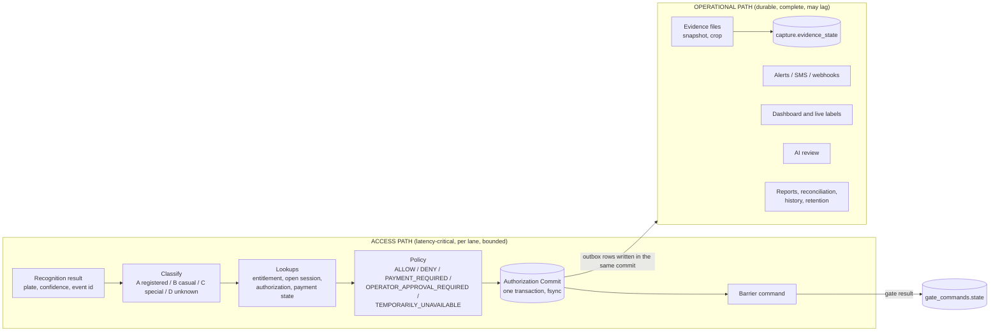

# Zirp: High-Throughput Architecture Decision

| | |
|---|---|
| Date | 2026-11-18 |
| Branch / HEAD | `production-readiness` @ `c6217e0` |
| Input | `# ZIRP — FIRST-PRINCIPLES RE-ARCHITECTURE.md` (the brief), `ZIRP_ENGINEERING_HANDOVER.md`, `ZIRP_PRODUCTION_READINESS.md`, owner's direction of 2026-11-18 |
| Evidence | SERVER01, four live QY cameras (lane 1# .144/.145, lane 2# .49/.50), PostgreSQL 18 `smartpark`. 681k trace records (17–18 Nov), 4,159 cars joined end to end. **Read-only measurement: no gate was pulsed, no row was written.** |

Evidence labels follow the handover: **[SRC]** source read, **[RUN]** measured on SERVER01, **[HW]** against real cameras. Nothing here claims barrier motion.

---

## 1. Decisions

1. **No rewrite and no new infrastructure.** Keep the four processes (Site Service, HVX host, Media Service, Recognition Worker) plus the portal. No Kafka, RabbitMQ, Redis, PgBouncer, microservices or extra worker processes. The measurements in section 2 show why: the database and the decision engine are two orders of magnitude below their limits.
2. **Two paths inside the Site Service, with a hard boundary.** The *access path* ends when the barrier command is sent. Everything else (evidence files, reports, alerts, dashboards, AI review, reconciliation) is on the *operational path* and may never be awaited by the access path.
3. **Authorization Commit.** No barrier command is sent until one database transaction has durably committed the event, the decision, the session change and the gate-command intent. Section 4 defines it and what happens after a power cut at every step.
4. **Evidence is persisted after the decision, not before.** Today the JPEG crop/encode and file writes sit in front of the decision (about 200–350 ms of the critical path). The capture *row* stays inside the Authorization Commit. The *image files* move to the operational path.
5. **The real latency budget is recognition ingestion, not the database.** Optimisation work goes to event drain and image fetch (p50 505 ms) and ALPR (p50 ~130 ms), in that order.
6. **Central PostgreSQL stays the single authority.** Edge Nodes keep talking to it directly on the LAN. A local offline journal is built only for the explicit offline policy (section 6), not as a second database for normal operation.
7. **The brief's new business capability that is genuinely missing is Class C** (temporary special/government authorization). It is added as one table and one controller branch, not a new subsystem.
8. **`Current_ParkSystem_configs/` is reference material only.** Nothing in it is imported, loaded, read at runtime or packaged. Where a protocol detail is needed (for example the loop-board UDP format), the relevant part is re-implemented in Zirp's own code with its own tests, as already done for `loop_board` (commit `a99e4d3` removed the last build-time dependency).

---

## 2. Measured baseline (four cameras, live)

### 2.1 Where one car's time goes (camera event → parking decision)

Measured with `tools/critical_path_report.py` over 4,159 cars **[RUN][HW]**:

| Segment | What runs there | p50 | p95 | p99 |
|---|---|---|---|---|
| Event → ingested | Host event queue, Site Service drain poll, event JPEG + crop fetch from host | **506 ms** | 1,125 ms | 2,943 ms |
| Ingested → capture saved | FastALPR (~130 ms), zone crop/encode, crop/snapshot file writes, capture INSERT + commits | **361 ms** | 696 ms | 1,658 ms |
| Capture saved → decision returned | Access engine: entitlement, open-session, look-alike, session create/claim, commits | **22 ms** | 77 ms | 135 ms |
| **End to end** | | **910 ms** | **1,900 ms** | 4,971 ms |

The access engine is 2–4 % of the time. A further 0.3–1.3 s (`board`/`gpio` rows of the latency report) sits after the decision in the gate actuator chain and is measured separately (handover D27, A1 kit).

### 2.2 Database

`tools/db_hotpath_bench.py`, live PostgreSQL, 200 calls each **[RUN]**:

| Query | p50 | p95 | Queries per call |
|---|---|---|---|
| Round trip | 0.35 ms | 0.75 ms | 1 |
| `lookup_entitlement(strict)` | 1.1 ms | 2.7 ms | 1 |
| `active_for_plate` | 1.7 ms | 3.4 ms | 1 |
| `recent_lookalike_session` | 2.2 ms | 4.2 ms | 1 |
| `latest_for_camera` | 1.8 ms | 3.2 ms | 1 |
| **Durable commit** (WAL flush, `synchronous_commit=on`, `fsync=on`) | **0.8 ms** | **1.3 ms** | – |

`site_policy` and `parking_settings` are cached (0 queries). Connections in use: **9 of 100** (8 idle). The brief's targets (lookup p95 < 50 ms, local entitlement p95 < 20 ms, decision p95 < 200 ms) are already met by the engine alone.

### 2.3 Traffic actually seen

From `vehicle_captures` / `parking_sessions` (Zirp observes all four lanes in shadow mode) **[RUN]**:

| Measure | Value |
|---|---|
| Sessions per day | 725 (17 Nov), 1,067 (18 Nov, still running) |
| Plate captures, last 24 h | 2,815 entry, 3,012 exit |
| Peak distinct plates per minute, all four cameras | **19** |
| Peak distinct plates per 5 minutes | **50** |
| Busiest hours (EAT) | 16:00–19:00, ~170–190 distinct plates per hour |

Peak demand is therefore about **one decision every 3 s site-wide**, against an engine that takes 22 ms. The brief's "20 consecutive vehicles" is a burst of the size already handled on 18 Nov at 18:22.

### 2.4 CPU and memory

i7-8650U, 4 cores / 8 threads, 16 GB. CPU time over 30 s **[RUN]**:

| Process | CPU (cores) | Memory |
|---|---|---|
| Site Service (decisions, FastALPR, virtual-loop detector 4 Hz × 4 cameras, MJPEG relay) | ~1.5 | ~270 MB |
| Desktop (four live views) | ~1.2 | ~190 MB |
| HVX host (32-bit SDK, decode, JPEG encode) | ~0.5 | ~160 MB |
| Recognition Worker (no generic cameras) | ~0 | ~80 MB |

About 3.2 of 8 logical CPUs are in use. Headroom is roughly 2× before recognition needs another process.

### 2.5 What the numbers decide

| Question | Decision | Why |
|---|---|---|
| More processes or a message broker? | **No** | 1 decision / 3 s at peak; the outbox (SQLite, attempt counting, dead letter) and in-process queues are enough. |
| PgBouncer? | **No** | 9 connections; PostgreSQL allows 100. Revisit above ~60. |
| DB pool size | Keep `QueuePool(5, +10)` per process; add a **separate small pool (2) for the access path** so reports or the portal can never take its connection (section 5). | Isolation, not capacity. |
| Read-model cache for entitlements? | **Not for speed** (1 ms query). Build it only as the **offline snapshot** (section 6). | |
| Partitioning | **No** | Largest table is 25 MB. Revisit at ~10 M capture rows. |
| Threads | Split the single default `asyncio.to_thread` pool into named, bounded executors (section 5). | Today ONNX inference, evidence encoding, file writes and DB work all share one pool of 12 threads. |
| Where to optimise | Event drain + image fetch, then ALPR, then evidence off the critical path | Section 2.1. |

These numbers are re-measured after each step in section 7 with the same two tools.

---

## 3. The two paths

**Access path, exact boundary in this code base:**

| Step | Today | Target |
|---|---|---|
| Recognition result | `05_recognition_ingest._drain_camera_events` → `_run_event_alpr` | Unchanged entry point |
| Evidence | `05_scope._persist_capture_event` → `persist_event` writes zone JPEG, crop and snapshot files **before** the decision | Capture row with plate, confidence, identity and *reserved* media names; files written afterwards |
| Classification + lookups | `EntryLaneController.submit`, `ExitLaneController.submit_plate`; `lookup_entitlement` is called twice (once in `_persist_capture_event`, once in the controller) | One classification call returning a `Classification` value; second lookup removed |
| Decision record | `record_access_decision` is written **after** the gate pulse | Written inside the Authorization Commit |
| Gate intent | `open_command_uuid` / `exit_open_command_uuid` claim committed before the pulse **[SRC]** (correct, kept) | Same claim, plus a `gate_commands` row in state `REQUESTED` in the same transaction |
| Barrier command | `_pulse_gate` (`services/simulation/00_context.py`) | Unchanged hardware call |
| Result | `record_gate_command` after the pulse | Updates the `REQUESTED` row to `ACCEPTED` / `FAILED` |

**Operational path:** evidence files, `ai_review.schedule_capture_review`, manual-open alerts, `remember_last_car` / live labels, dashboard counters, payment reconciliation loop, retention, reports, portal back office. None of these may be awaited between "recognition result" and "barrier command".

Rules that keep the boundary honest:
- The access path never awaits disk I/O other than the database commit, never calls a remote service (payment provider, SMS, AI), and never renders anything.
- Operational work is triggered by rows the Authorization Commit wrote (outbox), so a crash cannot lose it: on restart the consumer finds the rows still pending.
- A slow or failed operational consumer never changes an access decision already made.

---

## 4. Authorization Commit (safe commit protocol)

**Rule: a barrier is commanded only for an authorization whose transaction has returned from COMMIT on the authoritative store.** On PostgreSQL that is a WAL flush (`synchronous_commit=on`, measured 0.8 ms p50). On the SQLite single-PC store it requires `PRAGMA synchronous=FULL` (section 4.3).

### 4.1 Entry, one transaction

1. INSERT `vehicle_captures` (camera, event id / visit id, plate, raw plate, confidence, reserved snapshot and crop names, `evidence_state='PENDING'`). The existing unique keys `(camera_id, event_id)` / `(camera_id, visit_id)` make a replay a no-op.
2. Session: create (casual), reuse (same stay / look-alike / open plate) or attach entitlement (registered) or authorization (special). The partial unique index on open plate per site still prevents a second open visit.
3. INSERT `access_decisions` with outcome, reason code, classification, policy version, capture id.
4. If the outcome is ALLOW and a gate is assigned: conditional UPDATE `open_command_uuid` (existing claim) and INSERT `gate_commands` (`state='REQUESTED'`, `command_uuid`).
5. INSERT outbox rows for operational work (`evidence.write`, `alerts`, `dashboard`).
6. **COMMIT.** Only now: send the barrier command.
7. After the hardware answers: UPDATE `gate_commands.state` to `ACCEPTED` or `FAILED` (separate small transaction). Passage (loop, board, time-out) later moves the session to ACTIVE as today.

### 4.2 Exit, one transaction

`SELECT … FOR UPDATE` on the open session (existing, `start_exit`), fresh quote, ledger total from `payment_transactions` (verified credits only), decision row, `exit_open_command_uuid` claim and `gate_commands` `REQUESTED`, COMMIT, then the barrier. A payment that arrives a millisecond later is seen by the next read: the row lock serialises it against the exit decision.

### 4.3 What a power cut does at each step

| Power lost | Durable state after restart | Physical state | Recovery |
|---|---|---|---|
| Before COMMIT | Nothing from this car | Barrier closed | The car is still there; the next capture decides again. Nothing to repair. |
| After COMMIT, before the command left | Decision ALLOW, `gate_commands` REQUESTED, claim set | Barrier closed | Startup sweep marks REQUESTED rows older than 10 s as `INTERRUPTED` and raises an operator item "barrier command not confirmed: plate X, lane Y". A fresh capture of the **same stay** within the stay window may re-issue the command under the **same** `command_uuid` (idempotent). Never re-pulsed blindly after restart. |
| After the command, before the result was written | Same as above | Barrier may be open | Same sweep. Passage (sensor or time-out) completes the session. Revenue is safe because the session and decision exist. |
| After COMMIT, before evidence files were written | Capture row `evidence_state='PENDING'` | – | The outbox `evidence.write` is still pending; if the image bytes are gone, the sweep marks `MISSING`. The session is valid without the photo, and the gap is visible, never silent. |

What can **not** happen under this protocol: a barrier that opened for a decision that no longer exists in the database.

**Implemented (step 1, 2026-11-18)** for steps 3, 4 and 6–7 of 4.1 and for 4.2: the session claim, the access decision (`ENTRY_AUTHORIZED` / `EXIT_AUTHORIZED`, with the `command_uuid` in `extra`) and a `gate_commands` row in state `REQUESTED` are one transaction committed before the barrier command; the hardware answer moves the command to `ACCEPTED` / `FAILED` and finalizes the same decision row (`GATE_UNAVAILABLE` on failure, so there is still one row per decision). `_pulse_gate` makes a REQUESTED row durable first for every other caller (manual opens). The lane sweeper turns REQUESTED rows older than 60 s into `INTERRUPTED` with a `GATE_COMMAND_INTERRUPTED` decision; an operator retry re-arms the same command uuid. Migration `0018_gate_command_state` adds `state`, `side`, `completed_at`. Tests: `tests/test_authorization_commit.py` (the barrier double reads the database through a separate connection when it is called; a "power cut" is an exception thrown from it). Session creation and the capture row still commit earlier, which is safe (more durable, never less); moving evidence files out is step 3.

Gap found before step 1 **[SRC]**: steps 1–2 and 4 committed in separate transactions (`persist_event`, `start_entry_from_recognition`, the claim UPDATE), and the ALLOW decision row (`record_access_decision`) is written after the pulse. The claim is durable before the pulse, so a session and an intent always exist, but the decision row can be missing and there is no REQUESTED/INTERRUPTED state for recovery. The SQLite store runs `PRAGMA synchronous=NORMAL` in WAL mode (`app/db.py:152`), which can roll back the last commits on power loss: acceptable for development, **not** for a single-PC production lane. (The SQLite outbox file uses the default `synchronous=FULL` and is durable.)

---

## 5. Isolation inside the Site Service

The brief asks for "per-lane isolation" and "no global queue". Measured load does not need more processes; it needs these boundaries inside the one process:

| Resource | Today | Target |
|---|---|---|
| Thread pools | One default pool (12 threads) for ONNX inference, evidence encoding, file writes and DB work **[SRC]** | `inference` pool (bounded at physical cores − 1 = 3, one in-flight read per camera, as `recognition_runtime` already enforces), `evidence` pool (2 threads), default pool for everything else |
| DB connections | One `QueuePool(5,+10)` shared by API, reports, portal back office, loops and decisions | Separate `access` engine/pool (size 2, `statement_timeout` 2 s) used only by the access path |
| Per-lane ordering | Events are processed per camera by the drain task; lanes share the event loop | Unchanged: one drain task per camera, decisions for different lanes never wait on each other except for the DB row lock on the same plate |
| Back-pressure | Stale events over 20 s are diverted to review **[SRC]**; worker frames over 2 s dropped | Unchanged. Add: evidence queue depth and age exported in the heartbeat; if the evidence queue is saturated, evidence waits, decisions do not |
| Timeouts | Board relay grace 0.3 s; DB statement timeout 15 s | Access-path DB timeout 2 s → `TEMPORARILY_UNAVAILABLE`, never a hang at the barrier |

---

## 6. Edge Nodes and offline operation

**Normal operation:** an Edge Node owns its cameras and gate hardware (exclusive gate ownership, migration 0012) and runs the same access path against the central PostgreSQL. LAN round trip is about 1 ms, so a local read model is not needed for speed.

**Offline (DB link down):** today the node fails fast and queues recognition events in the outbox **[SRC]**. Target, built after the steps above and only with an explicit site policy:
- A versioned **entitlement and authorization snapshot** pushed from the Site Server (registered vehicles, active special authorizations, policy version, issued-at, expiry). A snapshot older than its expiry is ignored.
- A **local journal** (SQLite, `synchronous=FULL`) that plays the role of the authoritative store for offline decisions: the Authorization Commit is written there before the barrier command.
- Offline policy per decision class: registered vehicle with a valid snapshot → ALLOW; casual entry → ALLOW with a provisional session (site choice) or OPERATOR_APPROVAL_REQUIRED; casual exit → never ALLOW on unverified payment, OPERATOR_APPROVAL_REQUIRED; unknown → operator.
- On reconnect the journal replays into the central store through the same idempotent keys (event id, command uuid). Conflicts (for example the same plate opened elsewhere) go to an operator queue, never silently merged.

---

## 7. Implementation sequence

Each step is one reviewable commit (or a few), keeps the application working, runs the full test suite, and is re-measured with `tools/critical_path_report.py` and `tools/db_hotpath_bench.py`. Each has a rollback that is a revert, not a data migration, unless noted.

| # | Step | Changes | Guard against breakage | Expected effect |
|---|---|---|---|---|
| 0 | **Baseline** (this document) | `tools/critical_path_report.py`, `tools/db_hotpath_bench.py` | Read-only | Numbers in section 2 |
| 1 | **Authorization Commit, entry and exit** (done 2026-11-18, section 4.3) | `gate_commands.state` (`REQUESTED/ACCEPTED/FAILED/INTERRUPTED`) and `access_decisions.capture_id`, `classification`, `policy_version` (additive migration 0018, nullable); controllers write decision + claim + REQUESTED in one transaction before `_pulse_gate`; startup sweep for REQUESTED → INTERRUPTED | Additive columns only; existing tests for entry/exit/duplicate/lookalike/gate retry must pass unchanged; new tests kill the process between COMMIT and pulse (fake opener) and assert recovery | Durable decision before every barrier command |
| 2 | **SQLite durability** (done 2026-11-19: `app.db.sqlite_synchronous_mode`, `tests/test_sqlite_durability.py`) | `PRAGMA synchronous=FULL` when `deployment_profile=PRODUCTION` or the SQLite file is the lane authority | Development keeps NORMAL | Single-PC lanes become power-safe |
| 3 | **Evidence off the access path** (done 2026-11-19, section 7b) | `persist_event` split: `record_capture` (row + reserved names, in the Authorization Commit) and `write_evidence` (outbox consumer on the `evidence` pool); `evidence_state` column; live label and AI review consume after commit | Media URLs stay identical (names reserved up front); retention already never deletes referenced photos; test that a decision completes when the evidence writer is blocked | −200 to −350 ms p50 on the critical path |
| 4 | **Named executors and access DB pool** | `inference`, `evidence` executors; `access` engine (size 2, 2 s timeout) | Behavioural tests unchanged; soak with four cameras and the desktop running | p95 stability under bursts; reports cannot starve decisions |
| 5 | **Event ingestion latency** | Host pushes "event ready" through the existing long-poll mechanism instead of the drain poll interval; event JPEG fetched with the notification | Host and Site Service versions negotiated through `/info`; old drain kept as fallback | Target: event → ingested p50 < 200 ms |
| 6 | **Classification engine + Class C** | `Classification` value object (A/B/C/D, reason code, evidence refs, node); `special_authorizations` table (plate, visit/session, approved_by, reason, exemption or tariff, valid_from/until, closed_at); operator approval endpoint and UI action; exit honours it; decision vocabulary mapped to ALLOW / DENY / PAYMENT_REQUIRED / OPERATOR_APPROVAL_REQUIRED / TEMPORARILY_UNAVAILABLE | A government-looking plate never authorises by itself (test); special prefixes already protected from plate correction | Brief section 5 complete |
| 7 | **Offline snapshot + journal** | Section 6 | Behind a site policy flag, off by default | Brief section 11 |
| 8 | **Remaining handover items** | D1 receipt-taken sensor, loop wiring (D25), restore (D10), security (D9), de-`exec` (D11) one package at a time | As listed in the handover | Go-live blockers |

Steps 1 and 2 go first because they are the owner's non-negotiable safety rule. Step 3 is the largest measured latency win inside the Site Service. Steps 1–4 do not change any HTTP API, UI or hardware call.

---

## 7b. Step 3 as built (2026-11-19)

Measured first on 20 real captures at camera size (1920×1080) on SERVER01 while the live system ran: zone snapshot crop + encode **103 ms p50 (1.15 s max)**, plate crop + enhancement **51 ms p50 (357 ms max)**, writing both files **2 ms**. So the image *work* moved, not just the writes.

- `persist_event(..., defer_evidence=True)` (used only by the live camera path, `_persist_capture_event`) commits the capture row with reserved names (`snapshots/<stamp>-car.jpg`, `crops/<plate name>`) and `evidence_state='PENDING'`, then queues an `app.services.evidence.EvidenceJob`. The decision continues at once with the row it needs (plate, confidence, identity, photo references).
- The job runs on its own 2-thread pool (`evidence-*`), never the plate-inference threads. It writes each file through a `.part` rename, then sets `STORED`; a photo that could not be made is un-referenced (never a dangling path), and if neither could be made the row is `MISSING`.
- A screen that asks for the photo before it is written: `/media/{kind}/{name}` waits up to 2 s for a photo this process is still writing (`evidence.wait_for`, in the route's worker thread, not the event loop).
- Power cut with photos in memory: the lane sweeper marks rows still `PENDING` after 10 min `MISSING` (or `STORED` if a file did land). The visit and its decision are unaffected.
- Other callers (simulation, manual capture, commissioning) keep writing photos with the row (`evidence_state=''`).
- Migration `0019_capture_evidence_state`. Tests: `tests/test_deferred_evidence.py` (the zone crop is patched to fail if it runs before the commit).

## 7a. Session closing fix found while starting step 1 (2026-11-18)

**Symptom (owner):** no visit ever reached 45 minutes.

**Cause [RUN]:** the lane sweeper's stranded-entry time-out (`stranded_entry_minutes`, 15) cancelled every entry Zirp had not opened the barrier for. On SERVER01 that is every casual entry (production profile, simulated printer); in production it would be every entry awaiting a receipt (D1). Last 2 days: 3,469 visits `ENTRY_CANCELLED` 10–20 min after entry; 1,620 of the 2,531 exit reads with "no session" were cars whose entry had just been cancelled, and 450 more exits were refused with "cannot exit from SESSION_CREATED".

**Fix:**
- The time-out is off by default (0). A timer cannot tell a driver who reversed away from a car let in by an operator or by the barrier's own button.
- An exit read of a visit whose entry Zirp never completed finishes that entry (`ENTRY_COMPLETED_AT_EXIT`) and bills from the original entry time, instead of refusing the car.
- The plate is still never blocked: a read of the same plate *entering* again more than 10 min after an attempt that never passed the barrier closes that attempt as `ENTRY_SUPERSEDED` and opens a new visit. Visits whose barrier command was sent are never superseded.
- Tests: `tests/test_lane_flow.py`.

Existing bench rows (the 3,469 cancelled visits) are left as they are.

## 8. What the brief asks for that is deliberately not done

| Brief item | Decision | Reason |
|---|---|---|
| Kafka / RabbitMQ / Redis | Not introduced | Section 2.5; the brief itself asks for evidence first |
| PgBouncer | Not introduced | 9 of 100 connections |
| Partitioning of event tables | Deferred | 25 MB largest table |
| Separate edge database in normal operation | Not introduced | 1 ms LAN round trip; one authority avoids reconciliation in the common case |
| Local entitlement read model for speed | Built only as the offline snapshot | Lookup is 1.1 ms p50 |
| Rewrite of the HVX host or the streaming path | Not done | 17.5 measured smooth video at camera rate; the remaining latency is event delivery (step 5) |
| A second Android application for the kiosk | Not started | Brief's own preference: HID scanner into the existing kiosk page first |

---

## 9. Verification still needed (cannot be done from software)

- Barrier motion and boom feedback (handover D13); loop wiring to camera inputs (D25).
- A deliberate power-cut test of step 1 on a supervised, empty lane with the owner present.
- Disk write cache on SERVER01: PostgreSQL's fsync is only as honest as the drive and controller. Confirm write caching policy or a UPS before go-live.
- Real ClickPesa payment with live keys (readiness gap 4).
