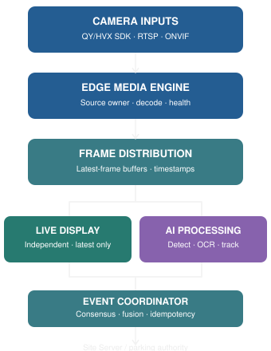
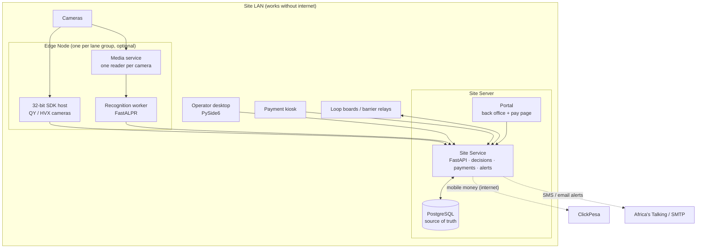
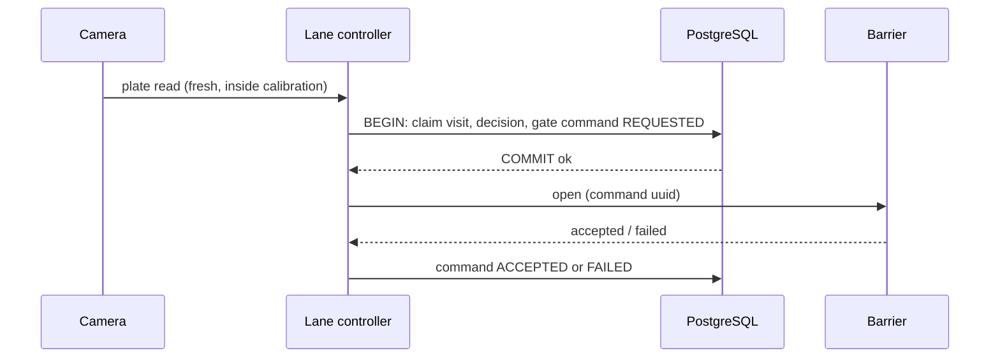

# How Zirp is put together

This page is for developers and for technicians who want to know why things
behave the way they do. Day-to-day setup is in the other guides.

## The big picture

On a small site, the Site Server and the Edge Node are the same PC (the
*Site Server with cameras and gates* role).

## Design rules we hold on to

1. **LAN first.** Gates, kiosks, cash and exits work with the internet
   unplugged. Only mobile money and outgoing alerts need it, and both queue
   and retry.
2. **PostgreSQL is the truth.** No lane PC keeps a private copy of who's
   inside. Concurrency is settled by unique indexes and conditional updates in
   the database, not by locks in Python.
3. **One owner per camera.** One process reads each camera. Everything else
   consumes the newest frame from it.
4. **Never decide on old data.** Frames, recognition results and replayed
   events past their age limit are dropped or sent to a person, never acted on.
5. **Durable before physical.** A barrier moves only after its decision is
   committed (see below).

## Authorization commit

This is the rule that keeps the barrier and the books in agreement:

> A barrier is commanded only for an authorization whose transaction has
> already committed.

What a power cut does at each step:

| Power lost | After restart | Barrier |
|---|---|---|
| Before COMMIT | Nothing recorded; the next read decides again | closed |
| After COMMIT, before the command left | Command marked `INTERRUPTED` after 60 s, shown to an operator | closed |
| After the command, before its answer was saved | Same as above; passage or time-out completes the visit | maybe open |

What can't happen: a barrier that opened for a decision the database doesn't
have. A command ID is also only ever pulsed once: replays of an accepted
command are answered without touching the hardware, and a racing "failed"
answer can't overwrite an "accepted" one.

The code: `app/services/decisions.py` (states), `app/application/entry_lane.py`
and `exit_lane.py` (the transactions), `app/services/lane_sweeper.py`
(interrupted commands), `app/services/simulation/00_context.py::_pulse_gate`
(manual opens). Tests: `tests/test_authorization_commit.py`.

## Evidence after the decision

Snapshots and plate crops take real CPU time. A live capture is stored with
reserved file names and `evidence_state='PENDING'`; the images are written
right after the decision, so the barrier doesn't wait for JPEG encoding. If
the image is gone after a crash, the capture is marked `MISSING`: the gap is
visible, never silent. See `app/services/evidence.py`.

## Where the code lives

| Folder | What's in it |
|---|---|
| `app/domain/` | Pure rules: parking engine, tariffs, recognition policy, vehicle groups. No I/O. |
| `app/application/` | Lane controllers (entry, exit) that turn a plate read into a decision. |
| `app/services/` | Everything with I/O: media gateway, recognition runtime, payments, alerts, captures, calibration, backups. |
| `app/infrastructure/` | Database, hardware adapters (HVX, ONVIF, RTSP), payment providers. |
| `app/api/` | FastAPI routes. `runtime_parts/` are pieces of one large module, loaded in order. |
| `app/recognition_worker/` | The separate recognition process. |
| `app/desktop/` | The PySide6 operator app and setup wizard. |
| `app/migrations/` | Alembic migrations. |
| `portal/` | Next.js back office and driver pay page. |
| `tools/` | Camera lab, field tests, soak monitor, HVX SDK host. |
| `packaging/installer/` | The Windows installer and `zirpctl`. |
| `research/` | Notes from reverse-engineering the vendor camera software and the previous parking system. |
