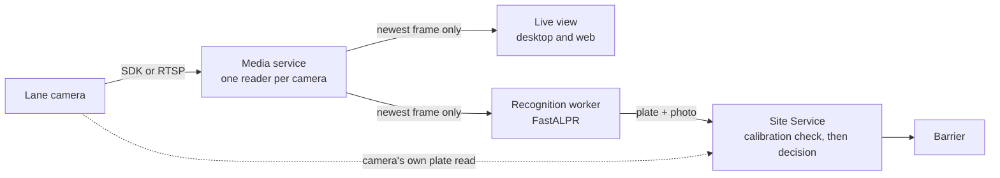

# Connecting cameras

This is the page to read when you're adding a camera to a lane, the picture
won't come up, or plates aren't being read.

## How the camera side works



A few rules hold everywhere and are worth knowing when you debug:

- **One reader per camera.** Exactly one process pulls video from each camera
  (the media service, or the SDK host for QY/HVX cameras). The live view and the
  recognition worker are consumers of that one stream. Opening the same camera
  in a second tool such as VLC or the vendor client competes with Zirp, so
  close it before blaming Zirp.
- **Only the newest frame counts.** Buffers keep a single frame per camera. A
  slow consumer skips frames instead of falling behind.
- **Old frames never open a barrier.** Recognition refuses frames older than
  2 seconds (`SMARTPARK_RECOGNITION_STALE_FRAME_MS`, default 2000), and results
  from before a reconnect are thrown away.
- **It reconnects by itself.** When a camera drops off the network, Zirp
  reconnects in the background and shows the camera as disconnected until then.

## Supported cameras

| Type in the camera dialog | What it talks to | Notes |
|---|---|---|
| **HVX / QY** | The vendor SDK, through the 32-bit SDK host on `127.0.0.1:8765` | The LPR cameras used on our first site. The camera reads plates itself and Zirp can verify them. SDK port defaults to 30000. |
| **ONVIF** | ONVIF discovery, then the camera's RTSP stream | Most modern IP cameras. |
| **IP camera (RTSP)** | A plain RTSP URL | Anything that serves RTSP. Leave the URL blank and use **Discover Streams** to find it. |
| Simulated | Nothing | Development and demos only. |

## Adding a camera

1. Open **Live Gates → Devices**.
2. Click **Discover** to find cameras on the LAN, or type the IP address
   yourself.
3. Fill in the camera:
   - **Name**: something the guards understand, e.g. `2# Entry`.
   - **Direction**: Entry, Exit or Bidirectional.
   - **Gate**: the barrier this camera controls. Pick *No gate, monitoring
     only* for a camera that should just watch.
   - **Username / password**: the camera's own login.
   - **Recognition**: who reads the plate (see below). *Use the site default*
     is fine to start with.
4. Click **Test Video**. You should see a live picture within a few seconds.
5. Click **Test Recognition** with a car (or a printed plate) in front of the
   camera.
6. Click **Save Camera**.

If this PC should process this lane, use **Assign PC to this gate…**. Each gate
is owned by one computer at a time, so two PCs never fight over the same
barrier.

### Who reads the plate (recognition mode)

| Mode | Meaning |
|---|---|
| `FASTALPR_ONLY` | Zirp reads the plate from the video with its own model. Works with any camera. |
| `NATIVE_ONLY` | The camera's built-in plate reader decides; Zirp doesn't run its own OCR. |
| `HYBRID` | Both run; the results are combined. |
| `NATIVE_WITH_LOCAL_VERIFY` | The camera reads, Zirp double-checks the plate on the snapshot. |

### Tanzanian plates

Turn on the Tanzania profile in `C:\ProgramData\SmartParkEdge\config\zirp.env`:

```
SMARTPARK_ALPR_COUNTRY=tanzania
```

It fixes the usual OCR mix-ups for `T123ABC` plates: `O`/`0`, `I`/`1`, `S`/`5`,
`B`/`8` in the right positions, and a leading `T` hidden by a bolt that gets
read as `7`. Restart the services afterwards (`zirpctl services restart`).

Also set **Settings → Site → Plate validation** to `TZ`. Then only real
Tanzanian formats open a visit on their own: `T123ABC`, motorcycles
`MC123ABC`, and government, police, army and diplomatic plates (`STK…`, `PT…`,
`JWTZ…`, `CD…`). Anything else, like a badge read as `TQYOTA` or a glare read
like `T70DMT`, waits for an operator instead of opening a session.

### When a car is read more than once

Most cars are read several times: from the live video and from the camera's
own snapshots. Zirp keeps one capture per car, and **the best read wins**. A
weak read that's waiting for review is replaced by a more confident read of
the same car, and two frames that agree exactly are enough to go ahead even
when each is below the 0.92 confidence bar. A read that has already been
decided (visit opened, exit checked) is never changed afterwards.

## Capture calibration (where on the picture a car counts)

Every camera can be calibrated so only reads from the right part of the picture
become a visit. This stops cars in the next lane, or plates read from too far
away, from opening the barrier.

Open **Settings → Camera calibration**, select the camera and click
**Calibrate selected camera…**. On an Edge Node (signed in with its node
account) it's the **Camera calibration** page. Cameras assigned to an Edge Node
are calibrated on that node: only the computer that runs a camera has its live
picture and plate boxes. You can set:

| Rule | What it does | On by default |
|---|---|---|
| Capture zone | The plate must be inside the polygon you draw | Yes |
| Start line | The plate must have crossed this line | No |
| End line | The plate must not be past this line yet | No |
| Minimum plate size | Plates that are too small (too far away) are ignored | Yes |
| Detector confidence | The plate detector must be sure enough | Yes |
| Sharpness, brightness and glare | Blurry, dark or washed-out pictures are ignored | Yes |
| Recognition confidence | The OCR result must be sure enough | Yes |

Each rule has its own switch. A rule that's switched off still shows on screen
and still helps pick the best frame, but it never stops a car from being
stored.

The calibration window refuses values that would block nearly every car. Night
headlights make plates bright, so for example "brightness to" can't go below
150.

**Test mode** lets you drive past and see what would have happened, without
creating visits or opening the barrier. Use it after every calibration change.

Calibration applies to every way a car can be read: the camera's own trigger,
Zirp's video reader and the recognition worker. All of them go through the
same check before a visit is created.

### Start and end lines with the camera's own trigger

With `SMARTPARK_CAPTURE_TRIGGER=external`, the camera decides when to take its
snapshot, and it sends one or two stills per car. The lines can only accept or
refuse those stills; they can't make the camera wait. On our first site,
43% of one entry camera's snapshots were taken before the plate reached the
drawn start line, so switching that line on would have refused those cars.

If you want the start line to **start** the read, let Zirp trigger the camera:

```
SMARTPARK_CAPTURE_TRIGGER=zirp
```

Zirp then watches the live video and asks the camera for its full-resolution
snapshot when the plate crosses the start line. Try it on one lane with test
mode first. `both` keeps the camera's trigger as well.

## Troubleshooting

| Symptom | Check |
|---|---|
| Black picture, "disconnected" | Ping the camera. Check the username and password. Close the vendor tool or VLC if it's open on the same camera. |
| Picture freezes now and then | Look at `http://<server>:8760/health/pipeline`: it shows the frame age and reconnect count per camera. Network drops show up there first. |
| Live view works, but no plates | Run **Test Recognition**. If calibration is on, test mode tells you which rule refused the read (for example "plate too small"). |
| Plates read wrong at night | Usually glare from headlights on two-row plates. Camera exposure or IR settings help more than anything in software. Turn on the Tanzania profile. |
| One lane's car shows on the other lane's camera | Fixed in 1.0.0-rc6 (sessions are matched by camera IP). On older versions, restart the services after a camera-host restart. |
| QY/HVX camera won't connect | The camera SDK host must be running (`SmartParkHvxHost` service or its sign-in task). Check `C:\ProgramData\SmartParkEdge\logs\services`. |

### Testing a camera without touching parking

The camera lab watches the media engine without creating visits, payments or
barrier commands:

```powershell
cd "C:\Program Files\Zirp\current"
.\python64\python.exe -m tools.camera_lab --camera 1 --duration 60
.\python64\python.exe -m tools.camera_lab --all --duration 300 --recognition
```

## Related

- Barriers and ground loops: [gates-and-loops.md](gates-and-loops.md)
- Services and logs: [operations.md](operations.md)
- How the pieces fit together: [architecture.md](architecture.md)
