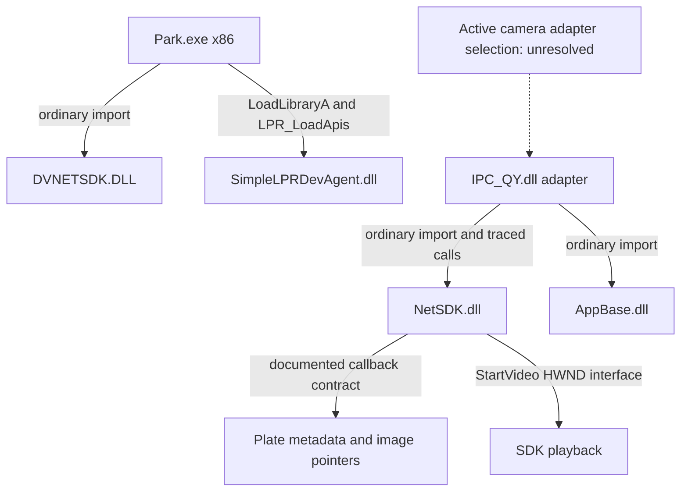

# Confirmed links and unresolved selection

Solid links represent static code/import evidence or the labeled vendor contract, not observed runtime traffic. Park.exe to the active QY adapter has not been established. Inventory JSON contains ordinary dependency names for all parsed binaries; Windows loader resolution and delay/dynamic dependencies are outside that graph.
